# DAG.md — Interface designs for the HF task taxonomy

> Generated by `planning/dag_generator.py` from the live `capability_cards` + `gui_cards` tables and the `path_builder.py` chain ranker. Regenerate after any card or taxonomy change with:
> ```
> python3 planning/dag_generator.py > planning/DAG.md
> ```

**Coverage:** 53 opcodes · 53 capability cards · 53 gui cards.

---

## Global UX principles

1. **Modality drives layout.** File modalities (IMAGE/AUDIO/VIDEO/DOC) get
   `file_upload` with the right `accept=` filter. Live capture (mic, camera)
   is a same-spec alternative widget — show it as a tab or alt button.
2. **One Run button, one progress indicator.** Every opcode panel is a
   submit-and-wait cycle. The Run button disables during inference; a
   progress strip estimates time from `meta.estimated_runtime_s`.
3. **HITL is a checkpoint, not a permanent prompt.** `meta.hitl_likely=true`
   surfaces a "review before saving" modal on the output — `[approve]` /
   `[reject]` / `[redo with adjustments]`. The chain pauses there.
4. **Outputs are first-class artifacts.** Every output gets a Download
   button (with sensible filename and format), a Copy-to-clipboard for
   text outputs, and a Share-link for media outputs (when authenticated).
5. **Failure modes from capability cards drive error UX.** Each opcode's
   `failure_modes` translates to UI hint cards: "if the model returns
   '<failure>', try '<mitigation>'". Pre-emptive, not reactive.
6. **Param widgets vs modality widgets are different layers.** Modality
   inputs go in the primary panel; param widgets (sliders, dropdowns,
   number inputs) collapse into an "Advanced" disclosure by default.
7. **Chain steps look the same as single steps.** When the user is inside
   a multi-step workflow (e.g., the YouTube-avatar template), each step
   renders as one of these per-opcode panels, with progress strip showing
   which step is active and what's already done.


---

## Multimodal  (10 opcodes)

> Multimodal opcodes are where MySpace++ shines hardest: ONE model absorbs two or more modality types and emits a third. The UI pattern is consistent — a multi-input panel on the left (each modality gets its own widget, typed appropriately), a single output preview on the right, and an explicit submit. Era-5 collapse means most of these subsume what used to be 3-step chains in earlier eras — surface the alternatives as 'advanced mode' tabs if needed.

### Audio-Image-to-Video

**I/O** `IMAGE+AUDIO → VIDEO`   **Era** 4   **Layer** L3   **First practical** 2024

_Role:_ THE LIPSYNC STEP, properly typed — audio + reference image -> talking-head video. Wav2Lip/MuseTalk/SadTalker/EMO all live here.

**Top chains involving this opcode:**
- `Audio-Image-to-Video`
- `Image-Text-to-Image → Audio-Image-to-Video`

**Widget spec** (from `gui_card`):
- 4 input widget(s), 1 output widget(s), layout `two-column`, est `60s`, **HITL likely**
  - **!** `file_upload`  `input_image` slot=IMAGE  accept=`image/*`
  - **!** `audio_recorder`  `input_audio` slot=AUDIO  accept=`audio/*`
  -   `text_input`  `resolution`
  -   `slider`  `frame_rate`
  - output: `output_preview` kind=`video` modality=`VIDEO`

**Failure modes the UI should pre-empt:**
- _Audio file not found_  →  Check if the audio file exists and is accessible.
- _Image file not found_  →  Verify that the image files are present and correctly referenced in the script.
- _Video file already exists_  →  Ensure that the video file does not already exist before attempting to create it.

**Interface mockup:**

```
┌──────────────────────────────┬──────────────────────────────┐
│ INPUTS                       │ OUTPUTS                      │
│   input_image:               │   output  (VIDEO):           │
│   [📁 Browse...    ]          │   ┌─────────────────┐        │
│                              │   │                 │        │
│   input_audio:               │   │   ▶ VIDEO       │        │
│   [🎤 Record        ]         │   │                 │        │
│                              │   └─────────────────┘        │
│   resolution:                │                              │
│   [___________________]      │                              │
│                              │                              │
│   frame_rate:                │                              │
│   ├──────◉────────────┤      │                              │
│                              │                              │
└──────────────────────────────┴──────────────────────────────┘

                    [ ▶ Run ]      ~60s — HITL likely
```

**GUI interaction DAG** — widget → submit → progress → output → download (with HITL / failure loops where relevant):

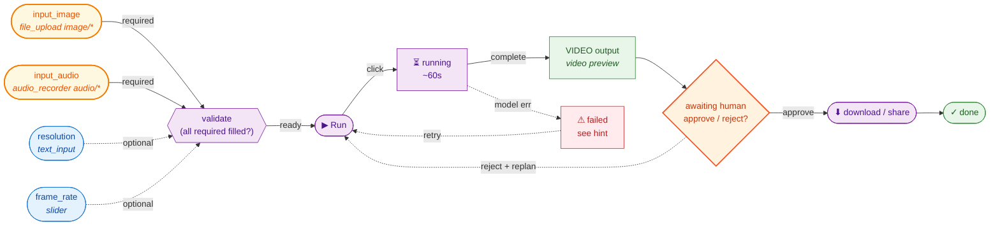

### Audio-Text-to-Text

**I/O** `AUDIO+TEXT → TEXT`   **Era** 5   **Layer** L3   **First practical** 2024

_Role:_ COLLAPSES VAD+ASR+LLM into one model — sub-200ms turn-around possible

**Top chains involving this opcode:**
- `Audio-Text-to-Text`
- `Audio-Text-to-Text → Document Question Answering`
- `Audio-Text-to-Text → Image-Text-to-Text`

**Widget spec** (from `gui_card`):
- 6 input widget(s), 1 output widget(s), layout `two-column`, est `5s`
  - **!** `text_input_multi`  `input_text` slot=TEXT
  - **!** `file_upload`  `audio_file` slot=AUDIO  accept=`audio/*`
  -   `text_input_multi`  `text_input`
  - **!** `dropdown`  `language_code`
  -   `text_input`  `transcription_format`
  -   `slider`  `temperature`
  - output: `output_preview` kind=`text` modality=`TEXT`

**Failure modes the UI should pre-empt:**
- _Audio file not found_  →  Check if the audio file exists and is accessible.
- _Insufficient permissions_  →  Ensure you have the necessary permissions to access the audio file.
- _Invalid audio format_  →  Convert the audio file to a supported format (e.g., MP3, WAV).

**Interface mockup:**

```
┌──────────────────────────────┬──────────────────────────────┐
│ INPUTS                       │ OUTPUTS                      │
│   input_text:                │   output  (TEXT):            │
│   ┌─────────────────┐        │   ┌─────────────────┐        │
│   │                 │        │   │  Response text  │        │
│   │                 │        │   │  ...            │        │
│   └─────────────────┘        │   └─────────────────┘        │
│                              │                              │
│   audio_file:                │                              │
│   [📁 Browse...    ]          │                              │
│                              │                              │
│   text_input:                │                              │
│   ┌─────────────────┐        │                              │
│   │                 │        │                              │
│   │                 │        │                              │
│   └─────────────────┘        │                              │
│                              │                              │
│   language_code:             │                              │
│   [Choose...      ▾  ]       │                              │
│                              │                              │
│   transcription_format:      │                              │
│   [___________________]      │                              │
│                              │                              │
│   temperature:               │                              │
│   ├──────◉────────────┤      │                              │
│                              │                              │
└──────────────────────────────┴──────────────────────────────┘

                    [ ▶ Run ]      ~5s
```

**GUI interaction DAG** — widget → submit → progress → output → download (with HITL / failure loops where relevant):

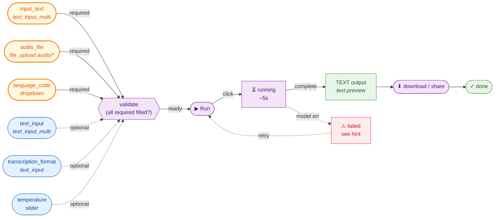

### Document Question Answering

**I/O** `DOC+TEXT → TEXT`   **Era** 5   **Layer** L3   **First practical** 2022

_Role:_ tangential — paperwork/legal-assistant avatar variant

**Top chains involving this opcode:**
- `Document Question Answering`
- `Document Question Answering → Audio-Text-to-Text`
- `Document Question Answering → Image-Text-to-Text`

**Widget spec** (from `gui_card`):
- 2 input widget(s), 1 output widget(s), layout `single-column`, est `5s`
  - **!** `file_upload`  `input_doc` slot=DOC  accept=`.pdf,.docx,.txt,.md`
  - **!** `text_input_multi`  `input_text`
  - output: `output_preview` kind=`text` modality=`TEXT`

**Failure modes the UI should pre-empt:**
- _Incorrect query format_  →  Ensure the query is correctly formatted and includes all necessary parameters.
- _Insufficient context_  →  Provide more context to help the model understand the question better.
- _Invalid or unsupported data_  →  Verify that the provided data is valid and supported by the opcode.

**Interface mockup:**

```
┌──────────────────────────────┬──────────────────────────────┐
│ INPUTS                       │ OUTPUTS                      │
│   input_doc:                 │   output  (TEXT):            │
│   [📁 Browse...    ]          │   ┌─────────────────┐        │
│                              │   │  Response text  │        │
│   input_text:                │   │  ...            │        │
│   ┌─────────────────┐        │   └─────────────────┘        │
│   │                 │        │                              │
│   │                 │        │                              │
│   └─────────────────┘        │                              │
│                              │                              │
└──────────────────────────────┴──────────────────────────────┘

                    [ ▶ Run ]      ~5s
```

**GUI interaction DAG** — widget → submit → progress → output → download (with HITL / failure loops where relevant):

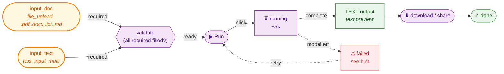

### Image-Text-to-Image

**I/O** `IMAGE+TEXT → IMAGE`   **Era** 5   **Layer** L3   **First practical** 2023

_Role:_ edit avatar appearance via text mid-conversation ('now wearing a hat')

**Top chains involving this opcode:**
- `Image-Text-to-Image`
- `Image-Text-to-Text → Image-Text-to-Image`
- `Visual Question Answering → Image-Text-to-Image`

**Widget spec** (from `gui_card`):
- 6 input widget(s), 1 output widget(s), layout `two-column`, est `8s`
  - **!** `file_upload`  `input_image` slot=IMAGE  accept=`image/*`
  - **!** `text_input_multi`  `prompt`
  -   `slider`  `resolution`
  -   `slider`  `strength`
  -   `slider`  `guidance_scale`
  -   `slider`  `num_inference_steps`
  - output: `output_preview` kind=`image` modality=`IMAGE`

**Failure modes the UI should pre-empt:**
- _Image not found_  →  Check if the image URL is correct and accessible.
- _Text not provided_  →  Ensure that text is inputted correctly before generating the image.
- _Insufficient text_  →  Provide more detailed or specific text to generate a better image.

**Interface mockup:**

```
┌──────────────────────────────┬──────────────────────────────┐
│ INPUTS                       │ OUTPUTS                      │
│   input_image:               │   output  (IMAGE):           │
│   [📁 Browse...    ]          │   ┌─────────────────┐        │
│                              │   │                 │        │
│   prompt:                    │   │   ▒ IMAGE ▒     │        │
│   ┌─────────────────┐        │   │                 │        │
│   │                 │        │   └─────────────────┘        │
│   │                 │        │                              │
│   └─────────────────┘        │                              │
│                              │                              │
│   resolution:                │                              │
│   ├──────◉────────────┤      │                              │
│                              │                              │
│   strength:                  │                              │
│   ├──────◉────────────┤      │                              │
│                              │                              │
│   guidance_scale:            │                              │
│   ├──────◉────────────┤      │                              │
│                              │                              │
│   num_inference_steps:       │                              │
│   ├──────◉────────────┤      │                              │
│                              │                              │
└──────────────────────────────┴──────────────────────────────┘

                    [ ▶ Run ]      ~8s
```

**GUI interaction DAG** — widget → submit → progress → output → download (with HITL / failure loops where relevant):

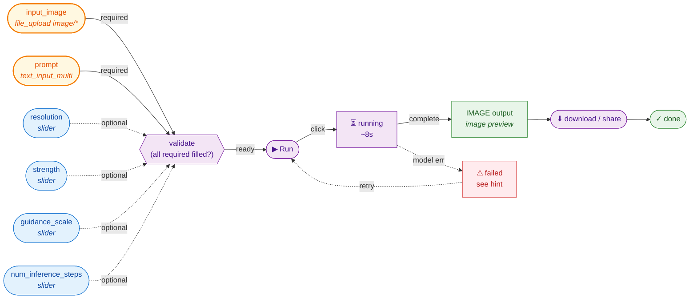

### Image-Text-to-Text

**I/O** `IMAGE+TEXT → TEXT`   **Era** 5   **Layer** L3   **First practical** 2023

_Role:_ avatar can describe / reason about images shown during conversation

**Top chains involving this opcode:**
- `Image-Text-to-Text`
- `Image-Text-to-Image → Image-Text-to-Text`
- `Image-Text-to-Text → Audio-Text-to-Text`

**Widget spec** (from `gui_card`):
- 5 input widget(s), 1 output widget(s), layout `two-column`, est `5s`
  - **!** `text_input_multi`  `input_text` slot=TEXT
  - **!** `file_upload`  `image_path` slot=IMAGE  accept=`image/*`
  - **!** `text_input_multi`  `text_prompt`
  -   `slider`  `temperature`
  -   `slider`  `top_p`
  - output: `output_preview` kind=`text` modality=`TEXT`

**Failure modes the UI should pre-empt:**
- _Image not found_  →  Check if the image URL is correct and accessible.
- _Text not provided_  →  Ensure that the text input is correctly formatted and not empty.
- _Model not available_  →  Verify that the model you are using is properly installed and configured.

**Interface mockup:**

```
┌──────────────────────────────┬──────────────────────────────┐
│ INPUTS                       │ OUTPUTS                      │
│   input_text:                │   output  (TEXT):            │
│   ┌─────────────────┐        │   ┌─────────────────┐        │
│   │                 │        │   │  Response text  │        │
│   │                 │        │   │  ...            │        │
│   └─────────────────┘        │   └─────────────────┘        │
│                              │                              │
│   image_path:                │                              │
│   [📁 Browse...    ]          │                              │
│                              │                              │
│   text_prompt:               │                              │
│   ┌─────────────────┐        │                              │
│   │                 │        │                              │
│   │                 │        │                              │
│   └─────────────────┘        │                              │
│                              │                              │
│   temperature:               │                              │
│   ├──────◉────────────┤      │                              │
│                              │                              │
│   top_p:                     │                              │
│   ├──────◉────────────┤      │                              │
│                              │                              │
└──────────────────────────────┴──────────────────────────────┘

                    [ ▶ Run ]      ~5s
```

**GUI interaction DAG** — widget → submit → progress → output → download (with HITL / failure loops where relevant):

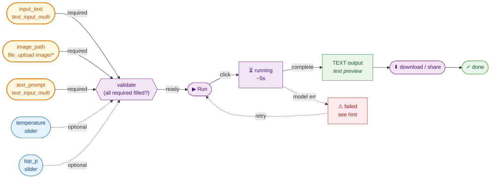

### Image-Text-to-Video

**I/O** `IMAGE+TEXT → VIDEO`   **Era** 5   **Layer** L3   **First practical** 2024

_Role:_ reference photo + instruction -> animated avatar performs the instruction

**Top chains involving this opcode:**
- `Image-Text-to-Video`
- `Image-Text-to-Image → Image-Text-to-Video`
- `Image-Text-to-Text → Image-Text-to-Video`

**Widget spec** (from `gui_card`):
- 4 input widget(s), 1 output widget(s), layout `two-column`, est `60s`, **HITL likely**
  - **!** `text_input_multi`  `input_text` slot=TEXT
  - **!** `file_upload`  `input_image` slot=IMAGE  accept=`image/*`
  - **!** `text_input_multi`  `text_prompt`
  -   `file_upload`  `video_length_seconds` slot=VIDEO  accept=`video/*`
  - output: `output_preview` kind=`video` modality=`VIDEO`

**Failure modes the UI should pre-empt:**
- _Image size mismatch_  →  Ensure that the input image dimensions match those expected by the model.
- _Model not trained on this dataset_  →  Train the model on a dataset similar to the one used for the input image.
- _Insufficient training data_  →  Increase the amount of training data available to the model.

**Interface mockup:**

```
┌──────────────────────────────┬──────────────────────────────┐
│ INPUTS                       │ OUTPUTS                      │
│   input_text:                │   output  (VIDEO):           │
│   ┌─────────────────┐        │   ┌─────────────────┐        │
│   │                 │        │   │                 │        │
│   │                 │        │   │   ▶ VIDEO       │        │
│   └─────────────────┘        │   │                 │        │
│                              │   └─────────────────┘        │
│   input_image:               │                              │
│   [📁 Browse...    ]          │                              │
│                              │                              │
│   text_prompt:               │                              │
│   ┌─────────────────┐        │                              │
│   │                 │        │                              │
│   │                 │        │                              │
│   └─────────────────┘        │                              │
│                              │                              │
│   video_length_seconds:      │                              │
│   [📁 Browse...    ]          │                              │
│                              │                              │
└──────────────────────────────┴──────────────────────────────┘

                    [ ▶ Run ]      ~60s — HITL likely
```

**GUI interaction DAG** — widget → submit → progress → output → download (with HITL / failure loops where relevant):

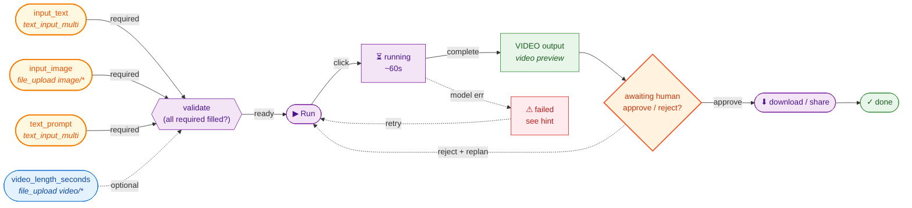

### Video-Text-to-Text

**I/O** `VIDEO+TEXT → TEXT`   **Era** 5   **Layer** L3   **First practical** 2024

_Role:_ avatar can watch a clip during conversation and answer about it

**Top chains involving this opcode:**
- `Video-Text-to-Text`
- `Video-Text-to-Text → Audio-Text-to-Text`
- `Video-Text-to-Text → Document Question Answering`

**Widget spec** (from `gui_card`):
- 4 input widget(s), 1 output widget(s), layout `two-column`, est `5s`
  - **!** `file_upload`  `input_video` slot=VIDEO  accept=`video/*`
  - **!** `text_input`  `input_text`
  -   `slider`  `temperature`
  -   `number_input`  `max_length`
  - output: `output_preview` kind=`text` modality=`TEXT`

**Failure modes the UI should pre-empt:**
- _Insufficient permissions_  →  Ensure you have the necessary permissions to execute this opcode.
- _Invalid input data_  →  Verify that the input data is correctly formatted and meets the requirements of the opcode.
- _Resource not found_  →  Check if the resources required by the opcode are available and accessible.

**Interface mockup:**

```
┌──────────────────────────────┬──────────────────────────────┐
│ INPUTS                       │ OUTPUTS                      │
│   input_video:               │   output  (TEXT):            │
│   [📁 Browse...    ]          │   ┌─────────────────┐        │
│                              │   │  Response text  │        │
│   input_text:                │   │  ...            │        │
│   [___________________]      │   └─────────────────┘        │
│                              │                              │
│   temperature:               │                              │
│   ├──────◉────────────┤      │                              │
│                              │                              │
│   max_length:                │                              │
│   [ 42  ▲▼          ]        │                              │
│                              │                              │
└──────────────────────────────┴──────────────────────────────┘

                    [ ▶ Run ]      ~5s
```

**GUI interaction DAG** — widget → submit → progress → output → download (with HITL / failure loops where relevant):

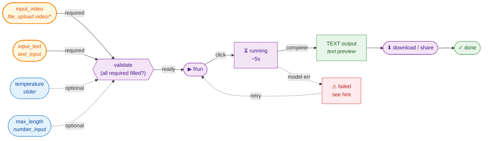

### Visual Document Retrieval

**I/O** `DOC+TEXT → DOC`   **Era** 5   **Layer** L3   **First practical** 2024

_Role:_ RAG over visual documents — avatar with knowledge base of PDFs/slides

**Top chains involving this opcode:**
- `Visual Document Retrieval`
- `Document Question Answering → Visual Document Retrieval`
- `Document Question Answering → Audio-Text-to-Text → Visual Document Retrieval`

**Widget spec** (from `gui_card`):
- 6 input widget(s), 1 output widget(s), layout `two-column`, est `5s`
  - **!** `file_upload`  `input_doc` slot=DOC  accept=`.pdf,.docx,.txt,.md`
  - **!** `text_input`  `query`
  -   `number_input`  `max_results`
  -   `dropdown`  `language`
  -   `text_input`  `filter`
  -   `text_input`  `sort`
  - output: `output_preview` kind=`doc` modality=`DOC`

**Failure modes the UI should pre-empt:**
- _Document not found_  →  Check if the document ID is correct and that the document exists in the system.
- _Permission denied_  →  Ensure you have the necessary permissions to access the document.
- _Network issue_  →  Verify your internet connection and try again later.

**Interface mockup:**

```
┌──────────────────────────────┬──────────────────────────────┐
│ INPUTS                       │ OUTPUTS                      │
│   input_doc:                 │   output  (DOC):             │
│   [📁 Browse...    ]          │   ┌─────────────────┐        │
│                              │   │  📄 Document    │         │
│   query:                     │   └─────────────────┘        │
│   [___________________]      │                              │
│                              │                              │
│   max_results:               │                              │
│   [ 42  ▲▼          ]        │                              │
│                              │                              │
│   language:                  │                              │
│   [Choose...      ▾  ]       │                              │
│                              │                              │
│   filter:                    │                              │
│   [___________________]      │                              │
│                              │                              │
│   sort:                      │                              │
│   [___________________]      │                              │
│                              │                              │
└──────────────────────────────┴──────────────────────────────┘

                    [ ▶ Run ]      ~5s
```

**GUI interaction DAG** — widget → submit → progress → output → download (with HITL / failure loops where relevant):

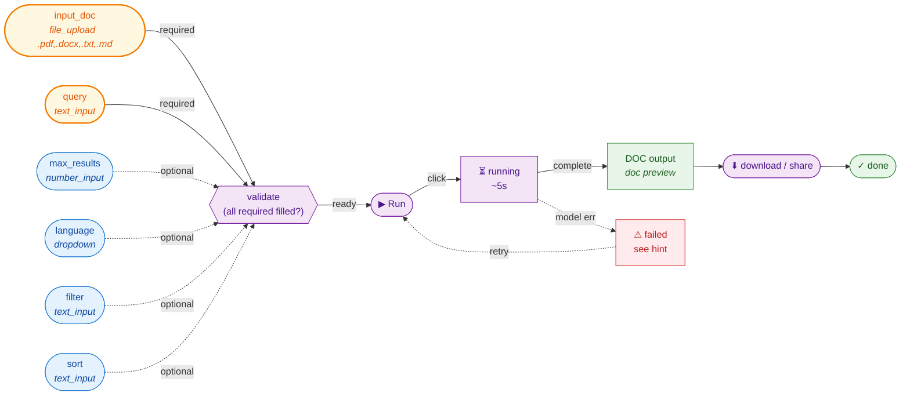

### Visual Question Answering

**I/O** `IMAGE+TEXT → TEXT`   **Era** 3   **Layer** L3   **First practical** 2021

_Role:_ avatar can see and answer about its own current frame — image grounding

**Top chains involving this opcode:**
- `Visual Question Answering`
- `Image-Text-to-Image → Visual Question Answering`

**Widget spec** (from `gui_card`):
- 4 input widget(s), 1 output widget(s), layout `two-column`, est `5s`
  - **!** `text_input_multi`  `input_text` slot=TEXT
  - **!** `file_upload`  `image_path` slot=IMAGE  accept=`image/*`
  - **!** `text_input_multi`  `question_text`
  - **!** `text_input`  `model_name`
  - output: `output_preview` kind=`text` modality=`TEXT`

**Failure modes the UI should pre-empt:**
- _Incorrect question format_  →  Ensure the question is clear and concise.
- _Insufficient context_  →  Provide additional information to clarify the question.
- _Inadequate response_  →  Offer a detailed and comprehensive answer.

**Interface mockup:**

```
┌──────────────────────────────┬──────────────────────────────┐
│ INPUTS                       │ OUTPUTS                      │
│   input_text:                │   output  (TEXT):            │
│   ┌─────────────────┐        │   ┌─────────────────┐        │
│   │                 │        │   │  Response text  │        │
│   │                 │        │   │  ...            │        │
│   └─────────────────┘        │   └─────────────────┘        │
│                              │                              │
│   image_path:                │                              │
│   [📁 Browse...    ]          │                              │
│                              │                              │
│   question_text:             │                              │
│   ┌─────────────────┐        │                              │
│   │                 │        │                              │
│   │                 │        │                              │
│   └─────────────────┘        │                              │
│                              │                              │
│   model_name:                │                              │
│   [___________________]      │                              │
│                              │                              │
└──────────────────────────────┴──────────────────────────────┘

                    [ ▶ Run ]      ~5s
```

**GUI interaction DAG** — widget → submit → progress → output → download (with HITL / failure loops where relevant):

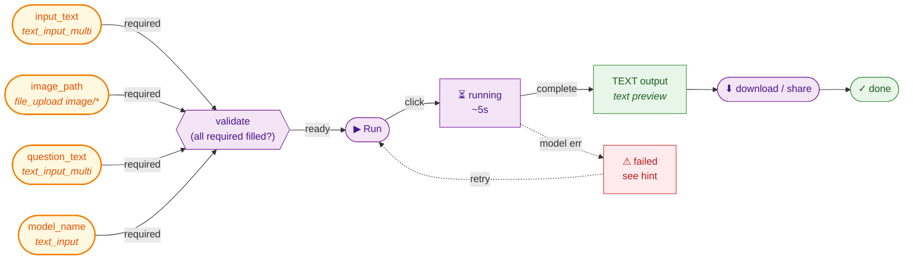

### Any-to-Any

**I/O** `TEXT+IMAGE+AUDIO+VIDEO → TEXT+IMAGE+AUDIO+VIDEO`   **Era** 7   **Layer** L5   **First practical** 2024

_Role:_ ENDGAME — one model that takes any modality in and emits any modality out. Collapses 6+ pipeline steps into one inference call.

**Widget spec** (from `gui_card`):
- 4 input widget(s), 4 output widget(s), layout `two-column`, est `60s`, **HITL likely**
  - **!** `text_input`  `input_text`
  -   `file_upload`  `input_image` slot=IMAGE  accept=`image/*`
  -   `audio_recorder`  `input_audio` slot=AUDIO  accept=`audio/*`
  -   `video_recorder`  `input_video` slot=VIDEO  accept=`video/*`
  - output: `output_preview` kind=`text` modality=`TEXT`
  - output: `output_preview` kind=`image` modality=`IMAGE`
  - output: `output_preview` kind=`audio` modality=`AUDIO`
  - output: `output_preview` kind=`video` modality=`VIDEO`

**Failure modes the UI should pre-empt:**
- _Data corruption_  →  Verify data integrity before processing
- _Inconsistent state_  →  Ensure consistent state across all nodes
- _Resource exhaustion_  →  Implement resource limits and monitoring

**Interface mockup:**

```
┌──────────────────────────────┬──────────────────────────────┐
│ INPUTS                       │ OUTPUTS                      │
│   input_text:                │   output  (TEXT):            │
│   [___________________]      │   ┌─────────────────┐        │
│                              │   │  Response text  │        │
│   input_image:               │   │  ...            │        │
│   [📁 Browse...    ]          │   └─────────────────┘        │
│                              │                              │
│   input_audio:               │   output  (IMAGE):           │
│   [🎤 Record        ]         │   ┌─────────────────┐        │
│                              │   │                 │        │
│   input_video:               │   │   ▒ IMAGE ▒     │        │
│   [📹 Capture       ]         │   │                 │        │
│                              │   └─────────────────┘        │
│                              │                              │
│                              │   output  (AUDIO):           │
│                              │   [▶  ──◉────────  0:23 / 1:05 ] │
│                              │                              │
│                              │   output  (VIDEO):           │
│                              │   ┌─────────────────┐        │
│                              │   │                 │        │
│                              │   │   ▶ VIDEO       │        │
│                              │   │                 │        │
│                              │   └─────────────────┘        │
│                              │                              │
└──────────────────────────────┴──────────────────────────────┘

                    [ ▶ Run ]      ~60s — HITL likely
```

**GUI interaction DAG** — widget → submit → progress → output → download (with HITL / failure loops where relevant):

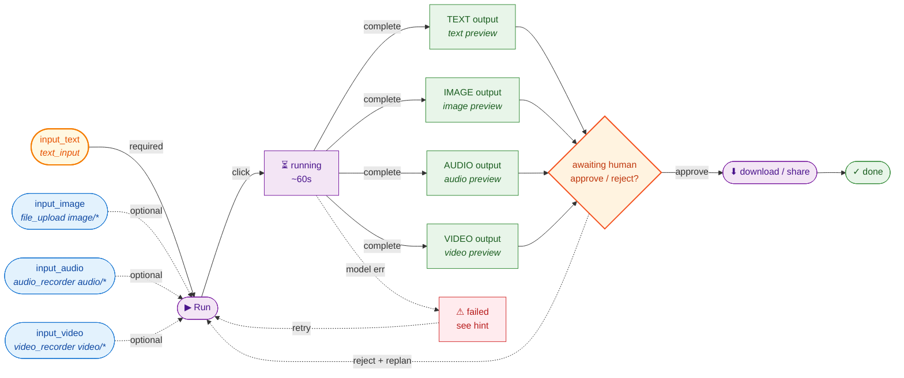

---

## Computer Vision  (19 opcodes)

> Computer Vision splits into two UX classes: ANALYZE (Image → Label/Mask/Boxes/Depth/Keypoints) where the input panel is a single file drop zone and the output is a typed overlay/visualization; and GENERATE (Text/Image → Image/Video/3D) where the input panel adds a prompt + sliders for diffusion params, and the output preview is polymorphic by modality. Always include a download/share button on outputs — these are sharable artifacts.

### Depth Estimation

**I/O** `IMAGE → DEPTH_MAP`   **Era** 1   **Layer** L1   **First practical** 2015

_Role:_ feeds 3D-aware avatar pipelines (NeRF, Gaussian splat) for parallax / view synthesis

**Top chains involving this opcode:**
- `Depth Estimation`
- `Image-Text-to-Image → Depth Estimation`
- `Image-Text-to-Text → Image-Text-to-Image → Depth Estimation`

**Widget spec** (from `gui_card`):
- 4 input widget(s), 1 output widget(s), layout `two-column`, est `3s`
  - **!** `file_upload`  `input_image` slot=IMAGE  accept=`image/*`
  - **!** `dropdown`  `model_name`
  -   `slider`  `batch_size`
  -   `slider`  `num_workers`
  - output: `output_preview` kind=`heatmap` modality=`DEPTH_MAP`

**Failure modes the UI should pre-empt:**
- _Insufficient depth information_  →  Ensure that the input image contains sufficient depth information.
- _Depth estimation error_  →  Check if the model is trained on a dataset with similar lighting conditions and scene complexity as the input image.
- _Model not trained for depth estimation_  →  Train the model specifically for depth estimation tasks.

**Interface mockup:**

```
┌──────────────────────────────┬──────────────────────────────┐
│ INPUTS                       │ OUTPUTS                      │
│   input_image:               │   output  (DEPTH_MAP):       │
│   [📁 Browse...    ]          │   ┌─────────────────┐        │
│                              │   │  ░▒▓ heatmap ▒░ │        │
│   model_name:                │   └─────────────────┘        │
│   [Choose...      ▾  ]       │                              │
│                              │                              │
│   batch_size:                │                              │
│   ├──────◉────────────┤      │                              │
│                              │                              │
│   num_workers:               │                              │
│   ├──────◉────────────┤      │                              │
│                              │                              │
└──────────────────────────────┴──────────────────────────────┘

                    [ ▶ Run ]      ~3s
```

**GUI interaction DAG** — widget → submit → progress → output → download (with HITL / failure loops where relevant):

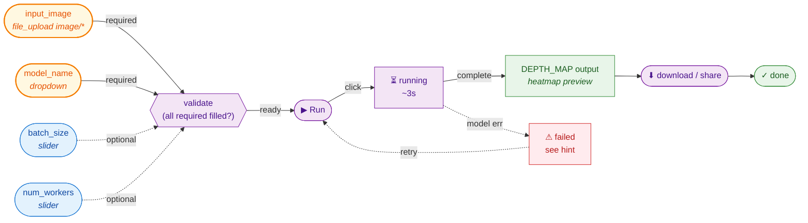

### Image Classification

**I/O** `IMAGE → LABEL`   **Era** 1   **Layer** L1   **First practical** 2014

_Role:_ foundational — every later vision system inherits these backbones

**Top chains involving this opcode:**
- `Image Classification`
- `Image-Text-to-Image → Image Classification`

**Widget spec** (from `gui_card`):
- 5 input widget(s), 1 output widget(s), layout `two-column`, est `3s`
  - **!** `file_upload`  `image_path` slot=IMAGE  accept=`image/*`
  -   `text_input`  `model_name`
  -   `slider`  `batch_size`
  -   `slider`  `top_k`
  -   `slider`  `confidence_threshold`
  - output: `output_preview` kind=`label` modality=`LABEL`

**Failure modes the UI should pre-empt:**
- _Model not trained_  →  Train the model using appropriate data.
- _Insufficient data_  →  Collect more training data to improve model performance.
- _Incorrect input format_  →  Ensure that the input data is in the correct format for the model.

**Interface mockup:**

```
┌──────────────────────────────┬──────────────────────────────┐
│ INPUTS                       │ OUTPUTS                      │
│   image_path:                │   output  (LABEL):           │
│   [📁 Browse...    ]          │   [ Predicted: "…" 0.87 ]    │
│                              │                              │
│   model_name:                │                              │
│   [___________________]      │                              │
│                              │                              │
│   batch_size:                │                              │
│   ├──────◉────────────┤      │                              │
│                              │                              │
│   top_k:                     │                              │
│   ├──────◉────────────┤      │                              │
│                              │                              │
│   confidence_threshold:      │                              │
│   ├──────◉────────────┤      │                              │
│                              │                              │
└──────────────────────────────┴──────────────────────────────┘

                    [ ▶ Run ]      ~3s
```

**GUI interaction DAG** — widget → submit → progress → output → download (with HITL / failure loops where relevant):

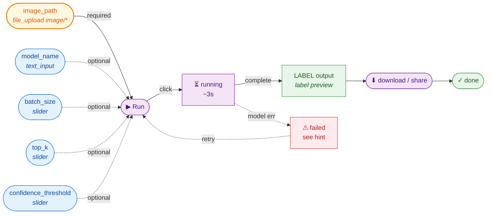

### Image Segmentation

**I/O** `IMAGE → MASK`   **Era** 1   **Layer** L1   **First practical** 2015

_Role:_ separates avatar from background pre-lipsync — required for clean composite

**Top chains involving this opcode:**
- `Image Segmentation`
- `Image-Text-to-Image → Image Segmentation`
- `Image-Text-to-Text → Image-Text-to-Image → Image Segmentation`

**Widget spec** (from `gui_card`):
- 4 input widget(s), 1 output widget(s), layout `two-column`, est `3s`
  - **!** `file_upload`  `input_image` slot=IMAGE  accept=`image/*`
  - **!** `dropdown`  `model_type`
  -   `slider`  `threshold`
  -   `slider`  `confidence_threshold`
  - output: `output_preview` kind=`mask` modality=`MASK`

**Failure modes the UI should pre-empt:**
- _Image not found_  →  Check if the image file exists and is accessible.
- _Incorrect image format_  →  Ensure the image file is in a supported format (e.g., JPEG, PNG).
- _Insufficient permissions_  →  Verify that the user has the necessary permissions to access and process the image.

**Interface mockup:**

```
┌──────────────────────────────┬──────────────────────────────┐
│ INPUTS                       │ OUTPUTS                      │
│   input_image:               │   output  (MASK):            │
│   [📁 Browse...    ]          │   ┌─────────────────┐        │
│                              │   │  ░▒▓ MASK ▓▒░  │         │
│   model_type:                │   └─────────────────┘        │
│   [Choose...      ▾  ]       │                              │
│                              │                              │
│   threshold:                 │                              │
│   ├──────◉────────────┤      │                              │
│                              │                              │
│   confidence_threshold:      │                              │
│   ├──────◉────────────┤      │                              │
│                              │                              │
└──────────────────────────────┴──────────────────────────────┘

                    [ ▶ Run ]      ~3s
```

**GUI interaction DAG** — widget → submit → progress → output → download (with HITL / failure loops where relevant):

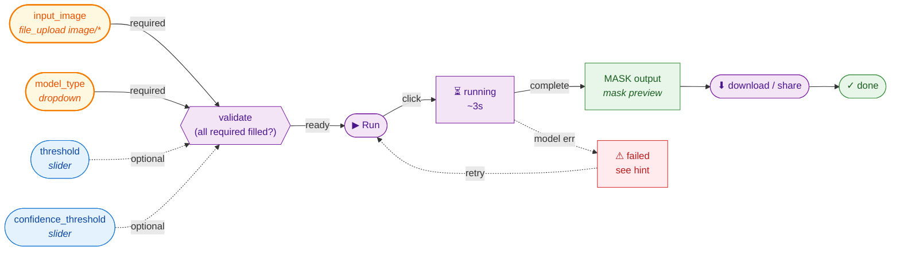

### Image-to-Image

**I/O** `IMAGE → IMAGE`   **Era** 3   **Layer** L1   **First practical** 2022

_Role:_ style transfer / refinement of avatar frames; ControlNet conditions on pose/depth

**Top chains involving this opcode:**
- `Image-to-Image`
- `Image-Text-to-Image → Image-to-Image`
- `Image-to-Image → Image-Text-to-Image`

**Widget spec** (from `gui_card`):
- 6 input widget(s), 1 output widget(s), layout `two-column`, est `8s`
  - **!** `file_upload`  `input_image` slot=IMAGE  accept=`image/*`
  - **!** `text_input_multi`  `prompt`
  -   `text_input_multi`  `negative_prompt`
  - **!** `slider`  `strength`
  -   `slider`  `guidance_scale`
  - **!** `slider`  `num_inference_steps`
  - output: `output_preview` kind=`image` modality=`IMAGE`

**Failure modes the UI should pre-empt:**
- _Image size mismatch_  →  Ensure both input and output images have the same dimensions.
- _Color space mismatch_  →  Convert both input and output images to the same color space.
- _Model not trained for this task_  →  Train a model specifically designed for image-to-image tasks.

**Interface mockup:**

```
┌──────────────────────────────┬──────────────────────────────┐
│ INPUTS                       │ OUTPUTS                      │
│   input_image:               │   output  (IMAGE):           │
│   [📁 Browse...    ]          │   ┌─────────────────┐        │
│                              │   │                 │        │
│   prompt:                    │   │   ▒ IMAGE ▒     │        │
│   ┌─────────────────┐        │   │                 │        │
│   │                 │        │   └─────────────────┘        │
│   │                 │        │                              │
│   └─────────────────┘        │                              │
│                              │                              │
│   negative_prompt:           │                              │
│   ┌─────────────────┐        │                              │
│   │                 │        │                              │
│   │                 │        │                              │
│   └─────────────────┘        │                              │
│                              │                              │
│   strength:                  │                              │
│   ├──────◉────────────┤      │                              │
│                              │                              │
│   guidance_scale:            │                              │
│   ├──────◉────────────┤      │                              │
│                              │                              │
│   num_inference_steps:       │                              │
│   ├──────◉────────────┤      │                              │
│                              │                              │
└──────────────────────────────┴──────────────────────────────┘

                    [ ▶ Run ]      ~8s
```

**GUI interaction DAG** — widget → submit → progress → output → download (with HITL / failure loops where relevant):

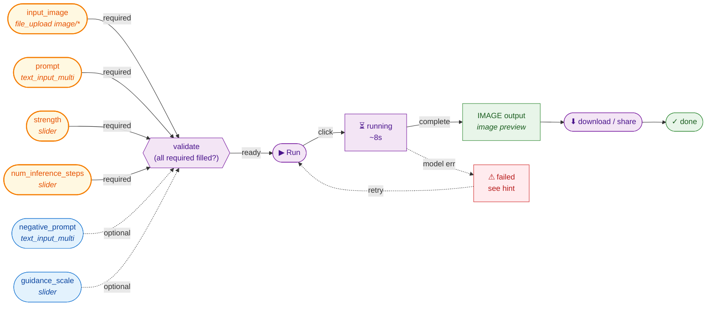

### Keypoint Detection

**I/O** `IMAGE → KEYPOINTS`   **Era** 1   **Layer** L1   **First practical** 2016

_Role:_ drives pose/skeleton for the walking body; conditions ControlNet-style video gen

**Top chains involving this opcode:**
- `Keypoint Detection`
- `Image-Text-to-Image → Keypoint Detection`
- `Image-Text-to-Text → Image-Text-to-Image → Keypoint Detection`

**Widget spec** (from `gui_card`):
- 4 input widget(s), 1 output widget(s), layout `two-column`, est `3s`
  - **!** `file_upload`  `image` slot=IMAGE  accept=`image/*`
  - **!** `slider`  `confidence_threshold`
  -   `number_input`  `max_keypoints`
  - **!** `text_input`  `model_name`
  - output: `output_preview` kind=`keypoints_overlay` modality=`KEYPOINTS`

**Failure modes the UI should pre-empt:**
- _Insufficient Keypoint Data_  →  Ensure sufficient keypoints are captured during image processing.
- _Keypoint Detection Error_  →  Verify that the keypoint detection algorithm is correctly implemented and calibrated.
- _Keypoint Not Found_  →  Check if the detected keypoints meet the criteria for the specific task.

**Interface mockup:**

```
┌──────────────────────────────┬──────────────────────────────┐
│ INPUTS                       │ OUTPUTS                      │
│   image:                     │   output  (KEYPOINTS):       │
│   [📁 Browse...    ]          │   ┌─────────────────┐        │
│                              │   │  • • • (joints) │        │
│   confidence_threshold:      │   └─────────────────┘        │
│   ├──────◉────────────┤      │                              │
│                              │                              │
│   max_keypoints:             │                              │
│   [ 42  ▲▼          ]        │                              │
│                              │                              │
│   model_name:                │                              │
│   [___________________]      │                              │
│                              │                              │
└──────────────────────────────┴──────────────────────────────┘

                    [ ▶ Run ]      ~3s
```

**GUI interaction DAG** — widget → submit → progress → output → download (with HITL / failure loops where relevant):

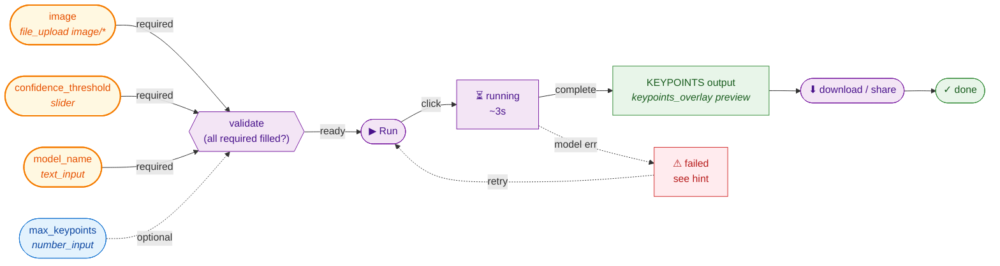

### Mask Generation

**I/O** `IMAGE → MASK`   **Era** 3   **Layer** L1   **First practical** 2023

_Role:_ background extraction — clean separation of avatar from source video

**Top chains involving this opcode:**
- `Mask Generation`
- `Image-Text-to-Image → Mask Generation`
- `Image-Text-to-Text → Image-Text-to-Image → Mask Generation`

**Widget spec** (from `gui_card`):
- 4 input widget(s), 1 output widget(s), layout `two-column`, est `3s`
  - **!** `file_upload`  `input_image` slot=IMAGE  accept=`image/*`
  - **!** `slider`  `mask_size`
  - **!** `number_input`  `num_masks`
  -   `text_input`  `mask_format`
  - output: `output_preview` kind=`mask` modality=`MASK`

**Failure modes the UI should pre-empt:**
- _Invalid input data_  →  Ensure that the input data is valid and meets the requirements of the opcode.
- _Insufficient randomness_  →  Use a secure random number generator to generate the mask.
- _Incorrect key or nonce_  →  Ensure that the key and nonce are correctly generated and used.

**Interface mockup:**

```
┌──────────────────────────────┬──────────────────────────────┐
│ INPUTS                       │ OUTPUTS                      │
│   input_image:               │   output  (MASK):            │
│   [📁 Browse...    ]          │   ┌─────────────────┐        │
│                              │   │  ░▒▓ MASK ▓▒░  │         │
│   mask_size:                 │   └─────────────────┘        │
│   ├──────◉────────────┤      │                              │
│                              │                              │
│   num_masks:                 │                              │
│   [ 42  ▲▼          ]        │                              │
│                              │                              │
│   mask_format:               │                              │
│   [___________________]      │                              │
│                              │                              │
└──────────────────────────────┴──────────────────────────────┘

                    [ ▶ Run ]      ~3s
```

**GUI interaction DAG** — widget → submit → progress → output → download (with HITL / failure loops where relevant):

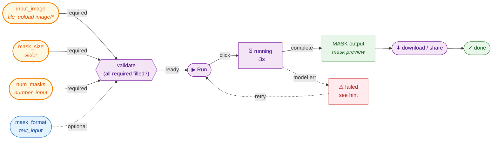

### Object Detection

**I/O** `IMAGE → BOXES+LABEL`   **Era** 1   **Layer** L1   **First practical** 2014

_Role:_ locate face/body in source frames before lipsync or pose transfer

**Top chains involving this opcode:**
- `Object Detection`
- `Image-Text-to-Image → Object Detection`
- `Image-Text-to-Text → Image-Text-to-Image → Object Detection`

**Widget spec** (from `gui_card`):
- 4 input widget(s), 2 output widget(s), layout `two-column`, est `3s`
  - **!** `file_upload`  `image_path` slot=IMAGE  accept=`image/*`
  -   `slider`  `confidence_threshold`
  -   `slider`  `iou_threshold`
  -   `number_input`  `max_boxes_per_class`
  - output: `output_preview` kind=`boxes_overlay` modality=`BOXES`
  - output: `output_preview` kind=`label` modality=`LABEL`

**Failure modes the UI should pre-empt:**
- _Object not detected_  →  Check if the object is within the detection range and if the camera is properly aligned.
- _Incorrect object classification_  →  Verify that the model used for object detection is trained on the correct dataset and that it has been fine-tuned for th
- _Insufficient lighting conditions_  →  Ensure that the camera has sufficient lighting to capture clear images of the object.

**Interface mockup:**

```
┌──────────────────────────────┬──────────────────────────────┐
│ INPUTS                       │ OUTPUTS                      │
│   image_path:                │   output  (BOXES):           │
│   [📁 Browse...    ]          │   ┌─────────────────┐        │
│                              │   │  □ □ □ (boxes)  │        │
│   confidence_threshold:      │   └─────────────────┘        │
│   ├──────◉────────────┤      │                              │
│                              │   output  (LABEL):           │
│   iou_threshold:             │   [ Predicted: "…" 0.87 ]    │
│   ├──────◉────────────┤      │                              │
│                              │                              │
│   max_boxes_per_class:       │                              │
│   [ 42  ▲▼          ]        │                              │
│                              │                              │
└──────────────────────────────┴──────────────────────────────┘

                    [ ▶ Run ]      ~3s
```

**GUI interaction DAG** — widget → submit → progress → output → download (with HITL / failure loops where relevant):

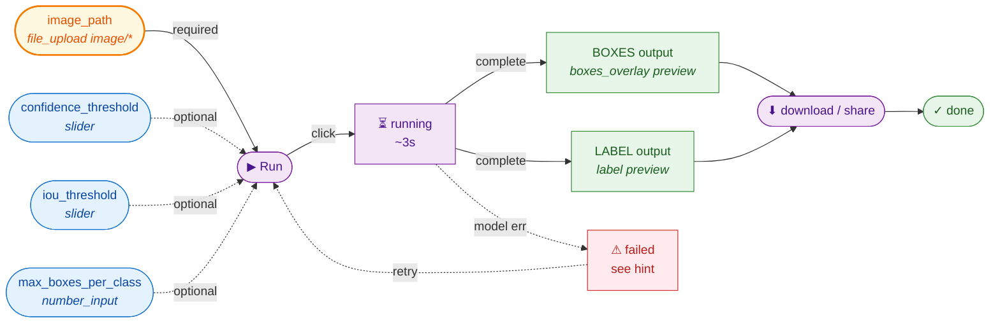

### Unconditional Image Generation

**I/O** `- → IMAGE`   **Era** 3   **Layer** L1   **First practical** 2014

_Role:_ foundation for everything generative — diffusion replaced GAN as dominant 2020+

**Widget spec** (from `gui_card`):
- 5 input widget(s), 1 output widget(s), layout `two-column`, est `8s`
  - **!** `text_input_multi`  `prompt`
  -   `file_upload`  `num_images` slot=IMAGE  accept=`image/*`
  -   `number_input`  `seed`
  -   `text_input`  `resolution`
  -   `slider`  `guidance_scale`
  - output: `output_preview` kind=`image` modality=`IMAGE`

**Failure modes the UI should pre-empt:**
- _Image generation fails due to insufficient memory._  →  Increase system RAM or use a GPU.
- _Model parameters are not properly initialized._  →  Reinitialize the model with fresh weights.
- _Input image is too large for the model._  →  Resize the input image to fit within the model's capabilities.

**Interface mockup:**

```
┌──────────────────────────────┬──────────────────────────────┐
│ INPUTS                       │ OUTPUTS                      │
│   prompt:                    │   output  (IMAGE):           │
│   ┌─────────────────┐        │   ┌─────────────────┐        │
│   │                 │        │   │                 │        │
│   │                 │        │   │   ▒ IMAGE ▒     │        │
│   └─────────────────┘        │   │                 │        │
│                              │   └─────────────────┘        │
│   num_images:                │                              │
│   [📁 Browse...    ]          │                              │
│                              │                              │
│   seed:                      │                              │
│   [ 42  ▲▼          ]        │                              │
│                              │                              │
│   resolution:                │                              │
│   [___________________]      │                              │
│                              │                              │
│   guidance_scale:            │                              │
│   ├──────◉────────────┤      │                              │
│                              │                              │
└──────────────────────────────┴──────────────────────────────┘

                    [ ▶ Run ]      ~8s
```

**GUI interaction DAG** — widget → submit → progress → output → download (with HITL / failure loops where relevant):

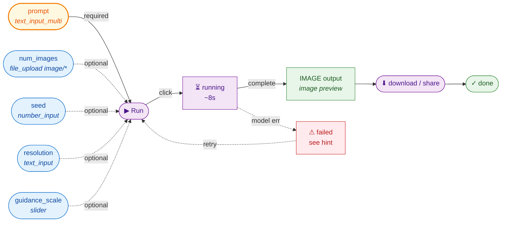

### Video Classification

**I/O** `VIDEO → LABEL`   **Era** 4   **Layer** L1   **First practical** 2017

_Role:_ asset filtering — classify source videos by motion type before reuse

**Top chains involving this opcode:**
- `Video Classification`

**Widget spec** (from `gui_card`):
- 6 input widget(s), 1 output widget(s), layout `two-column`, est `3s`
  - **!** `video_recorder`  `input_video` slot=VIDEO  accept=`video/*`
  - **!** `text_input_multi`  `model_name`
  -   `text_input`  `input_shape`
  - **!** `slider`  `batch_size`
  - **!** `slider`  `num_classes`
  -   `toggle`  `pretrained`
  - output: `output_preview` kind=`label` modality=`LABEL`

**Failure modes the UI should pre-empt:**
- _Model not trained_  →  Train the model using appropriate data
- _Insufficient data_  →  Collect more training data
- _Incorrect input format_  →  Ensure the input is in the correct format for the model

**Interface mockup:**

```
┌──────────────────────────────┬──────────────────────────────┐
│ INPUTS                       │ OUTPUTS                      │
│   input_video:               │   output  (LABEL):           │
│   [📹 Capture       ]         │   [ Predicted: "…" 0.87 ]    │
│                              │                              │
│   model_name:                │                              │
│   ┌─────────────────┐        │                              │
│   │                 │        │                              │
│   │                 │        │                              │
│   └─────────────────┘        │                              │
│                              │                              │
│   input_shape:               │                              │
│   [___________________]      │                              │
│                              │                              │
│   batch_size:                │                              │
│   ├──────◉────────────┤      │                              │
│                              │                              │
│   num_classes:               │                              │
│   ├──────◉────────────┤      │                              │
│                              │                              │
│   pretrained:                │                              │
│   [ ● ○ ]                    │                              │
│                              │                              │
└──────────────────────────────┴──────────────────────────────┘

                    [ ▶ Run ]      ~3s
```

**GUI interaction DAG** — widget → submit → progress → output → download (with HITL / failure loops where relevant):

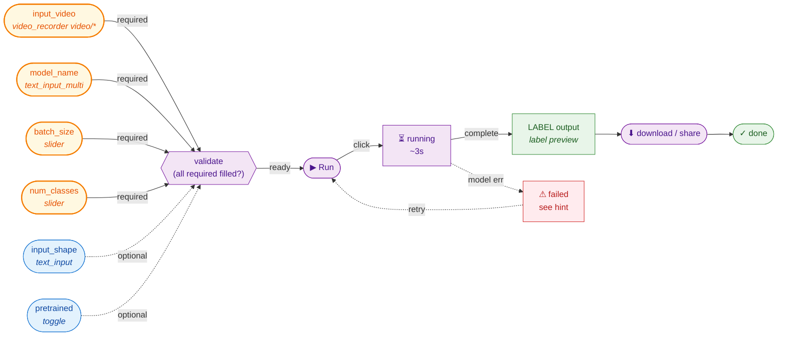

### Video-to-Video

**I/O** `VIDEO → VIDEO`   **Era** 4   **Layer** L1   **First practical** 2023

_Role:_ THE LIPSYNC STEP — audio-conditioned video editing produces the talking face

**Top chains involving this opcode:**
- `Video-to-Video`

**Widget spec** (from `gui_card`):
- 4 input widget(s), 1 output widget(s), layout `two-column`, est `60s`, **HITL likely**
  - **!** `file_upload`  `input_video` slot=VIDEO  accept=`video/*`
  -   `number_input`  `video_length` slot=VIDEO  accept=`video/*`
  -   `slider`  `frame_rate`
  - **!** `file_upload`  `audio_input` slot=AUDIO  accept=`audio/*`
  - output: `output_preview` kind=`video` modality=`VIDEO`

**Failure modes the UI should pre-empt:**
- _Video resolution mismatch_  →  Ensure both input and output videos have the same resolution.
- _Audio codec mismatch_  →  Use compatible audio codecs for both input and output videos.
- _Frame rate mismatch_  →  Adjust frame rates to match between input and output videos.

**Interface mockup:**

```
┌──────────────────────────────┬──────────────────────────────┐
│ INPUTS                       │ OUTPUTS                      │
│   input_video:               │   output  (VIDEO):           │
│   [📁 Browse...    ]          │   ┌─────────────────┐        │
│                              │   │                 │        │
│   video_length:              │   │   ▶ VIDEO       │        │
│   [ 42  ▲▼          ]        │   │                 │        │
│                              │   └─────────────────┘        │
│   frame_rate:                │                              │
│   ├──────◉────────────┤      │                              │
│                              │                              │
│   audio_input:               │                              │
│   [📁 Browse...    ]          │                              │
│                              │                              │
└──────────────────────────────┴──────────────────────────────┘

                    [ ▶ Run ]      ~60s — HITL likely
```

**GUI interaction DAG** — widget → submit → progress → output → download (with HITL / failure loops where relevant):

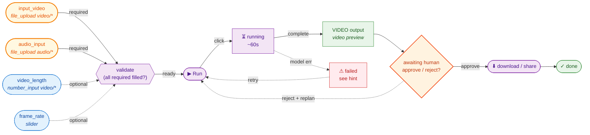

### Image-to-3D

**I/O** `IMAGE → 3D`   **Era** 4   **Layer** L2   **First practical** 2023

_Role:_ single-photo -> 3D avatar; fast asset creation from a reference

**Top chains involving this opcode:**
- `Image-to-3D`
- `Image-Text-to-Image → Image-to-3D`
- `Image-Text-to-Text → Image-Text-to-Image → Image-to-3D`

**Widget spec** (from `gui_card`):
- 3 input widget(s), 1 output widget(s), layout `two-column`, est `30s`, **HITL likely**
  - **!** `file_upload`  `input_image` slot=IMAGE  accept=`image/*`
  -   `slider`  `num_samples`
  -   `text_input`  `rendering_method`
  - output: `output_preview` kind=`3d_viewer` modality=`3D`

**Failure modes the UI should pre-empt:**
- _Image size mismatch_  →  Ensure that the input image dimensions match the expected dimensions for the opcode.
- _Color depth mismatch_  →  Adjust the color depth of the input image to match the required format for the opcode.
- _Unsupported image format_  →  Convert the input image to a supported format before processing with this opcode.

**Interface mockup:**

```
┌──────────────────────────────┬──────────────────────────────┐
│ INPUTS                       │ OUTPUTS                      │
│   input_image:               │   output  (3D):              │
│   [📁 Browse...    ]          │   ┌─────────────────┐        │
│                              │   │   ◇ 3D mesh ◇   │        │
│   num_samples:               │   │   (drag-rotate) │        │
│   ├──────◉────────────┤      │   └─────────────────┘        │
│                              │                              │
│   rendering_method:          │                              │
│   [___________________]      │                              │
│                              │                              │
└──────────────────────────────┴──────────────────────────────┘

                    [ ▶ Run ]      ~30s — HITL likely
```

**GUI interaction DAG** — widget → submit → progress → output → download (with HITL / failure loops where relevant):

```mermaid
flowchart LR
    classDef inputNode fill:#e3f2fd,stroke:#1976d2,color:#0d47a1
    classDef requiredNode fill:#fff8e1,stroke:#f57c00,color:#e65100,stroke-width:2px
    classDef stateNode fill:#f3e5f5,stroke:#7b1fa2,color:#4a148c
    classDef outputNode fill:#e8f5e9,stroke:#388e3c,color:#1b5e20
    classDef hitlNode fill:#fff3e0,stroke:#f4511e,color:#bf360c,stroke-width:2px
    classDef errorNode fill:#ffebee,stroke:#d32f2f,color:#b71c1c
    in_input_image(["input_image<br/><i>file_upload  image/*</i>"])
    class in_input_image requiredNode
    in_num_samples(["num_samples<br/><i>slider</i>"])
    class in_num_samples inputNode
    in_rendering_method(["rendering_method<br/><i>text_input</i>"])
    class in_rendering_method inputNode
    submit(["▶ Run"])
    class submit stateNode
    in_input_image -->|required| submit
    in_num_samples -.->|optional| submit
    in_rendering_method -.->|optional| submit
    running["⏳ running<br/>~30s"]
    class running stateNode
    submit -->|click| running
    out__3D["3D output<br/><i>3d_viewer preview</i>"]
    class out__3D outputNode
    running -->|complete| out__3D
    error["⚠ failed<br/>see hint"]
    class error errorNode
    running -.->|model err| error
    error -.->|retry| submit
    download(["⬇ download / share"])
    class download stateNode
    hitl{"awaiting human<br/>approve / reject?"}
    class hitl hitlNode
    out__3D --> hitl
    done(["✓ done"])
    class done outputNode
    hitl -->|approve| download
    hitl -.->|reject + replan| submit
    download --> done
```

### Image-to-Text

**I/O** `IMAGE → TEXT`   **Era** 3   **Layer** L2   **First practical** 2021

_Role:_ reverse direction — describe what's in a frame; used for captioning / context awareness

**Top chains involving this opcode:**
- `Image-to-Text`

**Widget spec** (from `gui_card`):
- 5 input widget(s), 1 output widget(s), layout `two-column`, est `4s`
  - **!** `file_upload`  `image_path` slot=IMAGE  accept=`image/*`
  -   `text_input`  `model_name`
  -   `text_input_multi`  `prompt`
  -   `slider`  `temperature`
  -   `slider`  `top_p`
  - output: `output_preview` kind=`text` modality=`TEXT`

**Failure modes the UI should pre-empt:**
- _Image not found_  →  Check if the image URL is correct and accessible.
- _Text extraction error_  →  Ensure that the image contains text that can be recognized by the model.
- _Model not trained on this type of image_  →  Train the model with images of the specific type you are trying to extract text from.

**Interface mockup:**

```
┌──────────────────────────────┬──────────────────────────────┐
│ INPUTS                       │ OUTPUTS                      │
│   image_path:                │   output  (TEXT):            │
│   [📁 Browse...    ]          │   ┌─────────────────┐        │
│                              │   │  Response text  │        │
│   model_name:                │   │  ...            │        │
│   [___________________]      │   └─────────────────┘        │
│                              │                              │
│   prompt:                    │                              │
│   ┌─────────────────┐        │                              │
│   │                 │        │                              │
│   │                 │        │                              │
│   └─────────────────┘        │                              │
│                              │                              │
│   temperature:               │                              │
│   ├──────◉────────────┤      │                              │
│                              │                              │
│   top_p:                     │                              │
│   ├──────◉────────────┤      │                              │
│                              │                              │
└──────────────────────────────┴──────────────────────────────┘

                    [ ▶ Run ]      ~4s
```

**GUI interaction DAG** — widget → submit → progress → output → download (with HITL / failure loops where relevant):

```mermaid
flowchart LR
    classDef inputNode fill:#e3f2fd,stroke:#1976d2,color:#0d47a1
    classDef requiredNode fill:#fff8e1,stroke:#f57c00,color:#e65100,stroke-width:2px
    classDef stateNode fill:#f3e5f5,stroke:#7b1fa2,color:#4a148c
    classDef outputNode fill:#e8f5e9,stroke:#388e3c,color:#1b5e20
    classDef hitlNode fill:#fff3e0,stroke:#f4511e,color:#bf360c,stroke-width:2px
    classDef errorNode fill:#ffebee,stroke:#d32f2f,color:#b71c1c
    in_image_path(["image_path<br/><i>file_upload  image/*</i>"])
    class in_image_path requiredNode
    in_model_name(["model_name<br/><i>text_input</i>"])
    class in_model_name inputNode
    in_prompt(["prompt<br/><i>text_input_multi</i>"])
    class in_prompt inputNode
    in_temperature(["temperature<br/><i>slider</i>"])
    class in_temperature inputNode
    in_top_p(["top_p<br/><i>slider</i>"])
    class in_top_p inputNode
    submit(["▶ Run"])
    class submit stateNode
    in_image_path -->|required| submit
    in_model_name -.->|optional| submit
    in_prompt -.->|optional| submit
    in_temperature -.->|optional| submit
    in_top_p -.->|optional| submit
    running["⏳ running<br/>~4s"]
    class running stateNode
    submit -->|click| running
    out_TEXT["TEXT output<br/><i>text preview</i>"]
    class out_TEXT outputNode
    running -->|complete| out_TEXT
    error["⚠ failed<br/>see hint"]
    class error errorNode
    running -.->|model err| error
    error -.->|retry| submit
    download(["⬇ download / share"])
    class download stateNode
    done(["✓ done"])
    class done outputNode
    out_TEXT --> download
    download --> done
```

### Image-to-Video

**I/O** `IMAGE → VIDEO`   **Era** 4   **Layer** L2   **First practical** 2023

_Role:_ animate a still avatar portrait — used pre-lipsync for subtle motion

**Top chains involving this opcode:**
- `Image-to-Video`

**Widget spec** (from `gui_card`):
- 4 input widget(s), 1 output widget(s), layout `two-column`, est `60s`, **HITL likely**
  - **!** `file_upload`  `input_image` slot=IMAGE  accept=`image/*`
  - **!** `slider`  `frame_rate`
  -   `slider`  `duration_seconds`
  - **!** `slider`  `noise_level`
  - output: `output_preview` kind=`video` modality=`VIDEO`

**Failure modes the UI should pre-empt:**
- _Image format not supported_  →  Ensure the image is in a supported format (e.g., JPEG, PNG).
- _Insufficient memory_  →  Increase the available system memory or use a smaller video size.
- _Invalid input parameters_  →  Check the input parameters for correctness and ensure they match the opcode's requirements.

**Interface mockup:**

```
┌──────────────────────────────┬──────────────────────────────┐
│ INPUTS                       │ OUTPUTS                      │
│   input_image:               │   output  (VIDEO):           │
│   [📁 Browse...    ]          │   ┌─────────────────┐        │
│                              │   │                 │        │
│   frame_rate:                │   │   ▶ VIDEO       │        │
│   ├──────◉────────────┤      │   │                 │        │
│                              │   └─────────────────┘        │
│   duration_seconds:          │                              │
│   ├──────◉────────────┤      │                              │
│                              │                              │
│   noise_level:               │                              │
│   ├──────◉────────────┤      │                              │
│                              │                              │
└──────────────────────────────┴──────────────────────────────┘

                    [ ▶ Run ]      ~60s — HITL likely
```

**GUI interaction DAG** — widget → submit → progress → output → download (with HITL / failure loops where relevant):

```mermaid
flowchart LR
    classDef inputNode fill:#e3f2fd,stroke:#1976d2,color:#0d47a1
    classDef requiredNode fill:#fff8e1,stroke:#f57c00,color:#e65100,stroke-width:2px
    classDef stateNode fill:#f3e5f5,stroke:#7b1fa2,color:#4a148c
    classDef outputNode fill:#e8f5e9,stroke:#388e3c,color:#1b5e20
    classDef hitlNode fill:#fff3e0,stroke:#f4511e,color:#bf360c,stroke-width:2px
    classDef errorNode fill:#ffebee,stroke:#d32f2f,color:#b71c1c
    in_input_image(["input_image<br/><i>file_upload  image/*</i>"])
    class in_input_image requiredNode
    in_frame_rate(["frame_rate<br/><i>slider</i>"])
    class in_frame_rate requiredNode
    in_duration_seconds(["duration_seconds<br/><i>slider</i>"])
    class in_duration_seconds inputNode
    in_noise_level(["noise_level<br/><i>slider</i>"])
    class in_noise_level requiredNode
    validate{{"validate<br/>(all required filled?)"}}
    class validate stateNode
    in_input_image -->|required| validate
    in_frame_rate -->|required| validate
    in_noise_level -->|required| validate
    in_duration_seconds -.->|optional| validate
    submit(["▶ Run"])
    class submit stateNode
    validate -->|ready| submit
    running["⏳ running<br/>~60s"]
    class running stateNode
    submit -->|click| running
    out_VIDEO["VIDEO output<br/><i>video preview</i>"]
    class out_VIDEO outputNode
    running -->|complete| out_VIDEO
    error["⚠ failed<br/>see hint"]
    class error errorNode
    running -.->|model err| error
    error -.->|retry| submit
    download(["⬇ download / share"])
    class download stateNode
    hitl{"awaiting human<br/>approve / reject?"}
    class hitl hitlNode
    out_VIDEO --> hitl
    done(["✓ done"])
    class done outputNode
    hitl -->|approve| download
    hitl -.->|reject + replan| submit
    download --> done
```

### Text-to-3D

**I/O** `TEXT → 3D`   **Era** 4   **Layer** L2   **First practical** 2022

_Role:_ full 3D avatar geometry — VR / game-engine integration

**Top chains involving this opcode:**
- `Text-to-3D`
- `Audio-Text-to-Text → Text-to-3D`
- `Document Question Answering → Text-to-3D`

**Widget spec** (from `gui_card`):
- 5 input widget(s), 1 output widget(s), layout `two-column`, est `30s`, **HITL likely**
  - **!** `text_input`  `text`
  -   `text_input`  `resolution`
  -   `text_input`  `texture_size`
  - **!** `text_input`  `model_type`
  -   `number_input`  `seed`
  - output: `output_preview` kind=`3d_viewer` modality=`3D`

**Failure modes the UI should pre-empt:**
- _Text-to-3D opcode is not supported by the current model._  →  Check if the model supports Text-to-3D and update the model if necessary.
- _The input text is too long for the model to process._  →  Reduce the length of the input text or use a smaller model.
- _The input text contains unsupported characters or symbols._  →  Remove or replace unsupported characters or symbols in the input text.

**Interface mockup:**

```
┌──────────────────────────────┬──────────────────────────────┐
│ INPUTS                       │ OUTPUTS                      │
│   text:                      │   output  (3D):              │
│   [___________________]      │   ┌─────────────────┐        │
│                              │   │   ◇ 3D mesh ◇   │        │
│   resolution:                │   │   (drag-rotate) │        │
│   [___________________]      │   └─────────────────┘        │
│                              │                              │
│   texture_size:              │                              │
│   [___________________]      │                              │
│                              │                              │
│   model_type:                │                              │
│   [___________________]      │                              │
│                              │                              │
│   seed:                      │                              │
│   [ 42  ▲▼          ]        │                              │
│                              │                              │
└──────────────────────────────┴──────────────────────────────┘

                    [ ▶ Run ]      ~30s — HITL likely
```

**GUI interaction DAG** — widget → submit → progress → output → download (with HITL / failure loops where relevant):

```mermaid
flowchart LR
    classDef inputNode fill:#e3f2fd,stroke:#1976d2,color:#0d47a1
    classDef requiredNode fill:#fff8e1,stroke:#f57c00,color:#e65100,stroke-width:2px
    classDef stateNode fill:#f3e5f5,stroke:#7b1fa2,color:#4a148c
    classDef outputNode fill:#e8f5e9,stroke:#388e3c,color:#1b5e20
    classDef hitlNode fill:#fff3e0,stroke:#f4511e,color:#bf360c,stroke-width:2px
    classDef errorNode fill:#ffebee,stroke:#d32f2f,color:#b71c1c
    in_text(["text<br/><i>text_input</i>"])
    class in_text requiredNode
    in_resolution(["resolution<br/><i>text_input</i>"])
    class in_resolution inputNode
    in_texture_size(["texture_size<br/><i>text_input</i>"])
    class in_texture_size inputNode
    in_model_type(["model_type<br/><i>text_input</i>"])
    class in_model_type requiredNode
    in_seed(["seed<br/><i>number_input</i>"])
    class in_seed inputNode
    validate{{"validate<br/>(all required filled?)"}}
    class validate stateNode
    in_text -->|required| validate
    in_model_type -->|required| validate
    in_resolution -.->|optional| validate
    in_texture_size -.->|optional| validate
    in_seed -.->|optional| validate
    submit(["▶ Run"])
    class submit stateNode
    validate -->|ready| submit
    running["⏳ running<br/>~30s"]
    class running stateNode
    submit -->|click| running
    out__3D["3D output<br/><i>3d_viewer preview</i>"]
    class out__3D outputNode
    running -->|complete| out__3D
    error["⚠ failed<br/>see hint"]
    class error errorNode
    running -.->|model err| error
    error -.->|retry| submit
    download(["⬇ download / share"])
    class download stateNode
    hitl{"awaiting human<br/>approve / reject?"}
    class hitl hitlNode
    out__3D --> hitl
    done(["✓ done"])
    class done outputNode
    hitl -->|approve| download
    hitl -.->|reject + replan| submit
    download --> done
```

### Text-to-Image

**I/O** `TEXT → IMAGE`   **Era** 3   **Layer** L2   **First practical** 2021

_Role:_ initial avatar appearance — face / outfit / style from a description

**Top chains involving this opcode:**
- `Text-to-Image`

**Widget spec** (from `gui_card`):
- 5 input widget(s), 1 output widget(s), layout `two-column`, est `8s`
  - **!** `text_input_multi`  `prompt`
  -   `slider`  `resolution`
  -   `number_input`  `strength`
  -   `number_input`  `seed`
  -   `slider`  `num_inference_steps`
  - output: `output_preview` kind=`image` modality=`IMAGE`

**Failure modes the UI should pre-empt:**
- _Model not available_  →  Check if the model is properly installed and loaded.
- _Insufficient memory_  →  Increase the system's RAM or use a smaller image size.
- _Invalid input format_  →  Ensure the input text is correctly formatted for the model.

**Interface mockup:**

```
┌──────────────────────────────┬──────────────────────────────┐
│ INPUTS                       │ OUTPUTS                      │
│   prompt:                    │   output  (IMAGE):           │
│   ┌─────────────────┐        │   ┌─────────────────┐        │
│   │                 │        │   │                 │        │
│   │                 │        │   │   ▒ IMAGE ▒     │        │
│   └─────────────────┘        │   │                 │        │
│                              │   └─────────────────┘        │
│   resolution:                │                              │
│   ├──────◉────────────┤      │                              │
│                              │                              │
│   strength:                  │                              │
│   [ 42  ▲▼          ]        │                              │
│                              │                              │
│   seed:                      │                              │
│   [ 42  ▲▼          ]        │                              │
│                              │                              │
│   num_inference_steps:       │                              │
│   ├──────◉────────────┤      │                              │
│                              │                              │
└──────────────────────────────┴──────────────────────────────┘

                    [ ▶ Run ]      ~8s
```

**GUI interaction DAG** — widget → submit → progress → output → download (with HITL / failure loops where relevant):

```mermaid
flowchart LR
    classDef inputNode fill:#e3f2fd,stroke:#1976d2,color:#0d47a1
    classDef requiredNode fill:#fff8e1,stroke:#f57c00,color:#e65100,stroke-width:2px
    classDef stateNode fill:#f3e5f5,stroke:#7b1fa2,color:#4a148c
    classDef outputNode fill:#e8f5e9,stroke:#388e3c,color:#1b5e20
    classDef hitlNode fill:#fff3e0,stroke:#f4511e,color:#bf360c,stroke-width:2px
    classDef errorNode fill:#ffebee,stroke:#d32f2f,color:#b71c1c
    in_prompt(["prompt<br/><i>text_input_multi</i>"])
    class in_prompt requiredNode
    in_resolution(["resolution<br/><i>slider</i>"])
    class in_resolution inputNode
    in_strength(["strength<br/><i>number_input</i>"])
    class in_strength inputNode
    in_seed(["seed<br/><i>number_input</i>"])
    class in_seed inputNode
    in_num_inference_steps(["num_inference_steps<br/><i>slider</i>"])
    class in_num_inference_steps inputNode
    submit(["▶ Run"])
    class submit stateNode
    in_prompt -->|required| submit
    in_resolution -.->|optional| submit
    in_strength -.->|optional| submit
    in_seed -.->|optional| submit
    in_num_inference_steps -.->|optional| submit
    running["⏳ running<br/>~8s"]
    class running stateNode
    submit -->|click| running
    out_IMAGE["IMAGE output<br/><i>image preview</i>"]
    class out_IMAGE outputNode
    running -->|complete| out_IMAGE
    error["⚠ failed<br/>see hint"]
    class error errorNode
    running -.->|model err| error
    error -.->|retry| submit
    download(["⬇ download / share"])
    class download stateNode
    done(["✓ done"])
    class done outputNode
    out_IMAGE --> download
    download --> done
```

### Text-to-Video

**I/O** `TEXT → VIDEO`   **Era** 4   **Layer** L2   **First practical** 2022

_Role:_ generate body/walking gait from prompt — the 'walks' half

**Top chains involving this opcode:**
- `Text-to-Video`

**Widget spec** (from `gui_card`):
- 5 input widget(s), 1 output widget(s), layout `two-column`, est `60s`, **HITL likely**
  - **!** `text_input_multi`  `prompt`
  -   `slider`  `resolution`
  -   `number_input`  `duration`
  -   `slider`  `frame_rate`
  -   `text_input`  `background_color`
  - output: `output_preview` kind=`video` modality=`VIDEO`

**Failure modes the UI should pre-empt:**
- _Insufficient permissions_  →  Ensure you have the necessary permissions to execute this opcode.
- _Invalid input parameters_  →  Verify that all required input parameters are correctly provided.
- _Resource not found_  →  Check if the specified resource exists and is accessible.

**Interface mockup:**

```
┌──────────────────────────────┬──────────────────────────────┐
│ INPUTS                       │ OUTPUTS                      │
│   prompt:                    │   output  (VIDEO):           │
│   ┌─────────────────┐        │   ┌─────────────────┐        │
│   │                 │        │   │                 │        │
│   │                 │        │   │   ▶ VIDEO       │        │
│   └─────────────────┘        │   │                 │        │
│                              │   └─────────────────┘        │
│   resolution:                │                              │
│   ├──────◉────────────┤      │                              │
│                              │                              │
│   duration:                  │                              │
│   [ 42  ▲▼          ]        │                              │
│                              │                              │
│   frame_rate:                │                              │
│   ├──────◉────────────┤      │                              │
│                              │                              │
│   background_color:          │                              │
│   [___________________]      │                              │
│                              │                              │
└──────────────────────────────┴──────────────────────────────┘

                    [ ▶ Run ]      ~60s — HITL likely
```

**GUI interaction DAG** — widget → submit → progress → output → download (with HITL / failure loops where relevant):

```mermaid
flowchart LR
    classDef inputNode fill:#e3f2fd,stroke:#1976d2,color:#0d47a1
    classDef requiredNode fill:#fff8e1,stroke:#f57c00,color:#e65100,stroke-width:2px
    classDef stateNode fill:#f3e5f5,stroke:#7b1fa2,color:#4a148c
    classDef outputNode fill:#e8f5e9,stroke:#388e3c,color:#1b5e20
    classDef hitlNode fill:#fff3e0,stroke:#f4511e,color:#bf360c,stroke-width:2px
    classDef errorNode fill:#ffebee,stroke:#d32f2f,color:#b71c1c
    in_prompt(["prompt<br/><i>text_input_multi</i>"])
    class in_prompt requiredNode
    in_resolution(["resolution<br/><i>slider</i>"])
    class in_resolution inputNode
    in_duration(["duration<br/><i>number_input</i>"])
    class in_duration inputNode
    in_frame_rate(["frame_rate<br/><i>slider</i>"])
    class in_frame_rate inputNode
    in_background_color(["background_color<br/><i>text_input</i>"])
    class in_background_color inputNode
    submit(["▶ Run"])
    class submit stateNode
    in_prompt -->|required| submit
    in_resolution -.->|optional| submit
    in_duration -.->|optional| submit
    in_frame_rate -.->|optional| submit
    in_background_color -.->|optional| submit
    running["⏳ running<br/>~60s"]
    class running stateNode
    submit -->|click| running
    out_VIDEO["VIDEO output<br/><i>video preview</i>"]
    class out_VIDEO outputNode
    running -->|complete| out_VIDEO
    error["⚠ failed<br/>see hint"]
    class error errorNode
    running -.->|model err| error
    error -.->|retry| submit
    download(["⬇ download / share"])
    class download stateNode
    hitl{"awaiting human<br/>approve / reject?"}
    class hitl hitlNode
    out_VIDEO --> hitl
    done(["✓ done"])
    class done outputNode
    hitl -->|approve| download
    hitl -.->|reject + replan| submit
    download --> done
```

### Zero-Shot Image Classification

**I/O** `IMAGE+LABELS → LABEL`   **Era** 3   **Layer** L4   **First practical** 2021

_Role:_ label new visual content without training — asset filtering

**Top chains involving this opcode:**
- `Zero-Shot Image Classification`
- `Image-Text-to-Image → Zero-Shot Image Classification`

**Widget spec** (from `gui_card`):
- 2 input widget(s), 1 output widget(s), layout `single-column`, est `6s`, **HITL likely**
  - **!** `file_upload`  `image` slot=IMAGE  accept=`image/*`
  -   `text_input_multi`  `labels`
  - output: `output_preview` kind=`label` modality=`LABEL`

**Failure modes the UI should pre-empt:**
- _Model not trained_  →  Train the model on a diverse dataset
- _Insufficient data_  →  Collect more training data
- _Incorrect image preprocessing_  →  Ensure proper image preprocessing techniques are used

**Interface mockup:**

```
┌──────────────────────────────┬──────────────────────────────┐
│ INPUTS                       │ OUTPUTS                      │
│   image:                     │   output  (LABEL):           │
│   [📁 Browse...    ]          │   [ Predicted: "…" 0.87 ]    │
│                              │                              │
│   labels:                    │                              │
│   ┌─────────────────┐        │                              │
│   │                 │        │                              │
│   │                 │        │                              │
│   └─────────────────┘        │                              │
│                              │                              │
└──────────────────────────────┴──────────────────────────────┘

                    [ ▶ Run ]      ~6s — HITL likely
```

**GUI interaction DAG** — widget → submit → progress → output → download (with HITL / failure loops where relevant):

```mermaid
flowchart LR
    classDef inputNode fill:#e3f2fd,stroke:#1976d2,color:#0d47a1
    classDef requiredNode fill:#fff8e1,stroke:#f57c00,color:#e65100,stroke-width:2px
    classDef stateNode fill:#f3e5f5,stroke:#7b1fa2,color:#4a148c
    classDef outputNode fill:#e8f5e9,stroke:#388e3c,color:#1b5e20
    classDef hitlNode fill:#fff3e0,stroke:#f4511e,color:#bf360c,stroke-width:2px
    classDef errorNode fill:#ffebee,stroke:#d32f2f,color:#b71c1c
    in_image(["image<br/><i>file_upload  image/*</i>"])
    class in_image requiredNode
    in_labels(["labels<br/><i>text_input_multi</i>"])
    class in_labels inputNode
    submit(["▶ Run"])
    class submit stateNode
    in_image -->|required| submit
    in_labels -.->|optional| submit
    running["⏳ running<br/>~6s"]
    class running stateNode
    submit -->|click| running
    out_LABEL["LABEL output<br/><i>label preview</i>"]
    class out_LABEL outputNode
    running -->|complete| out_LABEL
    error["⚠ failed<br/>see hint"]
    class error errorNode
    running -.->|model err| error
    error -.->|retry| submit
    download(["⬇ download / share"])
    class download stateNode
    hitl{"awaiting human<br/>approve / reject?"}
    class hitl hitlNode
    out_LABEL --> hitl
    done(["✓ done"])
    class done outputNode
    hitl -->|approve| download
    hitl -.->|reject + replan| submit
    download --> done
```

### Zero-Shot Object Detection

**I/O** `IMAGE+TEXT → BOXES`   **Era** 3   **Layer** L4   **First practical** 2022

_Role:_ find arbitrary objects by description — asset extraction without retraining

**Top chains involving this opcode:**
- `Zero-Shot Object Detection`
- `Image-Text-to-Image → Zero-Shot Object Detection`
- `Image-Text-to-Text → Zero-Shot Object Detection`

**Widget spec** (from `gui_card`):
- 2 input widget(s), 1 output widget(s), layout `single-column`, est `6s`, **HITL likely**
  - **!** `file_upload`  `image` slot=IMAGE  accept=`image/*`
  - **!** `text_input_multi`  `text`
  - output: `output_preview` kind=`boxes_overlay` modality=`BOXES`

**Failure modes the UI should pre-empt:**
- _Object not detected_  →  Check if the object is within the image boundaries and if the model has been trained on the correct dataset.
- _Incorrect object class_  →  Ensure that the input image contains the correct object class for which the model was trained.
- _Model not trained correctly_  →  Re-train the model on a new dataset or with updated parameters.

**Interface mockup:**

```
┌──────────────────────────────┬──────────────────────────────┐
│ INPUTS                       │ OUTPUTS                      │
│   image:                     │   output  (BOXES):           │
│   [📁 Browse...    ]          │   ┌─────────────────┐        │
│                              │   │  □ □ □ (boxes)  │        │
│   text:                      │   └─────────────────┘        │
│   ┌─────────────────┐        │                              │
│   │                 │        │                              │
│   │                 │        │                              │
│   └─────────────────┘        │                              │
│                              │                              │
└──────────────────────────────┴──────────────────────────────┘

                    [ ▶ Run ]      ~6s — HITL likely
```

**GUI interaction DAG** — widget → submit → progress → output → download (with HITL / failure loops where relevant):

```mermaid
flowchart LR
    classDef inputNode fill:#e3f2fd,stroke:#1976d2,color:#0d47a1
    classDef requiredNode fill:#fff8e1,stroke:#f57c00,color:#e65100,stroke-width:2px
    classDef stateNode fill:#f3e5f5,stroke:#7b1fa2,color:#4a148c
    classDef outputNode fill:#e8f5e9,stroke:#388e3c,color:#1b5e20
    classDef hitlNode fill:#fff3e0,stroke:#f4511e,color:#bf360c,stroke-width:2px
    classDef errorNode fill:#ffebee,stroke:#d32f2f,color:#b71c1c
    in_image(["image<br/><i>file_upload  image/*</i>"])
    class in_image requiredNode
    in_text(["text<br/><i>text_input_multi</i>"])
    class in_text requiredNode
    validate{{"validate<br/>(all required filled?)"}}
    class validate stateNode
    in_image -->|required| validate
    in_text -->|required| validate
    submit(["▶ Run"])
    class submit stateNode
    validate -->|ready| submit
    running["⏳ running<br/>~6s"]
    class running stateNode
    submit -->|click| running
    out_BOXES["BOXES output<br/><i>boxes_overlay preview</i>"]
    class out_BOXES outputNode
    running -->|complete| out_BOXES
    error["⚠ failed<br/>see hint"]
    class error errorNode
    running -.->|model err| error
    error -.->|retry| submit
    download(["⬇ download / share"])
    class download stateNode
    hitl{"awaiting human<br/>approve / reject?"}
    class hitl hitlNode
    out_BOXES --> hitl
    done(["✓ done"])
    class done outputNode
    hitl -->|approve| download
    hitl -.->|reject + replan| submit
    download --> done
```

### Image Feature Extraction

**I/O** `IMAGE → EMBEDDING`   **Era** 1   **Layer** L5   **First practical** 2014

_Role:_ embedding for retrieval / similarity / conditioning — used everywhere downstream

**Top chains involving this opcode:**
- `Image Feature Extraction`
- `Image-Text-to-Image → Image Feature Extraction`
- `Image-Text-to-Text → Image-Text-to-Image → Image Feature Extraction`

**Widget spec** (from `gui_card`):
- 4 input widget(s), 1 output widget(s), layout `two-column`, est `7s`, **HITL likely**
  - **!** `file_upload`  `image_path` slot=IMAGE  accept=`image/*`
  -   `text_input`  `model_name`
  -   `slider`  `batch_size`
  -   `toggle`  `pretrained`
  - output: `output_preview` kind=`vector` modality=`EMBEDDING`

**Failure modes the UI should pre-empt:**
- _Image not found_  →  Check if the image path is correct and the file exists.
- _Insufficient permissions_  →  Ensure that the user running the script has the necessary permissions to access the image file.
- _Invalid image format_  →  Verify that the image file is in a supported format (e.g., JPEG, PNG).

**Interface mockup:**

```
┌──────────────────────────────┬──────────────────────────────┐
│ INPUTS                       │ OUTPUTS                      │
│   image_path:                │   output  (EMBEDDING):       │
│   [📁 Browse...    ]          │   [ [0.21, -0.4, 0.8, ...]  (768-d) ] │
│                              │                              │
│   model_name:                │                              │
│   [___________________]      │                              │
│                              │                              │
│   batch_size:                │                              │
│   ├──────◉────────────┤      │                              │
│                              │                              │
│   pretrained:                │                              │
│   [ ● ○ ]                    │                              │
│                              │                              │
└──────────────────────────────┴──────────────────────────────┘

                    [ ▶ Run ]      ~7s — HITL likely
```

**GUI interaction DAG** — widget → submit → progress → output → download (with HITL / failure loops where relevant):

```mermaid
flowchart LR
    classDef inputNode fill:#e3f2fd,stroke:#1976d2,color:#0d47a1
    classDef requiredNode fill:#fff8e1,stroke:#f57c00,color:#e65100,stroke-width:2px
    classDef stateNode fill:#f3e5f5,stroke:#7b1fa2,color:#4a148c
    classDef outputNode fill:#e8f5e9,stroke:#388e3c,color:#1b5e20
    classDef hitlNode fill:#fff3e0,stroke:#f4511e,color:#bf360c,stroke-width:2px
    classDef errorNode fill:#ffebee,stroke:#d32f2f,color:#b71c1c
    in_image_path(["image_path<br/><i>file_upload  image/*</i>"])
    class in_image_path requiredNode
    in_model_name(["model_name<br/><i>text_input</i>"])
    class in_model_name inputNode
    in_batch_size(["batch_size<br/><i>slider</i>"])
    class in_batch_size inputNode
    in_pretrained(["pretrained<br/><i>toggle</i>"])
    class in_pretrained inputNode
    submit(["▶ Run"])
    class submit stateNode
    in_image_path -->|required| submit
    in_model_name -.->|optional| submit
    in_batch_size -.->|optional| submit
    in_pretrained -.->|optional| submit
    running["⏳ running<br/>~7s"]
    class running stateNode
    submit -->|click| running
    out_EMBEDDING["EMBEDDING output<br/><i>vector preview</i>"]
    class out_EMBEDDING outputNode
    running -->|complete| out_EMBEDDING
    error["⚠ failed<br/>see hint"]
    class error errorNode
    running -.->|model err| error
    error -.->|retry| submit
    download(["⬇ download / share"])
    class download stateNode
    hitl{"awaiting human<br/>approve / reject?"}
    class hitl hitlNode
    out_EMBEDDING --> hitl
    done(["✓ done"])
    class done outputNode
    hitl -->|approve| download
    hitl -.->|reject + replan| submit
    download --> done
```

---

## Natural Language Processing  (12 opcodes)

> NLP is the quietest category UX-wise — most opcodes are TEXT → TEXT/LABEL. Single-column layouts work fine. The interesting variation is the COMPOUND tasks (Question Answering needs context + question; Sentence Similarity needs two texts; Text Ranking needs a query + candidate list). These get two-column input panels. Default fonts should be monospace for token-level outputs (NER, Fill-Mask).

### Fill-Mask

**I/O** `TEXT → TEXT`   **Era** 2   **Layer** L1   **First practical** 2018

_Role:_ pretraining task — produced the encoders every classifier/embedding depends on

**Top chains involving this opcode:**
- `Fill-Mask`

**Widget spec** (from `gui_card`):
- 3 input widget(s), 1 output widget(s), layout `two-column`, est `3s`
  - **!** `text_input`  `text`
  - **!** `text_input`  `mask`
  - **!** `text_input`  `fill_value`
  - output: `output_preview` kind=`text` modality=`TEXT`

**Failure modes the UI should pre-empt:**
- _Mask size exceeds buffer capacity_  →  Check the mask size against the available buffer space before executing the fill-mask operation.
- _Buffer overflow occurs during the fill-mask operation_  →  Ensure that the buffer is properly allocated and sized to accommodate the data being filled.
- _Data corruption occurs due to incorrect mask application_  →  Verify the correctness of the mask before applying it to the data.

**Interface mockup:**

```
┌──────────────────────────────┬──────────────────────────────┐
│ INPUTS                       │ OUTPUTS                      │
│   text:                      │   output  (TEXT):            │
│   [___________________]      │   ┌─────────────────┐        │
│                              │   │  Response text  │        │
│   mask:                      │   │  ...            │        │
│   [___________________]      │   └─────────────────┘        │
│                              │                              │
│   fill_value:                │                              │
│   [___________________]      │                              │
│                              │                              │
└──────────────────────────────┴──────────────────────────────┘

                    [ ▶ Run ]      ~3s
```

**GUI interaction DAG** — widget → submit → progress → output → download (with HITL / failure loops where relevant):

```mermaid
flowchart LR
    classDef inputNode fill:#e3f2fd,stroke:#1976d2,color:#0d47a1
    classDef requiredNode fill:#fff8e1,stroke:#f57c00,color:#e65100,stroke-width:2px
    classDef stateNode fill:#f3e5f5,stroke:#7b1fa2,color:#4a148c
    classDef outputNode fill:#e8f5e9,stroke:#388e3c,color:#1b5e20
    classDef hitlNode fill:#fff3e0,stroke:#f4511e,color:#bf360c,stroke-width:2px
    classDef errorNode fill:#ffebee,stroke:#d32f2f,color:#b71c1c
    in_text(["text<br/><i>text_input</i>"])
    class in_text requiredNode
    in_mask(["mask<br/><i>text_input</i>"])
    class in_mask requiredNode
    in_fill_value(["fill_value<br/><i>text_input</i>"])
    class in_fill_value requiredNode
    validate{{"validate<br/>(all required filled?)"}}
    class validate stateNode
    in_text -->|required| validate
    in_mask -->|required| validate
    in_fill_value -->|required| validate
    submit(["▶ Run"])
    class submit stateNode
    validate -->|ready| submit
    running["⏳ running<br/>~3s"]
    class running stateNode
    submit -->|click| running
    out_TEXT["TEXT output<br/><i>text preview</i>"]
    class out_TEXT outputNode
    running -->|complete| out_TEXT
    error["⚠ failed<br/>see hint"]
    class error errorNode
    running -.->|model err| error
    error -.->|retry| submit
    download(["⬇ download / share"])
    class download stateNode
    done(["✓ done"])
    class done outputNode
    out_TEXT --> download
    download --> done
```

### Summarization

**I/O** `TEXT → TEXT`   **Era** 2   **Layer** L1   **First practical** 2019

_Role:_ conversation memory compression — long chat history -> short context

**Top chains involving this opcode:**
- `Summarization`

**Widget spec** (from `gui_card`):
- 4 input widget(s), 1 output widget(s), layout `two-column`, est `3s`
  - **!** `text_input`  `input_text`
  -   `number_input`  `min_length`
  -   `slider`  `top_p`
  -   `slider`  `temperature`
  - output: `output_preview` kind=`text` modality=`TEXT`

**Failure modes the UI should pre-empt:**
- _Incorrect operand types_  →  Ensure all operands are of compatible types.
- _Division by zero_  →  Add a check to prevent division by zero.
- _Overflow or underflow_  →  Use appropriate data types and ensure proper handling of overflow/underflow.

**Interface mockup:**

```
┌──────────────────────────────┬──────────────────────────────┐
│ INPUTS                       │ OUTPUTS                      │
│   input_text:                │   output  (TEXT):            │
│   [___________________]      │   ┌─────────────────┐        │
│                              │   │  Response text  │        │
│   min_length:                │   │  ...            │        │
│   [ 42  ▲▼          ]        │   └─────────────────┘        │
│                              │                              │
│   top_p:                     │                              │
│   ├──────◉────────────┤      │                              │
│                              │                              │
│   temperature:               │                              │
│   ├──────◉────────────┤      │                              │
│                              │                              │
└──────────────────────────────┴──────────────────────────────┘

                    [ ▶ Run ]      ~3s
```

**GUI interaction DAG** — widget → submit → progress → output → download (with HITL / failure loops where relevant):

```mermaid
flowchart LR
    classDef inputNode fill:#e3f2fd,stroke:#1976d2,color:#0d47a1
    classDef requiredNode fill:#fff8e1,stroke:#f57c00,color:#e65100,stroke-width:2px
    classDef stateNode fill:#f3e5f5,stroke:#7b1fa2,color:#4a148c
    classDef outputNode fill:#e8f5e9,stroke:#388e3c,color:#1b5e20
    classDef hitlNode fill:#fff3e0,stroke:#f4511e,color:#bf360c,stroke-width:2px
    classDef errorNode fill:#ffebee,stroke:#d32f2f,color:#b71c1c
    in_input_text(["input_text<br/><i>text_input</i>"])
    class in_input_text requiredNode
    in_min_length(["min_length<br/><i>number_input</i>"])
    class in_min_length inputNode
    in_top_p(["top_p<br/><i>slider</i>"])
    class in_top_p inputNode
    in_temperature(["temperature<br/><i>slider</i>"])
    class in_temperature inputNode
    submit(["▶ Run"])
    class submit stateNode
    in_input_text -->|required| submit
    in_min_length -.->|optional| submit
    in_top_p -.->|optional| submit
    in_temperature -.->|optional| submit
    running["⏳ running<br/>~3s"]
    class running stateNode
    submit -->|click| running
    out_TEXT["TEXT output<br/><i>text preview</i>"]
    class out_TEXT outputNode
    running -->|complete| out_TEXT
    error["⚠ failed<br/>see hint"]
    class error errorNode
    running -.->|model err| error
    error -.->|retry| submit
    download(["⬇ download / share"])
    class download stateNode
    done(["✓ done"])
    class done outputNode
    out_TEXT --> download
    download --> done
```

### Text Classification

**I/O** `TEXT → LABEL`   **Era** 2   **Layer** L1   **First practical** 2018

_Role:_ router — classify user intent before the LLM sees it

**Top chains involving this opcode:**
- `Text Classification`
- `Audio-Text-to-Text → Text Classification`
- `Document Question Answering → Text Classification`

**Widget spec** (from `gui_card`):
- 6 input widget(s), 1 output widget(s), layout `two-column`, est `3s`
  - **!** `text_input_multi`  `input_text` slot=TEXT
  - **!** `dropdown`  `model_name`
  -   `slider`  `max_length`
  -   `number_input`  `batch_size`
  - **!** `dropdown`  `num_labels`
  -   `slider`  `label_smoothing`
  - output: `output_preview` kind=`label` modality=`LABEL`

**Failure modes the UI should pre-empt:**
- _Model not trained_  →  Train the model using appropriate data
- _Insufficient training data_  →  Collect more labeled data for the model
- _Incorrect input format_  →  Ensure the input data is in the correct format required by the model

**Interface mockup:**

```
┌──────────────────────────────┬──────────────────────────────┐
│ INPUTS                       │ OUTPUTS                      │
│   input_text:                │   output  (LABEL):           │
│   ┌─────────────────┐        │   [ Predicted: "…" 0.87 ]    │
│   │                 │        │                              │
│   │                 │        │                              │
│   └─────────────────┘        │                              │
│                              │                              │
│   model_name:                │                              │
│   [Choose...      ▾  ]       │                              │
│                              │                              │
│   max_length:                │                              │
│   ├──────◉────────────┤      │                              │
│                              │                              │
│   batch_size:                │                              │
│   [ 42  ▲▼          ]        │                              │
│                              │                              │
│   num_labels:                │                              │
│   [Choose...      ▾  ]       │                              │
│                              │                              │
│   label_smoothing:           │                              │
│   ├──────◉────────────┤      │                              │
│                              │                              │
└──────────────────────────────┴──────────────────────────────┘

                    [ ▶ Run ]      ~3s
```

**GUI interaction DAG** — widget → submit → progress → output → download (with HITL / failure loops where relevant):

```mermaid
flowchart LR
    classDef inputNode fill:#e3f2fd,stroke:#1976d2,color:#0d47a1
    classDef requiredNode fill:#fff8e1,stroke:#f57c00,color:#e65100,stroke-width:2px
    classDef stateNode fill:#f3e5f5,stroke:#7b1fa2,color:#4a148c
    classDef outputNode fill:#e8f5e9,stroke:#388e3c,color:#1b5e20
    classDef hitlNode fill:#fff3e0,stroke:#f4511e,color:#bf360c,stroke-width:2px
    classDef errorNode fill:#ffebee,stroke:#d32f2f,color:#b71c1c
    in_input_text(["input_text<br/><i>text_input_multi</i>"])
    class in_input_text requiredNode
    in_model_name(["model_name<br/><i>dropdown</i>"])
    class in_model_name requiredNode
    in_max_length(["max_length<br/><i>slider</i>"])
    class in_max_length inputNode
    in_batch_size(["batch_size<br/><i>number_input</i>"])
    class in_batch_size inputNode
    in_num_labels(["num_labels<br/><i>dropdown</i>"])
    class in_num_labels requiredNode
    in_label_smoothing(["label_smoothing<br/><i>slider</i>"])
    class in_label_smoothing inputNode
    validate{{"validate<br/>(all required filled?)"}}
    class validate stateNode
    in_input_text -->|required| validate
    in_model_name -->|required| validate
    in_num_labels -->|required| validate
    in_max_length -.->|optional| validate
    in_batch_size -.->|optional| validate
    in_label_smoothing -.->|optional| validate
    submit(["▶ Run"])
    class submit stateNode
    validate -->|ready| submit
    running["⏳ running<br/>~3s"]
    class running stateNode
    submit -->|click| running
    out_LABEL["LABEL output<br/><i>label preview</i>"]
    class out_LABEL outputNode
    running -->|complete| out_LABEL
    error["⚠ failed<br/>see hint"]
    class error errorNode
    running -.->|model err| error
    error -.->|retry| submit
    download(["⬇ download / share"])
    class download stateNode
    done(["✓ done"])
    class done outputNode
    out_LABEL --> download
    download --> done
```

### Text Generation

**I/O** `TEXT → TEXT`   **Era** 2   **Layer** L1   **First practical** 2019

_Role:_ BRAIN — generates the response the avatar will speak

**Top chains involving this opcode:**
- `Text Generation`

**Widget spec** (from `gui_card`):
- 5 input widget(s), 1 output widget(s), layout `two-column`, est `3s`
  - **!** `text_input_multi`  `prompt`
  -   `number_input`  `max_length`
  -   `slider`  `temperature`
  -   `slider`  `top_p`
  -   `slider`  `num_return_sequences`
  - output: `output_preview` kind=`text` modality=`TEXT`

**Failure modes the UI should pre-empt:**
- _Model does not produce desired output_  →  Check model parameters and input data
- _Model produces incorrect or irrelevant output_  →  Review model's training data and fine-tuning process
- _Model crashes during execution_  →  Increase system resources, check for memory leaks, and optimize code

**Interface mockup:**

```
┌──────────────────────────────┬──────────────────────────────┐
│ INPUTS                       │ OUTPUTS                      │
│   prompt:                    │   output  (TEXT):            │
│   ┌─────────────────┐        │   ┌─────────────────┐        │
│   │                 │        │   │  Response text  │        │
│   │                 │        │   │  ...            │        │
│   └─────────────────┘        │   └─────────────────┘        │
│                              │                              │
│   max_length:                │                              │
│   [ 42  ▲▼          ]        │                              │
│                              │                              │
│   temperature:               │                              │
│   ├──────◉────────────┤      │                              │
│                              │                              │
│   top_p:                     │                              │
│   ├──────◉────────────┤      │                              │
│                              │                              │
│   num_return_sequences:      │                              │
│   ├──────◉────────────┤      │                              │
│                              │                              │
└──────────────────────────────┴──────────────────────────────┘

                    [ ▶ Run ]      ~3s
```

**GUI interaction DAG** — widget → submit → progress → output → download (with HITL / failure loops where relevant):

```mermaid
flowchart LR
    classDef inputNode fill:#e3f2fd,stroke:#1976d2,color:#0d47a1
    classDef requiredNode fill:#fff8e1,stroke:#f57c00,color:#e65100,stroke-width:2px
    classDef stateNode fill:#f3e5f5,stroke:#7b1fa2,color:#4a148c
    classDef outputNode fill:#e8f5e9,stroke:#388e3c,color:#1b5e20
    classDef hitlNode fill:#fff3e0,stroke:#f4511e,color:#bf360c,stroke-width:2px
    classDef errorNode fill:#ffebee,stroke:#d32f2f,color:#b71c1c
    in_prompt(["prompt<br/><i>text_input_multi</i>"])
    class in_prompt requiredNode
    in_max_length(["max_length<br/><i>number_input</i>"])
    class in_max_length inputNode
    in_temperature(["temperature<br/><i>slider</i>"])
    class in_temperature inputNode
    in_top_p(["top_p<br/><i>slider</i>"])
    class in_top_p inputNode
    in_num_return_sequences(["num_return_sequences<br/><i>slider</i>"])
    class in_num_return_sequences inputNode
    submit(["▶ Run"])
    class submit stateNode
    in_prompt -->|required| submit
    in_max_length -.->|optional| submit
    in_temperature -.->|optional| submit
    in_top_p -.->|optional| submit
    in_num_return_sequences -.->|optional| submit
    running["⏳ running<br/>~3s"]
    class running stateNode
    submit -->|click| running
    out_TEXT["TEXT output<br/><i>text preview</i>"]
    class out_TEXT outputNode
    running -->|complete| out_TEXT
    error["⚠ failed<br/>see hint"]
    class error errorNode
    running -.->|model err| error
    error -.->|retry| submit
    download(["⬇ download / share"])
    class download stateNode
    done(["✓ done"])
    class done outputNode
    out_TEXT --> download
    download --> done
```

### Token Classification

**I/O** `TEXT → LABEL_SEQ`   **Era** 2   **Layer** L1   **First practical** 2018

_Role:_ NER for grounding — extract person/place/product names the avatar should pronounce carefully

**Top chains involving this opcode:**
- `Token Classification`
- `Audio-Text-to-Text → Token Classification`
- `Document Question Answering → Token Classification`

**Widget spec** (from `gui_card`):
- 6 input widget(s), 1 output widget(s), layout `two-column`, est `3s`
  - **!** `text_input_multi`  `input_text` slot=TEXT
  - **!** `text_input_multi`  `model_name`
  -   `slider`  `batch_size`
  -   `number_input`  `max_length`
  -   `text_input`  `device`
  -   `slider`  `label_smoothing`
  - output: `output_preview` kind=`label_seq` modality=`LABEL_SEQ`

**Failure modes the UI should pre-empt:**
- _Token not found in vocabulary_  →  Check if the input token is correctly spelled and present in the model's vocabulary.
- _Incorrect token type_  →  Ensure that the input token is of the correct type (e.g., word, character).
- _Token out of range_  →  Check if the input token falls within the valid range for the model.

**Interface mockup:**

```
┌──────────────────────────────┬──────────────────────────────┐
│ INPUTS                       │ OUTPUTS                      │
│   input_text:                │   output  (LABEL_SEQ):       │
│   ┌─────────────────┐        │   [ B-PER  I-PER  O  B-LOC ... ] │
│   │                 │        │                              │
│   │                 │        │                              │
│   └─────────────────┘        │                              │
│                              │                              │
│   model_name:                │                              │
│   ┌─────────────────┐        │                              │
│   │                 │        │                              │
│   │                 │        │                              │
│   └─────────────────┘        │                              │
│                              │                              │
│   batch_size:                │                              │
│   ├──────◉────────────┤      │                              │
│                              │                              │
│   max_length:                │                              │
│   [ 42  ▲▼          ]        │                              │
│                              │                              │
│   device:                    │                              │
│   [___________________]      │                              │
│                              │                              │
│   label_smoothing:           │                              │
│   ├──────◉────────────┤      │                              │
│                              │                              │
└──────────────────────────────┴──────────────────────────────┘

                    [ ▶ Run ]      ~3s
```

**GUI interaction DAG** — widget → submit → progress → output → download (with HITL / failure loops where relevant):

```mermaid
flowchart LR
    classDef inputNode fill:#e3f2fd,stroke:#1976d2,color:#0d47a1
    classDef requiredNode fill:#fff8e1,stroke:#f57c00,color:#e65100,stroke-width:2px
    classDef stateNode fill:#f3e5f5,stroke:#7b1fa2,color:#4a148c
    classDef outputNode fill:#e8f5e9,stroke:#388e3c,color:#1b5e20
    classDef hitlNode fill:#fff3e0,stroke:#f4511e,color:#bf360c,stroke-width:2px
    classDef errorNode fill:#ffebee,stroke:#d32f2f,color:#b71c1c
    in_input_text(["input_text<br/><i>text_input_multi</i>"])
    class in_input_text requiredNode
    in_model_name(["model_name<br/><i>text_input_multi</i>"])
    class in_model_name requiredNode
    in_batch_size(["batch_size<br/><i>slider</i>"])
    class in_batch_size inputNode
    in_max_length(["max_length<br/><i>number_input</i>"])
    class in_max_length inputNode
    in_device(["device<br/><i>text_input</i>"])
    class in_device inputNode
    in_label_smoothing(["label_smoothing<br/><i>slider</i>"])
    class in_label_smoothing inputNode
    validate{{"validate<br/>(all required filled?)"}}
    class validate stateNode
    in_input_text -->|required| validate
    in_model_name -->|required| validate
    in_batch_size -.->|optional| validate
    in_max_length -.->|optional| validate
    in_device -.->|optional| validate
    in_label_smoothing -.->|optional| validate
    submit(["▶ Run"])
    class submit stateNode
    validate -->|ready| submit
    running["⏳ running<br/>~3s"]
    class running stateNode
    submit -->|click| running
    out_LABEL_SEQ["LABEL_SEQ output<br/><i>label_seq preview</i>"]
    class out_LABEL_SEQ outputNode
    running -->|complete| out_LABEL_SEQ
    error["⚠ failed<br/>see hint"]
    class error errorNode
    running -.->|model err| error
    error -.->|retry| submit
    download(["⬇ download / share"])
    class download stateNode
    done(["✓ done"])
    class done outputNode
    out_LABEL_SEQ --> download
    download --> done
```

### Translation

**I/O** `TEXT → TEXT`   **Era** 2   **Layer** L1   **First practical** 2017

_Role:_ i18n branch — multilingual avatar without retraining the voice

**Top chains involving this opcode:**
- `Translation`

**Widget spec** (from `gui_card`):
- 5 input widget(s), 1 output widget(s), layout `two-column`, est `3s`
  - **!** `text_input`  `input_text`
  - **!** `dropdown`  `target_language`
  -   `text_input`  `model_name`
  -   `slider`  `temperature`
  -   `number_input`  `max_length`
  - output: `output_preview` kind=`text` modality=`TEXT`

**Failure modes the UI should pre-empt:**
- _Invalid opcode_  →  Check the opcode and ensure it is correct.
- _Insufficient permissions_  →  Verify that you have the necessary permissions to execute this opcode.
- _Resource not found_  →  Ensure that the resource you are trying to access exists.

**Interface mockup:**

```
┌──────────────────────────────┬──────────────────────────────┐
│ INPUTS                       │ OUTPUTS                      │
│   input_text:                │   output  (TEXT):            │
│   [___________________]      │   ┌─────────────────┐        │
│                              │   │  Response text  │        │
│   target_language:           │   │  ...            │        │
│   [Choose...      ▾  ]       │   └─────────────────┘        │
│                              │                              │
│   model_name:                │                              │
│   [___________________]      │                              │
│                              │                              │
│   temperature:               │                              │
│   ├──────◉────────────┤      │                              │
│                              │                              │
│   max_length:                │                              │
│   [ 42  ▲▼          ]        │                              │
│                              │                              │
└──────────────────────────────┴──────────────────────────────┘

                    [ ▶ Run ]      ~3s
```

**GUI interaction DAG** — widget → submit → progress → output → download (with HITL / failure loops where relevant):

```mermaid
flowchart LR
    classDef inputNode fill:#e3f2fd,stroke:#1976d2,color:#0d47a1
    classDef requiredNode fill:#fff8e1,stroke:#f57c00,color:#e65100,stroke-width:2px
    classDef stateNode fill:#f3e5f5,stroke:#7b1fa2,color:#4a148c
    classDef outputNode fill:#e8f5e9,stroke:#388e3c,color:#1b5e20
    classDef hitlNode fill:#fff3e0,stroke:#f4511e,color:#bf360c,stroke-width:2px
    classDef errorNode fill:#ffebee,stroke:#d32f2f,color:#b71c1c
    in_input_text(["input_text<br/><i>text_input</i>"])
    class in_input_text requiredNode
    in_target_language(["target_language<br/><i>dropdown</i>"])
    class in_target_language requiredNode
    in_model_name(["model_name<br/><i>text_input</i>"])
    class in_model_name inputNode
    in_temperature(["temperature<br/><i>slider</i>"])
    class in_temperature inputNode
    in_max_length(["max_length<br/><i>number_input</i>"])
    class in_max_length inputNode
    validate{{"validate<br/>(all required filled?)"}}
    class validate stateNode
    in_input_text -->|required| validate
    in_target_language -->|required| validate
    in_model_name -.->|optional| validate
    in_temperature -.->|optional| validate
    in_max_length -.->|optional| validate
    submit(["▶ Run"])
    class submit stateNode
    validate -->|ready| submit
    running["⏳ running<br/>~3s"]
    class running stateNode
    submit -->|click| running
    out_TEXT["TEXT output<br/><i>text preview</i>"]
    class out_TEXT outputNode
    running -->|complete| out_TEXT
    error["⚠ failed<br/>see hint"]
    class error errorNode
    running -.->|model err| error
    error -.->|retry| submit
    download(["⬇ download / share"])
    class download stateNode
    done(["✓ done"])
    class done outputNode
    out_TEXT --> download
    download --> done
```

### Question Answering

**I/O** `TEXT+TEXT → TEXT`   **Era** 2   **Layer** L3   **First practical** 2018

_Role:_ conversational core if the avatar is grounded in docs

**Top chains involving this opcode:**
- `Question Answering`

**Widget spec** (from `gui_card`):
- 6 input widget(s), 1 output widget(s), layout `two-column`, est `5s`
  - **!** `text_input_multi`  `input_text` slot=TEXT
  - **!** `text_input_multi`  `question`
  - **!** `text_input_multi`  `context`
  -   `slider`  `top_k`
  -   `number_input`  `max_length`
  -   `number_input`  `min_length`
  - output: `output_preview` kind=`text` modality=`TEXT`

**Failure modes the UI should pre-empt:**
- _Incorrect question format_  →  Ensure the question is clear and concise.
- _Insufficient context_  →  Provide additional information to clarify the question.
- _No relevant data found_  →  Verify that the question can be answered with the available data.

**Interface mockup:**

```
┌──────────────────────────────┬──────────────────────────────┐
│ INPUTS                       │ OUTPUTS                      │
│   input_text:                │   output  (TEXT):            │
│   ┌─────────────────┐        │   ┌─────────────────┐        │
│   │                 │        │   │  Response text  │        │
│   │                 │        │   │  ...            │        │
│   └─────────────────┘        │   └─────────────────┘        │
│                              │                              │
│   question:                  │                              │
│   ┌─────────────────┐        │                              │
│   │                 │        │                              │
│   │                 │        │                              │
│   └─────────────────┘        │                              │
│                              │                              │
│   context:                   │                              │
│   ┌─────────────────┐        │                              │
│   │                 │        │                              │
│   │                 │        │                              │
│   └─────────────────┘        │                              │
│                              │                              │
│   top_k:                     │                              │
│   ├──────◉────────────┤      │                              │
│                              │                              │
│   max_length:                │                              │
│   [ 42  ▲▼          ]        │                              │
│                              │                              │
│   min_length:                │                              │
│   [ 42  ▲▼          ]        │                              │
│                              │                              │
└──────────────────────────────┴──────────────────────────────┘

                    [ ▶ Run ]      ~5s
```

**GUI interaction DAG** — widget → submit → progress → output → download (with HITL / failure loops where relevant):

```mermaid
flowchart LR
    classDef inputNode fill:#e3f2fd,stroke:#1976d2,color:#0d47a1
    classDef requiredNode fill:#fff8e1,stroke:#f57c00,color:#e65100,stroke-width:2px
    classDef stateNode fill:#f3e5f5,stroke:#7b1fa2,color:#4a148c
    classDef outputNode fill:#e8f5e9,stroke:#388e3c,color:#1b5e20
    classDef hitlNode fill:#fff3e0,stroke:#f4511e,color:#bf360c,stroke-width:2px
    classDef errorNode fill:#ffebee,stroke:#d32f2f,color:#b71c1c
    in_input_text(["input_text<br/><i>text_input_multi</i>"])
    class in_input_text requiredNode
    in_question(["question<br/><i>text_input_multi</i>"])
    class in_question requiredNode
    in_context(["context<br/><i>text_input_multi</i>"])
    class in_context requiredNode
    in_top_k(["top_k<br/><i>slider</i>"])
    class in_top_k inputNode
    in_max_length(["max_length<br/><i>number_input</i>"])
    class in_max_length inputNode
    in_min_length(["min_length<br/><i>number_input</i>"])
    class in_min_length inputNode
    validate{{"validate<br/>(all required filled?)"}}
    class validate stateNode
    in_input_text -->|required| validate
    in_question -->|required| validate
    in_context -->|required| validate
    in_top_k -.->|optional| validate
    in_max_length -.->|optional| validate
    in_min_length -.->|optional| validate
    submit(["▶ Run"])
    class submit stateNode
    validate -->|ready| submit
    running["⏳ running<br/>~5s"]
    class running stateNode
    submit -->|click| running
    out_TEXT["TEXT output<br/><i>text preview</i>"]
    class out_TEXT outputNode
    running -->|complete| out_TEXT
    error["⚠ failed<br/>see hint"]
    class error errorNode
    running -.->|model err| error
    error -.->|retry| submit
    download(["⬇ download / share"])
    class download stateNode
    done(["✓ done"])
    class done outputNode
    out_TEXT --> download
    download --> done
```

### Sentence Similarity

**I/O** `EMBEDDING+EMBEDDING → SCALAR`   **Era** 2   **Layer** L3   **First practical** 2019

_Role:_ dedup + memory recall — does the avatar already know this fact?

**Top chains involving this opcode:**
- `Sentence Similarity`

**Widget spec** (from `gui_card`):
- 2 input widget(s), 1 output widget(s), layout `single-column`, est `5s`
  - **!** `file_upload`  `input_embedding` slot=EMBEDDING  accept=`.npy,.bin`
  - **!** `text_input_multi`  `input_embeddings`
  - output: `output_preview` kind=`scalar` modality=`SCALAR`

**Failure modes the UI should pre-empt:**
- _Incorrect opcode used_  →  Verify the opcode is correct and match it with the appropriate instruction.
- _Insufficient operands provided_  →  Ensure all required operands are included in the instruction.
- _Invalid operand types_  →  Check the data types of the operands and ensure they match the expected types for the opcode.

**Interface mockup:**

```
┌──────────────────────────────┬──────────────────────────────┐
│ INPUTS                       │ OUTPUTS                      │
│   input_embedding:           │   output  (SCALAR):          │
│   [📁 Browse...    ]          │   [ 0.847 ]                  │
│                              │                              │
│   input_embeddings:          │                              │
│   ┌─────────────────┐        │                              │
│   │                 │        │                              │
│   │                 │        │                              │
│   └─────────────────┘        │                              │
│                              │                              │
└──────────────────────────────┴──────────────────────────────┘

                    [ ▶ Run ]      ~5s
```

**GUI interaction DAG** — widget → submit → progress → output → download (with HITL / failure loops where relevant):

```mermaid
flowchart LR
    classDef inputNode fill:#e3f2fd,stroke:#1976d2,color:#0d47a1
    classDef requiredNode fill:#fff8e1,stroke:#f57c00,color:#e65100,stroke-width:2px
    classDef stateNode fill:#f3e5f5,stroke:#7b1fa2,color:#4a148c
    classDef outputNode fill:#e8f5e9,stroke:#388e3c,color:#1b5e20
    classDef hitlNode fill:#fff3e0,stroke:#f4511e,color:#bf360c,stroke-width:2px
    classDef errorNode fill:#ffebee,stroke:#d32f2f,color:#b71c1c
    in_input_embedding(["input_embedding<br/><i>file_upload  .npy,.bin</i>"])
    class in_input_embedding requiredNode
    in_input_embeddings(["input_embeddings<br/><i>text_input_multi</i>"])
    class in_input_embeddings requiredNode
    validate{{"validate<br/>(all required filled?)"}}
    class validate stateNode
    in_input_embedding -->|required| validate
    in_input_embeddings -->|required| validate
    submit(["▶ Run"])
    class submit stateNode
    validate -->|ready| submit
    running["⏳ running<br/>~5s"]
    class running stateNode
    submit -->|click| running
    out_SCALAR["SCALAR output<br/><i>scalar preview</i>"]
    class out_SCALAR outputNode
    running -->|complete| out_SCALAR
    error["⚠ failed<br/>see hint"]
    class error errorNode
    running -.->|model err| error
    error -.->|retry| submit
    download(["⬇ download / share"])
    class download stateNode
    done(["✓ done"])
    class done outputNode
    out_SCALAR --> download
    download --> done
```

### Table Question Answering

**I/O** `TABULAR+TEXT → TEXT`   **Era** 2   **Layer** L3   **First practical** 2020

_Role:_ tangential — business-automation use case

**Top chains involving this opcode:**
- `Table Question Answering`
- `Table Question Answering → Audio-Text-to-Text`
- `Table Question Answering → Document Question Answering`

**Widget spec** (from `gui_card`):
- 5 input widget(s), 1 output widget(s), layout `two-column`, est `5s`
  - **!** `file_upload`  `input_tabular` slot=TABULAR  accept=`.csv,.tsv,.xlsx,.parquet`
  - **!** `text_input_multi`  `input_text` slot=TEXT
  - **!** `text_input`  `input_table`
  - **!** `text_input_multi`  `question`
  - **!** `text_input`  `answer`
  - output: `output_preview` kind=`text` modality=`TEXT`

**Failure modes the UI should pre-empt:**
- _Table overflow_  →  Increase table size or use a different data structure
- _Key not found_  →  Check for typos in keys or add error handling
- _Value not found_  →  Check for typos in values or add error handling

**Interface mockup:**

```
┌──────────────────────────────┬──────────────────────────────┐
│ INPUTS                       │ OUTPUTS                      │
│   input_tabular:             │   output  (TEXT):            │
│   [📁 Browse...    ]          │   ┌─────────────────┐        │
│                              │   │  Response text  │        │
│   input_text:                │   │  ...            │        │
│   ┌─────────────────┐        │   └─────────────────┘        │
│   │                 │        │                              │
│   │                 │        │                              │
│   └─────────────────┘        │                              │
│                              │                              │
│   input_table:               │                              │
│   [___________________]      │                              │
│                              │                              │
│   question:                  │                              │
│   ┌─────────────────┐        │                              │
│   │                 │        │                              │
│   │                 │        │                              │
│   └─────────────────┘        │                              │
│                              │                              │
│   answer:                    │                              │
│   [___________________]      │                              │
│                              │                              │
└──────────────────────────────┴──────────────────────────────┘

                    [ ▶ Run ]      ~5s
```

**GUI interaction DAG** — widget → submit → progress → output → download (with HITL / failure loops where relevant):

```mermaid
flowchart LR
    classDef inputNode fill:#e3f2fd,stroke:#1976d2,color:#0d47a1
    classDef requiredNode fill:#fff8e1,stroke:#f57c00,color:#e65100,stroke-width:2px
    classDef stateNode fill:#f3e5f5,stroke:#7b1fa2,color:#4a148c
    classDef outputNode fill:#e8f5e9,stroke:#388e3c,color:#1b5e20
    classDef hitlNode fill:#fff3e0,stroke:#f4511e,color:#bf360c,stroke-width:2px
    classDef errorNode fill:#ffebee,stroke:#d32f2f,color:#b71c1c
    in_input_tabular(["input_tabular<br/><i>file_upload  .csv,.tsv,.xlsx,.parquet</i>"])
    class in_input_tabular requiredNode
    in_input_text(["input_text<br/><i>text_input_multi</i>"])
    class in_input_text requiredNode
    in_input_table(["input_table<br/><i>text_input</i>"])
    class in_input_table requiredNode
    in_question(["question<br/><i>text_input_multi</i>"])
    class in_question requiredNode
    in_answer(["answer<br/><i>text_input</i>"])
    class in_answer requiredNode
    validate{{"validate<br/>(all required filled?)"}}
    class validate stateNode
    in_input_tabular -->|required| validate
    in_input_text -->|required| validate
    in_input_table -->|required| validate
    in_question -->|required| validate
    in_answer -->|required| validate
    submit(["▶ Run"])
    class submit stateNode
    validate -->|ready| submit
    running["⏳ running<br/>~5s"]
    class running stateNode
    submit -->|click| running
    out_TEXT["TEXT output<br/><i>text preview</i>"]
    class out_TEXT outputNode
    running -->|complete| out_TEXT
    error["⚠ failed<br/>see hint"]
    class error errorNode
    running -.->|model err| error
    error -.->|retry| submit
    download(["⬇ download / share"])
    class download stateNode
    done(["✓ done"])
    class done outputNode
    out_TEXT --> download
    download --> done
```

### Text Ranking

**I/O** `TEXT+TEXT → TEXT`   **Era** 2   **Layer** L3   **First practical** 2020

_Role:_ RAG quality — rerank top-k retrieved docs before stuffing into LLM context

**Top chains involving this opcode:**
- `Text Ranking`

**Widget spec** (from `gui_card`):
- 5 input widget(s), 1 output widget(s), layout `two-column`, est `5s`
  - **!** `text_input`  `query`
  - **!** `file_upload`  `documents` slot=DOC  accept=`.pdf,.docx,.txt,.md`
  -   `slider`  `top_k`
  -   `slider`  `score_threshold`
  -   `dropdown`  `model_name`
  - output: `output_preview` kind=`text` modality=`TEXT`

**Failure modes the UI should pre-empt:**
- _Text Ranking failed due to insufficient data_  →  Ensure there is enough text data available for ranking.
- _Text Ranking failed due to incorrect input format_  →  Verify that the input data is in the correct format for ranking.
- _Text Ranking failed due to insufficient computational resources_  →  Optimize the system's computational resources or use a more powerful machine if necessary.

**Interface mockup:**

```
┌──────────────────────────────┬──────────────────────────────┐
│ INPUTS                       │ OUTPUTS                      │
│   query:                     │   output  (TEXT):            │
│   [___________________]      │   ┌─────────────────┐        │
│                              │   │  Response text  │        │
│   documents:                 │   │  ...            │        │
│   [📁 Browse...    ]          │   └─────────────────┘        │
│                              │                              │
│   top_k:                     │                              │
│   ├──────◉────────────┤      │                              │
│                              │                              │
│   score_threshold:           │                              │
│   ├──────◉────────────┤      │                              │
│                              │                              │
│   model_name:                │                              │
│   [Choose...      ▾  ]       │                              │
│                              │                              │
└──────────────────────────────┴──────────────────────────────┘

                    [ ▶ Run ]      ~5s
```

**GUI interaction DAG** — widget → submit → progress → output → download (with HITL / failure loops where relevant):

```mermaid
flowchart LR
    classDef inputNode fill:#e3f2fd,stroke:#1976d2,color:#0d47a1
    classDef requiredNode fill:#fff8e1,stroke:#f57c00,color:#e65100,stroke-width:2px
    classDef stateNode fill:#f3e5f5,stroke:#7b1fa2,color:#4a148c
    classDef outputNode fill:#e8f5e9,stroke:#388e3c,color:#1b5e20
    classDef hitlNode fill:#fff3e0,stroke:#f4511e,color:#bf360c,stroke-width:2px
    classDef errorNode fill:#ffebee,stroke:#d32f2f,color:#b71c1c
    in_query(["query<br/><i>text_input</i>"])
    class in_query requiredNode
    in_documents(["documents<br/><i>file_upload  .pdf,.docx,.txt,.md</i>"])
    class in_documents requiredNode
    in_top_k(["top_k<br/><i>slider</i>"])
    class in_top_k inputNode
    in_score_threshold(["score_threshold<br/><i>slider</i>"])
    class in_score_threshold inputNode
    in_model_name(["model_name<br/><i>dropdown</i>"])
    class in_model_name inputNode
    validate{{"validate<br/>(all required filled?)"}}
    class validate stateNode
    in_query -->|required| validate
    in_documents -->|required| validate
    in_top_k -.->|optional| validate
    in_score_threshold -.->|optional| validate
    in_model_name -.->|optional| validate
    submit(["▶ Run"])
    class submit stateNode
    validate -->|ready| submit
    running["⏳ running<br/>~5s"]
    class running stateNode
    submit -->|click| running
    out_TEXT["TEXT output<br/><i>text preview</i>"]
    class out_TEXT outputNode
    running -->|complete| out_TEXT
    error["⚠ failed<br/>see hint"]
    class error errorNode
    running -.->|model err| error
    error -.->|retry| submit
    download(["⬇ download / share"])
    class download stateNode
    done(["✓ done"])
    class done outputNode
    out_TEXT --> download
    download --> done
```

### Zero-Shot Classification

**I/O** `TEXT+LABELS → LABEL`   **Era** 2   **Layer** L4   **First practical** 2019

_Role:_ label new inputs on the fly without training a classifier — fast intent routing

**Top chains involving this opcode:**
- `Zero-Shot Classification`
- `Audio-Text-to-Text → Zero-Shot Classification`
- `Document Question Answering → Zero-Shot Classification`

**Widget spec** (from `gui_card`):
- 2 input widget(s), 1 output widget(s), layout `single-column`, est `6s`, **HITL likely**
  - **!** `text_input`  `input_text`
  - **!** `text_input`  `label`
  - output: `output_preview` kind=`label` modality=`LABEL`

**Failure modes the UI should pre-empt:**
- _Model does not recognize input_  →  Ensure the model is trained on a diverse dataset and that the input is correctly formatted.
- _Model outputs incorrect results_  →  Verify the correctness of the model's training data and ensure it is being used with appropriate parameters.
- _Model crashes or freezes_  →  Check for hardware issues such as overheating or insufficient power. If necessary, update the model's software or hardwa

**Interface mockup:**

```
┌──────────────────────────────┬──────────────────────────────┐
│ INPUTS                       │ OUTPUTS                      │
│   input_text:                │   output  (LABEL):           │
│   [___________________]      │   [ Predicted: "…" 0.87 ]    │
│                              │                              │
│   label:                     │                              │
│   [___________________]      │                              │
│                              │                              │
└──────────────────────────────┴──────────────────────────────┘

                    [ ▶ Run ]      ~6s — HITL likely
```

**GUI interaction DAG** — widget → submit → progress → output → download (with HITL / failure loops where relevant):

```mermaid
flowchart LR
    classDef inputNode fill:#e3f2fd,stroke:#1976d2,color:#0d47a1
    classDef requiredNode fill:#fff8e1,stroke:#f57c00,color:#e65100,stroke-width:2px
    classDef stateNode fill:#f3e5f5,stroke:#7b1fa2,color:#4a148c
    classDef outputNode fill:#e8f5e9,stroke:#388e3c,color:#1b5e20
    classDef hitlNode fill:#fff3e0,stroke:#f4511e,color:#bf360c,stroke-width:2px
    classDef errorNode fill:#ffebee,stroke:#d32f2f,color:#b71c1c
    in_input_text(["input_text<br/><i>text_input</i>"])
    class in_input_text requiredNode
    in_label(["label<br/><i>text_input</i>"])
    class in_label requiredNode
    validate{{"validate<br/>(all required filled?)"}}
    class validate stateNode
    in_input_text -->|required| validate
    in_label -->|required| validate
    submit(["▶ Run"])
    class submit stateNode
    validate -->|ready| submit
    running["⏳ running<br/>~6s"]
    class running stateNode
    submit -->|click| running
    out_LABEL["LABEL output<br/><i>label preview</i>"]
    class out_LABEL outputNode
    running -->|complete| out_LABEL
    error["⚠ failed<br/>see hint"]
    class error errorNode
    running -.->|model err| error
    error -.->|retry| submit
    download(["⬇ download / share"])
    class download stateNode
    hitl{"awaiting human<br/>approve / reject?"}
    class hitl hitlNode
    out_LABEL --> hitl
    done(["✓ done"])
    class done outputNode
    hitl -->|approve| download
    hitl -.->|reject + replan| submit
    download --> done
```

### Feature Extraction

**I/O** `TEXT → EMBEDDING`   **Era** 2   **Layer** L5   **First practical** 2018

_Role:_ embeddings for RAG retrieval — avatar's knowledge base lookup

**Top chains involving this opcode:**
- `Feature Extraction`
- `Audio-Text-to-Text → Feature Extraction`
- `Document Question Answering → Feature Extraction`

**Widget spec** (from `gui_card`):
- 5 input widget(s), 1 output widget(s), layout `two-column`, est `7s`, **HITL likely**
  - **!** `text_input`  `model_name`
  - **!** `text_input`  `input_text`
  -   `number_input`  `max_length`
  -   `dropdown`  `padding_strategy`
  -   `dropdown`  `truncation_strategy`
  - output: `output_preview` kind=`vector` modality=`EMBEDDING`

**Failure modes the UI should pre-empt:**
- _Data corruption_  →  Verify data integrity before processing
- _Inconsistent results_  →  Ensure consistent input and output formats
- _Incorrect feature extraction_  →  Implement robust error handling and logging

**Interface mockup:**

```
┌──────────────────────────────┬──────────────────────────────┐
│ INPUTS                       │ OUTPUTS                      │
│   model_name:                │   output  (EMBEDDING):       │
│   [___________________]      │   [ [0.21, -0.4, 0.8, ...]  (768-d) ] │
│                              │                              │
│   input_text:                │                              │
│   [___________________]      │                              │
│                              │                              │
│   max_length:                │                              │
│   [ 42  ▲▼          ]        │                              │
│                              │                              │
│   padding_strategy:          │                              │
│   [Choose...      ▾  ]       │                              │
│                              │                              │
│   truncation_strategy:       │                              │
│   [Choose...      ▾  ]       │                              │
│                              │                              │
└──────────────────────────────┴──────────────────────────────┘

                    [ ▶ Run ]      ~7s — HITL likely
```

**GUI interaction DAG** — widget → submit → progress → output → download (with HITL / failure loops where relevant):

```mermaid
flowchart LR
    classDef inputNode fill:#e3f2fd,stroke:#1976d2,color:#0d47a1
    classDef requiredNode fill:#fff8e1,stroke:#f57c00,color:#e65100,stroke-width:2px
    classDef stateNode fill:#f3e5f5,stroke:#7b1fa2,color:#4a148c
    classDef outputNode fill:#e8f5e9,stroke:#388e3c,color:#1b5e20
    classDef hitlNode fill:#fff3e0,stroke:#f4511e,color:#bf360c,stroke-width:2px
    classDef errorNode fill:#ffebee,stroke:#d32f2f,color:#b71c1c
    in_model_name(["model_name<br/><i>text_input</i>"])
    class in_model_name requiredNode
    in_input_text(["input_text<br/><i>text_input</i>"])
    class in_input_text requiredNode
    in_max_length(["max_length<br/><i>number_input</i>"])
    class in_max_length inputNode
    in_padding_strategy(["padding_strategy<br/><i>dropdown</i>"])
    class in_padding_strategy inputNode
    in_truncation_strategy(["truncation_strategy<br/><i>dropdown</i>"])
    class in_truncation_strategy inputNode
    validate{{"validate<br/>(all required filled?)"}}
    class validate stateNode
    in_model_name -->|required| validate
    in_input_text -->|required| validate
    in_max_length -.->|optional| validate
    in_padding_strategy -.->|optional| validate
    in_truncation_strategy -.->|optional| validate
    submit(["▶ Run"])
    class submit stateNode
    validate -->|ready| submit
    running["⏳ running<br/>~7s"]
    class running stateNode
    submit -->|click| running
    out_EMBEDDING["EMBEDDING output<br/><i>vector preview</i>"]
    class out_EMBEDDING outputNode
    running -->|complete| out_EMBEDDING
    error["⚠ failed<br/>see hint"]
    class error errorNode
    running -.->|model err| error
    error -.->|retry| submit
    download(["⬇ download / share"])
    class download stateNode
    hitl{"awaiting human<br/>approve / reject?"}
    class hitl hitlNode
    out_EMBEDDING --> hitl
    done(["✓ done"])
    class done outputNode
    hitl -->|approve| download
    hitl -.->|reject + replan| submit
    download --> done
```

---

## Audio  (6 opcodes)

> Audio inputs offer a critical UX upgrade: in-browser recording vs file upload. The GUI cards already mark `audio_recorder` as the preferred widget for ASR-style opcodes (live capture) and `file_upload` for batch-processing ones (Audio Classification, Audio-to-Audio). Outputs split into AUDIO (with `[▶  ──◉── ]` player and download) and TEXT (transcription panel). Real-time streaming models warrant a partial-transcript view that updates as audio plays.

### Audio Classification

**I/O** `AUDIO → LABEL`   **Era** 1   **Layer** L1   **First practical** 2014

_Role:_ event detection — flag silence/music/voice; gates ASR/VAD branch

**Top chains involving this opcode:**
- `Audio Classification`

**Widget spec** (from `gui_card`):
- 6 input widget(s), 1 output widget(s), layout `two-column`, est `3s`
  - **!** `file_upload`  `input_audio` slot=AUDIO  accept=`audio/*`
  - **!** `text_input`  `model_name`
  -   `slider`  `batch_size`
  - **!** `slider`  `sample_rate`
  -   `slider`  `feature_length`
  - **!** `slider`  `num_classes`
  - output: `output_preview` kind=`label` modality=`LABEL`

**Failure modes the UI should pre-empt:**
- _Audio file not found_  →  Check if the audio file exists and is accessible.
- _Insufficient permissions_  →  Ensure that the script has the necessary permissions to read the audio file.
- _Invalid audio format_  →  Verify that the audio file is in a supported format (e.g., WAV, MP3).

**Interface mockup:**

```
┌──────────────────────────────┬──────────────────────────────┐
│ INPUTS                       │ OUTPUTS                      │
│   input_audio:               │   output  (LABEL):           │
│   [📁 Browse...    ]          │   [ Predicted: "…" 0.87 ]    │
│                              │                              │
│   model_name:                │                              │
│   [___________________]      │                              │
│                              │                              │
│   batch_size:                │                              │
│   ├──────◉────────────┤      │                              │
│                              │                              │
│   sample_rate:               │                              │
│   ├──────◉────────────┤      │                              │
│                              │                              │
│   feature_length:            │                              │
│   ├──────◉────────────┤      │                              │
│                              │                              │
│   num_classes:               │                              │
│   ├──────◉────────────┤      │                              │
│                              │                              │
└──────────────────────────────┴──────────────────────────────┘

                    [ ▶ Run ]      ~3s
```

**GUI interaction DAG** — widget → submit → progress → output → download (with HITL / failure loops where relevant):

```mermaid
flowchart LR
    classDef inputNode fill:#e3f2fd,stroke:#1976d2,color:#0d47a1
    classDef requiredNode fill:#fff8e1,stroke:#f57c00,color:#e65100,stroke-width:2px
    classDef stateNode fill:#f3e5f5,stroke:#7b1fa2,color:#4a148c
    classDef outputNode fill:#e8f5e9,stroke:#388e3c,color:#1b5e20
    classDef hitlNode fill:#fff3e0,stroke:#f4511e,color:#bf360c,stroke-width:2px
    classDef errorNode fill:#ffebee,stroke:#d32f2f,color:#b71c1c
    in_input_audio(["input_audio<br/><i>file_upload  audio/*</i>"])
    class in_input_audio requiredNode
    in_model_name(["model_name<br/><i>text_input</i>"])
    class in_model_name requiredNode
    in_batch_size(["batch_size<br/><i>slider</i>"])
    class in_batch_size inputNode
    in_sample_rate(["sample_rate<br/><i>slider</i>"])
    class in_sample_rate requiredNode
    in_feature_length(["feature_length<br/><i>slider</i>"])
    class in_feature_length inputNode
    in_num_classes(["num_classes<br/><i>slider</i>"])
    class in_num_classes requiredNode
    validate{{"validate<br/>(all required filled?)"}}
    class validate stateNode
    in_input_audio -->|required| validate
    in_model_name -->|required| validate
    in_sample_rate -->|required| validate
    in_num_classes -->|required| validate
    in_batch_size -.->|optional| validate
    in_feature_length -.->|optional| validate
    submit(["▶ Run"])
    class submit stateNode
    validate -->|ready| submit
    running["⏳ running<br/>~3s"]
    class running stateNode
    submit -->|click| running
    out_LABEL["LABEL output<br/><i>label preview</i>"]
    class out_LABEL outputNode
    running -->|complete| out_LABEL
    error["⚠ failed<br/>see hint"]
    class error errorNode
    running -.->|model err| error
    error -.->|retry| submit
    download(["⬇ download / share"])
    class download stateNode
    done(["✓ done"])
    class done outputNode
    out_LABEL --> download
    download --> done
```

### Audio-to-Audio

**I/O** `AUDIO → AUDIO`   **Era** 3   **Layer** L1   **First practical** 2020

_Role:_ source separation, voice conversion (style transfer the avatar's voice)

**Top chains involving this opcode:**
- `Audio-to-Audio`

**Widget spec** (from `gui_card`):
- 4 input widget(s), 1 output widget(s), layout `two-column`, est `5s`
  - **!** `file_upload`  `input_audio` slot=AUDIO  accept=`audio/*`
  -   `slider`  `enhancement_level`
  -   `toggle`  `noise_reduction`
  -   `toggle`  `use_vocoder`
  - output: `output_preview` kind=`audio` modality=`AUDIO`

**Failure modes the UI should pre-empt:**
- _Audio signal distortion_  →  Check audio input and output devices for proper calibration.
- _Insufficient audio processing power_  →  Upgrade your system's audio processing capabilities or use a lower bitrate.
- _Incorrect audio format_  →  Ensure the audio files are in the correct format for the opcode.

**Interface mockup:**

```
┌──────────────────────────────┬──────────────────────────────┐
│ INPUTS                       │ OUTPUTS                      │
│   input_audio:               │   output  (AUDIO):           │
│   [📁 Browse...    ]          │   [▶  ──◉────────  0:23 / 1:05 ] │
│                              │                              │
│   enhancement_level:         │                              │
│   ├──────◉────────────┤      │                              │
│                              │                              │
│   noise_reduction:           │                              │
│   [ ● ○ ]                    │                              │
│                              │                              │
│   use_vocoder:               │                              │
│   [ ● ○ ]                    │                              │
│                              │                              │
└──────────────────────────────┴──────────────────────────────┘

                    [ ▶ Run ]      ~5s
```

**GUI interaction DAG** — widget → submit → progress → output → download (with HITL / failure loops where relevant):

```mermaid
flowchart LR
    classDef inputNode fill:#e3f2fd,stroke:#1976d2,color:#0d47a1
    classDef requiredNode fill:#fff8e1,stroke:#f57c00,color:#e65100,stroke-width:2px
    classDef stateNode fill:#f3e5f5,stroke:#7b1fa2,color:#4a148c
    classDef outputNode fill:#e8f5e9,stroke:#388e3c,color:#1b5e20
    classDef hitlNode fill:#fff3e0,stroke:#f4511e,color:#bf360c,stroke-width:2px
    classDef errorNode fill:#ffebee,stroke:#d32f2f,color:#b71c1c
    in_input_audio(["input_audio<br/><i>file_upload  audio/*</i>"])
    class in_input_audio requiredNode
    in_enhancement_level(["enhancement_level<br/><i>slider</i>"])
    class in_enhancement_level inputNode
    in_noise_reduction(["noise_reduction<br/><i>toggle</i>"])
    class in_noise_reduction inputNode
    in_use_vocoder(["use_vocoder<br/><i>toggle</i>"])
    class in_use_vocoder inputNode
    submit(["▶ Run"])
    class submit stateNode
    in_input_audio -->|required| submit
    in_enhancement_level -.->|optional| submit
    in_noise_reduction -.->|optional| submit
    in_use_vocoder -.->|optional| submit
    running["⏳ running<br/>~5s"]
    class running stateNode
    submit -->|click| running
    out_AUDIO["AUDIO output<br/><i>audio preview</i>"]
    class out_AUDIO outputNode
    running -->|complete| out_AUDIO
    error["⚠ failed<br/>see hint"]
    class error errorNode
    running -.->|model err| error
    error -.->|retry| submit
    download(["⬇ download / share"])
    class download stateNode
    done(["✓ done"])
    class done outputNode
    out_AUDIO --> download
    download --> done
```

### Voice Activity Detection

**I/O** `AUDIO → LABEL_SEQ`   **Era** 1   **Layer** L1   **First practical** 2015

_Role:_ realtime gate — only run ASR/LLM when user actually talks

**Top chains involving this opcode:**
- `Voice Activity Detection`
- `Audio-to-Audio → Voice Activity Detection`

**Widget spec** (from `gui_card`):
- 5 input widget(s), 1 output widget(s), layout `two-column`, est `3s`
  - **!** `file_upload`  `input_audio` slot=AUDIO  accept=`audio/*`
  - **!** `slider`  `threshold`
  - **!** `slider`  `confidence_threshold`
  -   `slider`  `window_size`
  -   `slider`  `overlap`
  - output: `output_preview` kind=`label_seq` modality=`LABEL_SEQ`

**Failure modes the UI should pre-empt:**
- _Voice Activity Detection (VAD) failure_  →  Check microphone settings and ensure it is properly connected.
- _Insufficient audio input_  →  Ensure the microphone is capturing sound clearly.
- _Noise interference_  →  Use a noise-cancelling headset or speaker to reduce background noise.

**Interface mockup:**

```
┌──────────────────────────────┬──────────────────────────────┐
│ INPUTS                       │ OUTPUTS                      │
│   input_audio:               │   output  (LABEL_SEQ):       │
│   [📁 Browse...    ]          │   [ B-PER  I-PER  O  B-LOC ... ] │
│                              │                              │
│   threshold:                 │                              │
│   ├──────◉────────────┤      │                              │
│                              │                              │
│   confidence_threshold:      │                              │
│   ├──────◉────────────┤      │                              │
│                              │                              │
│   window_size:               │                              │
│   ├──────◉────────────┤      │                              │
│                              │                              │
│   overlap:                   │                              │
│   ├──────◉────────────┤      │                              │
│                              │                              │
└──────────────────────────────┴──────────────────────────────┘

                    [ ▶ Run ]      ~3s
```

**GUI interaction DAG** — widget → submit → progress → output → download (with HITL / failure loops where relevant):

```mermaid
flowchart LR
    classDef inputNode fill:#e3f2fd,stroke:#1976d2,color:#0d47a1
    classDef requiredNode fill:#fff8e1,stroke:#f57c00,color:#e65100,stroke-width:2px
    classDef stateNode fill:#f3e5f5,stroke:#7b1fa2,color:#4a148c
    classDef outputNode fill:#e8f5e9,stroke:#388e3c,color:#1b5e20
    classDef hitlNode fill:#fff3e0,stroke:#f4511e,color:#bf360c,stroke-width:2px
    classDef errorNode fill:#ffebee,stroke:#d32f2f,color:#b71c1c
    in_input_audio(["input_audio<br/><i>file_upload  audio/*</i>"])
    class in_input_audio requiredNode
    in_threshold(["threshold<br/><i>slider</i>"])
    class in_threshold requiredNode
    in_confidence_threshold(["confidence_threshold<br/><i>slider</i>"])
    class in_confidence_threshold requiredNode
    in_window_size(["window_size<br/><i>slider</i>"])
    class in_window_size inputNode
    in_overlap(["overlap<br/><i>slider</i>"])
    class in_overlap inputNode
    validate{{"validate<br/>(all required filled?)"}}
    class validate stateNode
    in_input_audio -->|required| validate
    in_threshold -->|required| validate
    in_confidence_threshold -->|required| validate
    in_window_size -.->|optional| validate
    in_overlap -.->|optional| validate
    submit(["▶ Run"])
    class submit stateNode
    validate -->|ready| submit
    running["⏳ running<br/>~3s"]
    class running stateNode
    submit -->|click| running
    out_LABEL_SEQ["LABEL_SEQ output<br/><i>label_seq preview</i>"]
    class out_LABEL_SEQ outputNode
    running -->|complete| out_LABEL_SEQ
    error["⚠ failed<br/>see hint"]
    class error errorNode
    running -.->|model err| error
    error -.->|retry| submit
    download(["⬇ download / share"])
    class download stateNode
    done(["✓ done"])
    class done outputNode
    out_LABEL_SEQ --> download
    download --> done
```

### Automatic Speech Recognition

**I/O** `AUDIO → TEXT`   **Era** 1   **Layer** L2   **First practical** 2014

_Role:_ user's spoken question -> text for the LLM

**Top chains involving this opcode:**
- `Automatic Speech Recognition`

**Widget spec** (from `gui_card`):
- 6 input widget(s), 1 output widget(s), layout `two-column`, est `4s`
  - **!** `file_upload`  `input_audio` slot=AUDIO  accept=`audio/*`
  - **!** `text_input`  `model`
  - **!** `dropdown`  `language`
  - **!** `slider`  `sample_rate`
  - **!** `slider`  `max_duration`
  -   `slider`  `min_duration`
  - output: `output_preview` kind=`text` modality=`TEXT`

**Failure modes the UI should pre-empt:**
- _Insufficient audio input_  →  Ensure the microphone is properly connected and functioning.
- _Poor audio quality_  →  Use a high-quality microphone or consider using an external microphone.
- _Speech recognition model not trained enough_  →  Train the speech recognition model with more data to improve accuracy.

**Interface mockup:**

```
┌──────────────────────────────┬──────────────────────────────┐
│ INPUTS                       │ OUTPUTS                      │
│   input_audio:               │   output  (TEXT):            │
│   [📁 Browse...    ]          │   ┌─────────────────┐        │
│                              │   │  Response text  │        │
│   model:                     │   │  ...            │        │
│   [___________________]      │   └─────────────────┘        │
│                              │                              │
│   language:                  │                              │
│   [Choose...      ▾  ]       │                              │
│                              │                              │
│   sample_rate:               │                              │
│   ├──────◉────────────┤      │                              │
│                              │                              │
│   max_duration:              │                              │
│   ├──────◉────────────┤      │                              │
│                              │                              │
│   min_duration:              │                              │
│   ├──────◉────────────┤      │                              │
│                              │                              │
└──────────────────────────────┴──────────────────────────────┘

                    [ ▶ Run ]      ~4s
```

**GUI interaction DAG** — widget → submit → progress → output → download (with HITL / failure loops where relevant):

```mermaid
flowchart LR
    classDef inputNode fill:#e3f2fd,stroke:#1976d2,color:#0d47a1
    classDef requiredNode fill:#fff8e1,stroke:#f57c00,color:#e65100,stroke-width:2px
    classDef stateNode fill:#f3e5f5,stroke:#7b1fa2,color:#4a148c
    classDef outputNode fill:#e8f5e9,stroke:#388e3c,color:#1b5e20
    classDef hitlNode fill:#fff3e0,stroke:#f4511e,color:#bf360c,stroke-width:2px
    classDef errorNode fill:#ffebee,stroke:#d32f2f,color:#b71c1c
    in_input_audio(["input_audio<br/><i>file_upload  audio/*</i>"])
    class in_input_audio requiredNode
    in_model(["model<br/><i>text_input</i>"])
    class in_model requiredNode
    in_language(["language<br/><i>dropdown</i>"])
    class in_language requiredNode
    in_sample_rate(["sample_rate<br/><i>slider</i>"])
    class in_sample_rate requiredNode
    in_max_duration(["max_duration<br/><i>slider</i>"])
    class in_max_duration requiredNode
    in_min_duration(["min_duration<br/><i>slider</i>"])
    class in_min_duration inputNode
    validate{{"validate<br/>(all required filled?)"}}
    class validate stateNode
    in_input_audio -->|required| validate
    in_model -->|required| validate
    in_language -->|required| validate
    in_sample_rate -->|required| validate
    in_max_duration -->|required| validate
    in_min_duration -.->|optional| validate
    submit(["▶ Run"])
    class submit stateNode
    validate -->|ready| submit
    running["⏳ running<br/>~4s"]
    class running stateNode
    submit -->|click| running
    out_TEXT["TEXT output<br/><i>text preview</i>"]
    class out_TEXT outputNode
    running -->|complete| out_TEXT
    error["⚠ failed<br/>see hint"]
    class error errorNode
    running -.->|model err| error
    error -.->|retry| submit
    download(["⬇ download / share"])
    class download stateNode
    done(["✓ done"])
    class done outputNode
    out_TEXT --> download
    download --> done
```

### Text-to-Audio

**I/O** `TEXT → AUDIO`   **Era** 3   **Layer** L2   **First practical** 2022

_Role:_ background music / SFX for avatar's environment / vignettes

**Top chains involving this opcode:**
- `Text-to-Audio`
- `Audio-Text-to-Text → Text-to-Audio`
- `Document Question Answering → Text-to-Audio`

**Widget spec** (from `gui_card`):
- 4 input widget(s), 1 output widget(s), layout `two-column`, est `5s`
  - **!** `text_input`  `text`
  -   `dropdown`  `language`
  -   `slider`  `sample_rate`
  -   `number_input`  `duration`
  - output: `output_preview` kind=`audio` modality=`AUDIO`

**Failure modes the UI should pre-empt:**
- _Insufficient permissions_  →  Ensure you have the necessary permissions to execute this opcode.
- _Invalid input parameters_  →  Verify that all required input parameters are correctly provided.
- _Resource not found_  →  Check if the specified resource exists and is accessible.

**Interface mockup:**

```
┌──────────────────────────────┬──────────────────────────────┐
│ INPUTS                       │ OUTPUTS                      │
│   text:                      │   output  (AUDIO):           │
│   [___________________]      │   [▶  ──◉────────  0:23 / 1:05 ] │
│                              │                              │
│   language:                  │                              │
│   [Choose...      ▾  ]       │                              │
│                              │                              │
│   sample_rate:               │                              │
│   ├──────◉────────────┤      │                              │
│                              │                              │
│   duration:                  │                              │
│   [ 42  ▲▼          ]        │                              │
│                              │                              │
└──────────────────────────────┴──────────────────────────────┘

                    [ ▶ Run ]      ~5s
```

**GUI interaction DAG** — widget → submit → progress → output → download (with HITL / failure loops where relevant):

```mermaid
flowchart LR
    classDef inputNode fill:#e3f2fd,stroke:#1976d2,color:#0d47a1
    classDef requiredNode fill:#fff8e1,stroke:#f57c00,color:#e65100,stroke-width:2px
    classDef stateNode fill:#f3e5f5,stroke:#7b1fa2,color:#4a148c
    classDef outputNode fill:#e8f5e9,stroke:#388e3c,color:#1b5e20
    classDef hitlNode fill:#fff3e0,stroke:#f4511e,color:#bf360c,stroke-width:2px
    classDef errorNode fill:#ffebee,stroke:#d32f2f,color:#b71c1c
    in_text(["text<br/><i>text_input</i>"])
    class in_text requiredNode
    in_language(["language<br/><i>dropdown</i>"])
    class in_language inputNode
    in_sample_rate(["sample_rate<br/><i>slider</i>"])
    class in_sample_rate inputNode
    in_duration(["duration<br/><i>number_input</i>"])
    class in_duration inputNode
    submit(["▶ Run"])
    class submit stateNode
    in_text -->|required| submit
    in_language -.->|optional| submit
    in_sample_rate -.->|optional| submit
    in_duration -.->|optional| submit
    running["⏳ running<br/>~5s"]
    class running stateNode
    submit -->|click| running
    out_AUDIO["AUDIO output<br/><i>audio preview</i>"]
    class out_AUDIO outputNode
    running -->|complete| out_AUDIO
    error["⚠ failed<br/>see hint"]
    class error errorNode
    running -.->|model err| error
    error -.->|retry| submit
    download(["⬇ download / share"])
    class download stateNode
    done(["✓ done"])
    class done outputNode
    out_AUDIO --> download
    download --> done
```

### Text-to-Speech

**I/O** `TEXT → AUDIO`   **Era** 1   **Layer** L2   **First practical** 2016

_Role:_ converts LLM output text into the avatar's spoken voice; voice-clone variants enable identity transfer

**Top chains involving this opcode:**
- `Text-to-Speech`
- `Audio-Text-to-Text → Text-to-Speech`
- `Document Question Answering → Text-to-Speech`

**Widget spec** (from `gui_card`):
- 4 input widget(s), 1 output widget(s), layout `two-column`, est `5s`
  - **!** `text_input`  `text`
  -   `file_upload`  `voice` slot=AUDIO  accept=`audio/*`
  -   `dropdown`  `language`
  -   `slider`  `sample_rate`
  - output: `output_preview` kind=`audio` modality=`AUDIO`

**Failure modes the UI should pre-empt:**
- _Insufficient audio data_  →  Ensure sufficient audio data is provided to the TTS engine.
- _Invalid text input_  →  Verify that the input text is correctly formatted and contains valid characters for TTS.
- _Engine not available_  →  Check if the TTS engine is properly installed and configured on the system.

**Interface mockup:**

```
┌──────────────────────────────┬──────────────────────────────┐
│ INPUTS                       │ OUTPUTS                      │
│   text:                      │   output  (AUDIO):           │
│   [___________________]      │   [▶  ──◉────────  0:23 / 1:05 ] │
│                              │                              │
│   voice:                     │                              │
│   [📁 Browse...    ]          │                              │
│                              │                              │
│   language:                  │                              │
│   [Choose...      ▾  ]       │                              │
│                              │                              │
│   sample_rate:               │                              │
│   ├──────◉────────────┤      │                              │
│                              │                              │
└──────────────────────────────┴──────────────────────────────┘

                    [ ▶ Run ]      ~5s
```

**GUI interaction DAG** — widget → submit → progress → output → download (with HITL / failure loops where relevant):

```mermaid
flowchart LR
    classDef inputNode fill:#e3f2fd,stroke:#1976d2,color:#0d47a1
    classDef requiredNode fill:#fff8e1,stroke:#f57c00,color:#e65100,stroke-width:2px
    classDef stateNode fill:#f3e5f5,stroke:#7b1fa2,color:#4a148c
    classDef outputNode fill:#e8f5e9,stroke:#388e3c,color:#1b5e20
    classDef hitlNode fill:#fff3e0,stroke:#f4511e,color:#bf360c,stroke-width:2px
    classDef errorNode fill:#ffebee,stroke:#d32f2f,color:#b71c1c
    in_text(["text<br/><i>text_input</i>"])
    class in_text requiredNode
    in_voice(["voice<br/><i>file_upload  audio/*</i>"])
    class in_voice inputNode
    in_language(["language<br/><i>dropdown</i>"])
    class in_language inputNode
    in_sample_rate(["sample_rate<br/><i>slider</i>"])
    class in_sample_rate inputNode
    submit(["▶ Run"])
    class submit stateNode
    in_text -->|required| submit
    in_voice -.->|optional| submit
    in_language -.->|optional| submit
    in_sample_rate -.->|optional| submit
    running["⏳ running<br/>~5s"]
    class running stateNode
    submit -->|click| running
    out_AUDIO["AUDIO output<br/><i>audio preview</i>"]
    class out_AUDIO outputNode
    running -->|complete| out_AUDIO
    error["⚠ failed<br/>see hint"]
    class error errorNode
    running -.->|model err| error
    error -.->|retry| submit
    download(["⬇ download / share"])
    class download stateNode
    done(["✓ done"])
    class done outputNode
    out_AUDIO --> download
    download --> done
```

---

## Tabular  (3 opcodes)

> Tabular is the only category where the input is almost always a FILE (CSV/Parquet/XLSX). UI should preview the first 10 rows after upload so users confirm the right file went in. Outputs vary: classification and regression render a per-row prediction column appended to the preview table; forecasting renders an inline chart of the predicted series. This category is the entry point for the trading-bot and business-automation use cases.

### Tabular Classification

**I/O** `TABULAR → LABEL`   **Era** 1   **Layer** L1   **First practical** 2014

_Role:_ tangential — trading-bot / business-automation use cases

**Top chains involving this opcode:**
- `Tabular Classification`

**Widget spec** (from `gui_card`):
- 6 input widget(s), 1 output widget(s), layout `two-column`, est `3s`
  - **!** `file_upload`  `input_tabular` slot=TABULAR  accept=`.csv,.tsv,.xlsx,.parquet`
  - **!** `slider`  `num_trees`
  - **!** `slider`  `learning_rate`
  -   `number_input`  `max_depth`
  - **!** `number_input`  `min_samples_split`
  -   `slider`  `subsample`
  - output: `output_preview` kind=`label` modality=`LABEL`

**Failure modes the UI should pre-empt:**
- _Data inconsistency_  →  Verify data integrity before processing.
- _Model bias_  →  Train models on diverse and representative datasets.
- _Overfitting_  →  Implement regularization techniques to prevent overfitting.

**Interface mockup:**

```
┌──────────────────────────────┬──────────────────────────────┐
│ INPUTS                       │ OUTPUTS                      │
│   input_tabular:             │   output  (LABEL):           │
│   [📁 Browse...    ]          │   [ Predicted: "…" 0.87 ]    │
│                              │                              │
│   num_trees:                 │                              │
│   ├──────◉────────────┤      │                              │
│                              │                              │
│   learning_rate:             │                              │
│   ├──────◉────────────┤      │                              │
│                              │                              │
│   max_depth:                 │                              │
│   [ 42  ▲▼          ]        │                              │
│                              │                              │
│   min_samples_split:         │                              │
│   [ 42  ▲▼          ]        │                              │
│                              │                              │
│   subsample:                 │                              │
│   ├──────◉────────────┤      │                              │
│                              │                              │
└──────────────────────────────┴──────────────────────────────┘

                    [ ▶ Run ]      ~3s
```

**GUI interaction DAG** — widget → submit → progress → output → download (with HITL / failure loops where relevant):

```mermaid
flowchart LR
    classDef inputNode fill:#e3f2fd,stroke:#1976d2,color:#0d47a1
    classDef requiredNode fill:#fff8e1,stroke:#f57c00,color:#e65100,stroke-width:2px
    classDef stateNode fill:#f3e5f5,stroke:#7b1fa2,color:#4a148c
    classDef outputNode fill:#e8f5e9,stroke:#388e3c,color:#1b5e20
    classDef hitlNode fill:#fff3e0,stroke:#f4511e,color:#bf360c,stroke-width:2px
    classDef errorNode fill:#ffebee,stroke:#d32f2f,color:#b71c1c
    in_input_tabular(["input_tabular<br/><i>file_upload  .csv,.tsv,.xlsx,.parquet</i>"])
    class in_input_tabular requiredNode
    in_num_trees(["num_trees<br/><i>slider</i>"])
    class in_num_trees requiredNode
    in_learning_rate(["learning_rate<br/><i>slider</i>"])
    class in_learning_rate requiredNode
    in_max_depth(["max_depth<br/><i>number_input</i>"])
    class in_max_depth inputNode
    in_min_samples_split(["min_samples_split<br/><i>number_input</i>"])
    class in_min_samples_split requiredNode
    in_subsample(["subsample<br/><i>slider</i>"])
    class in_subsample inputNode
    validate{{"validate<br/>(all required filled?)"}}
    class validate stateNode
    in_input_tabular -->|required| validate
    in_num_trees -->|required| validate
    in_learning_rate -->|required| validate
    in_min_samples_split -->|required| validate
    in_max_depth -.->|optional| validate
    in_subsample -.->|optional| validate
    submit(["▶ Run"])
    class submit stateNode
    validate -->|ready| submit
    running["⏳ running<br/>~3s"]
    class running stateNode
    submit -->|click| running
    out_LABEL["LABEL output<br/><i>label preview</i>"]
    class out_LABEL outputNode
    running -->|complete| out_LABEL
    error["⚠ failed<br/>see hint"]
    class error errorNode
    running -.->|model err| error
    error -.->|retry| submit
    download(["⬇ download / share"])
    class download stateNode
    done(["✓ done"])
    class done outputNode
    out_LABEL --> download
    download --> done
```

### Tabular Regression

**I/O** `TABULAR → SCALAR`   **Era** 1   **Layer** L1   **First practical** 2014

_Role:_ tangential — see Tabular Classification

**Top chains involving this opcode:**
- `Tabular Regression`

**Widget spec** (from `gui_card`):
- 6 input widget(s), 1 output widget(s), layout `two-column`, est `3s`
  - **!** `file_upload`  `input_tabular` slot=TABULAR  accept=`.csv,.tsv,.xlsx,.parquet`
  - **!** `slider`  `learning_rate`
  -   `number_input`  `max_depth`
  -   `slider`  `num_leaves`
  -   `number_input`  `min_samples_split`
  - **!** `slider`  `n_estimators`
  - output: `output_preview` kind=`scalar` modality=`SCALAR`

**Failure modes the UI should pre-empt:**
- _Data Imbalance_  →  Use oversampling or undersampling techniques
- _Feature Selection_  →  Select relevant features using feature importance methods
- _Model Overfitting_  →  Regularize the model with techniques like L1, L2 regularization, or dropout

**Interface mockup:**

```
┌──────────────────────────────┬──────────────────────────────┐
│ INPUTS                       │ OUTPUTS                      │
│   input_tabular:             │   output  (SCALAR):          │
│   [📁 Browse...    ]          │   [ 0.847 ]                  │
│                              │                              │
│   learning_rate:             │                              │
│   ├──────◉────────────┤      │                              │
│                              │                              │
│   max_depth:                 │                              │
│   [ 42  ▲▼          ]        │                              │
│                              │                              │
│   num_leaves:                │                              │
│   ├──────◉────────────┤      │                              │
│                              │                              │
│   min_samples_split:         │                              │
│   [ 42  ▲▼          ]        │                              │
│                              │                              │
│   n_estimators:              │                              │
│   ├──────◉────────────┤      │                              │
│                              │                              │
└──────────────────────────────┴──────────────────────────────┘

                    [ ▶ Run ]      ~3s
```

**GUI interaction DAG** — widget → submit → progress → output → download (with HITL / failure loops where relevant):

```mermaid
flowchart LR
    classDef inputNode fill:#e3f2fd,stroke:#1976d2,color:#0d47a1
    classDef requiredNode fill:#fff8e1,stroke:#f57c00,color:#e65100,stroke-width:2px
    classDef stateNode fill:#f3e5f5,stroke:#7b1fa2,color:#4a148c
    classDef outputNode fill:#e8f5e9,stroke:#388e3c,color:#1b5e20
    classDef hitlNode fill:#fff3e0,stroke:#f4511e,color:#bf360c,stroke-width:2px
    classDef errorNode fill:#ffebee,stroke:#d32f2f,color:#b71c1c
    in_input_tabular(["input_tabular<br/><i>file_upload  .csv,.tsv,.xlsx,.parquet</i>"])
    class in_input_tabular requiredNode
    in_learning_rate(["learning_rate<br/><i>slider</i>"])
    class in_learning_rate requiredNode
    in_max_depth(["max_depth<br/><i>number_input</i>"])
    class in_max_depth inputNode
    in_num_leaves(["num_leaves<br/><i>slider</i>"])
    class in_num_leaves inputNode
    in_min_samples_split(["min_samples_split<br/><i>number_input</i>"])
    class in_min_samples_split inputNode
    in_n_estimators(["n_estimators<br/><i>slider</i>"])
    class in_n_estimators requiredNode
    validate{{"validate<br/>(all required filled?)"}}
    class validate stateNode
    in_input_tabular -->|required| validate
    in_learning_rate -->|required| validate
    in_n_estimators -->|required| validate
    in_max_depth -.->|optional| validate
    in_num_leaves -.->|optional| validate
    in_min_samples_split -.->|optional| validate
    submit(["▶ Run"])
    class submit stateNode
    validate -->|ready| submit
    running["⏳ running<br/>~3s"]
    class running stateNode
    submit -->|click| running
    out_SCALAR["SCALAR output<br/><i>scalar preview</i>"]
    class out_SCALAR outputNode
    running -->|complete| out_SCALAR
    error["⚠ failed<br/>see hint"]
    class error errorNode
    running -.->|model err| error
    error -.->|retry| submit
    download(["⬇ download / share"])
    class download stateNode
    done(["✓ done"])
    class done outputNode
    out_SCALAR --> download
    download --> done
```

### Time Series Forecasting

**I/O** `TIMESERIES → TIMESERIES`   **Era** 1   **Layer** L1   **First practical** 2015

_Role:_ tangential — trading-bot lineage. Chronos 2024 made TS foundation models real.

**Top chains involving this opcode:**
- `Time Series Forecasting`

**Widget spec** (from `gui_card`):
- 5 input widget(s), 1 output widget(s), layout `two-column`, est `3s`
  - **!** `text_input_multi`  `input_timeseries`
  -   `slider`  `forecast_length`
  - **!** `dropdown`  `model_type`
  -   `number_input`  `num_layers`
  -   `slider`  `learning_rate`
  - output: `output_preview` kind=`chart` modality=`TIMESERIES`

**Failure modes the UI should pre-empt:**
- _Data Unavailability_  →  Check for data integrity and availability. If necessary, use a backup or alternative source.
- _Model Overfitting_  →  Regularize the model by adding regularization terms to the loss function. Use early stopping to prevent overfitting.
- _Data Leakage_  →  Ensure that the training and testing datasets are disjoint. Use cross-validation techniques to avoid data leakage.

**Interface mockup:**

```
┌──────────────────────────────┬──────────────────────────────┐
│ INPUTS                       │ OUTPUTS                      │
│   input_timeseries:          │   output  (TIMESERIES):      │
│   ┌─────────────────┐        │   ┌─────────────────┐        │
│   │                 │        │   │  /\___/\___      │       │
│   │                 │        │   └─────────────────┘        │
│   └─────────────────┘        │                              │
│                              │                              │
│   forecast_length:           │                              │
│   ├──────◉────────────┤      │                              │
│                              │                              │
│   model_type:                │                              │
│   [Choose...      ▾  ]       │                              │
│                              │                              │
│   num_layers:                │                              │
│   [ 42  ▲▼          ]        │                              │
│                              │                              │
│   learning_rate:             │                              │
│   ├──────◉────────────┤      │                              │
│                              │                              │
└──────────────────────────────┴──────────────────────────────┘

                    [ ▶ Run ]      ~3s
```

**GUI interaction DAG** — widget → submit → progress → output → download (with HITL / failure loops where relevant):

```mermaid
flowchart LR
    classDef inputNode fill:#e3f2fd,stroke:#1976d2,color:#0d47a1
    classDef requiredNode fill:#fff8e1,stroke:#f57c00,color:#e65100,stroke-width:2px
    classDef stateNode fill:#f3e5f5,stroke:#7b1fa2,color:#4a148c
    classDef outputNode fill:#e8f5e9,stroke:#388e3c,color:#1b5e20
    classDef hitlNode fill:#fff3e0,stroke:#f4511e,color:#bf360c,stroke-width:2px
    classDef errorNode fill:#ffebee,stroke:#d32f2f,color:#b71c1c
    in_input_timeseries(["input_timeseries<br/><i>text_input_multi</i>"])
    class in_input_timeseries requiredNode
    in_forecast_length(["forecast_length<br/><i>slider</i>"])
    class in_forecast_length inputNode
    in_model_type(["model_type<br/><i>dropdown</i>"])
    class in_model_type requiredNode
    in_num_layers(["num_layers<br/><i>number_input</i>"])
    class in_num_layers inputNode
    in_learning_rate(["learning_rate<br/><i>slider</i>"])
    class in_learning_rate inputNode
    validate{{"validate<br/>(all required filled?)"}}
    class validate stateNode
    in_input_timeseries -->|required| validate
    in_model_type -->|required| validate
    in_forecast_length -.->|optional| validate
    in_num_layers -.->|optional| validate
    in_learning_rate -.->|optional| validate
    submit(["▶ Run"])
    class submit stateNode
    validate -->|ready| submit
    running["⏳ running<br/>~3s"]
    class running stateNode
    submit -->|click| running
    out_TIMESERIES["TIMESERIES output<br/><i>chart preview</i>"]
    class out_TIMESERIES outputNode
    running -->|complete| out_TIMESERIES
    error["⚠ failed<br/>see hint"]
    class error errorNode
    running -.->|model err| error
    error -.->|retry| submit
    download(["⬇ download / share"])
    class download stateNode
    done(["✓ done"])
    class done outputNode
    out_TIMESERIES --> download
    download --> done
```

---

## Reinforcement Learning  (2 opcodes)

> RL opcodes have unusual UI needs because they're stateful — the user configures an environment, runs the policy, then watches frames roll back as the agent acts. Two-panel layout: left configures env + policy params; right is a live frame viewer with playback controls. Robotics layers on a 3D scene viewer (input is camera + text, output is action). Not for the v1 launch; this is the long-tail category.

### Reinforcement Learning

**I/O** `STATE → ACTION`   **Era** 1   **Layer** L6   **First practical** 2013

_Role:_ powers RLHF that aligns the LLM; also gait controllers

**Top chains involving this opcode:**
- `Reinforcement Learning`

**Widget spec** (from `gui_card`):
- 6 input widget(s), 1 output widget(s), layout `two-column`, est `8s`, **HITL likely**
  - **!** `text_input_multi`  `input_state` slot=STATE
  - **!** `slider`  `learning_rate`
  - **!** `slider`  `batch_size`
  - **!** `slider`  `gamma`
  - **!** `slider`  `epsilon`
  -   `slider`  `target_update_interval`
  - output: `output_preview` kind=`action` modality=`ACTION`

**Failure modes the UI should pre-empt:**
- _Model instability_  →  Regularly evaluate and adjust model parameters
- _Overfitting_  →  Implement early stopping or regularization techniques
- _Underfitting_  →  Increase the size of the training dataset or use more complex models

**Interface mockup:**

```
┌──────────────────────────────┬──────────────────────────────┐
│ INPUTS                       │ OUTPUTS                      │
│   input_state:               │   output  (ACTION):          │
│   ┌─────────────────┐        │   [ → MoveTo(x,y) | params: ... ] │
│   │                 │        │                              │
│   │                 │        │                              │
│   └─────────────────┘        │                              │
│                              │                              │
│   learning_rate:             │                              │
│   ├──────◉────────────┤      │                              │
│                              │                              │
│   batch_size:                │                              │
│   ├──────◉────────────┤      │                              │
│                              │                              │
│   gamma:                     │                              │
│   ├──────◉────────────┤      │                              │
│                              │                              │
│   epsilon:                   │                              │
│   ├──────◉────────────┤      │                              │
│                              │                              │
│   target_update_interval:    │                              │
│   ├──────◉────────────┤      │                              │
│                              │                              │
└──────────────────────────────┴──────────────────────────────┘

                    [ ▶ Run ]      ~8s — HITL likely
```

**GUI interaction DAG** — widget → submit → progress → output → download (with HITL / failure loops where relevant):

```mermaid
flowchart LR
    classDef inputNode fill:#e3f2fd,stroke:#1976d2,color:#0d47a1
    classDef requiredNode fill:#fff8e1,stroke:#f57c00,color:#e65100,stroke-width:2px
    classDef stateNode fill:#f3e5f5,stroke:#7b1fa2,color:#4a148c
    classDef outputNode fill:#e8f5e9,stroke:#388e3c,color:#1b5e20
    classDef hitlNode fill:#fff3e0,stroke:#f4511e,color:#bf360c,stroke-width:2px
    classDef errorNode fill:#ffebee,stroke:#d32f2f,color:#b71c1c
    in_input_state(["input_state<br/><i>text_input_multi</i>"])
    class in_input_state requiredNode
    in_learning_rate(["learning_rate<br/><i>slider</i>"])
    class in_learning_rate requiredNode
    in_batch_size(["batch_size<br/><i>slider</i>"])
    class in_batch_size requiredNode
    in_gamma(["gamma<br/><i>slider</i>"])
    class in_gamma requiredNode
    in_epsilon(["epsilon<br/><i>slider</i>"])
    class in_epsilon requiredNode
    in_target_update_interval(["target_update_interval<br/><i>slider</i>"])
    class in_target_update_interval inputNode
    validate{{"validate<br/>(all required filled?)"}}
    class validate stateNode
    in_input_state -->|required| validate
    in_learning_rate -->|required| validate
    in_batch_size -->|required| validate
    in_gamma -->|required| validate
    in_epsilon -->|required| validate
    in_target_update_interval -.->|optional| validate
    submit(["▶ Run"])
    class submit stateNode
    validate -->|ready| submit
    running["⏳ running<br/>~8s"]
    class running stateNode
    submit -->|click| running
    out_ACTION["ACTION output<br/><i>action preview</i>"]
    class out_ACTION outputNode
    running -->|complete| out_ACTION
    error["⚠ failed<br/>see hint"]
    class error errorNode
    running -.->|model err| error
    error -.->|retry| submit
    download(["⬇ download / share"])
    class download stateNode
    hitl{"awaiting human<br/>approve / reject?"}
    class hitl hitlNode
    out_ACTION --> hitl
    done(["✓ done"])
    class done outputNode
    hitl -->|approve| download
    hitl -.->|reject + replan| submit
    download --> done
```

### Robotics

**I/O** `IMAGE+TEXT → ACTION`   **Era** 5   **Layer** L6   **First practical** 2026

_Role:_ VLA models — avatar in a physical robot body. Parallel evolution to the screen-avatar path.

**Top chains involving this opcode:**
- `Robotics`
- `Image-Text-to-Image → Robotics`
- `Image-Text-to-Text → Robotics`

**Widget spec** (from `gui_card`):
- 3 input widget(s), 1 output widget(s), layout `two-column`, est `8s`, **HITL likely**
  - **!** `file_upload`  `image` slot=IMAGE  accept=`image/*`
  - **!** `text_input_multi`  `text`
  -   `dropdown`  `action`
  - output: `output_preview` kind=`action` modality=`ACTION`

**Failure modes the UI should pre-empt:**
- _Robotics malfunction_  →  Check hardware connections and firmware updates
- _Programmable logic failure_  →  Review and update programming logic
- _Sensor failure_  →  Replace faulty sensors with new ones

**Interface mockup:**

```
┌──────────────────────────────┬──────────────────────────────┐
│ INPUTS                       │ OUTPUTS                      │
│   image:                     │   output  (ACTION):          │
│   [📁 Browse...    ]          │   [ → MoveTo(x,y) | params: ... ] │
│                              │                              │
│   text:                      │                              │
│   ┌─────────────────┐        │                              │
│   │                 │        │                              │
│   │                 │        │                              │
│   └─────────────────┘        │                              │
│                              │                              │
│   action:                    │                              │
│   [Choose...      ▾  ]       │                              │
│                              │                              │
└──────────────────────────────┴──────────────────────────────┘

                    [ ▶ Run ]      ~8s — HITL likely
```

**GUI interaction DAG** — widget → submit → progress → output → download (with HITL / failure loops where relevant):

```mermaid
flowchart LR
    classDef inputNode fill:#e3f2fd,stroke:#1976d2,color:#0d47a1
    classDef requiredNode fill:#fff8e1,stroke:#f57c00,color:#e65100,stroke-width:2px
    classDef stateNode fill:#f3e5f5,stroke:#7b1fa2,color:#4a148c
    classDef outputNode fill:#e8f5e9,stroke:#388e3c,color:#1b5e20
    classDef hitlNode fill:#fff3e0,stroke:#f4511e,color:#bf360c,stroke-width:2px
    classDef errorNode fill:#ffebee,stroke:#d32f2f,color:#b71c1c
    in_image(["image<br/><i>file_upload  image/*</i>"])
    class in_image requiredNode
    in_text(["text<br/><i>text_input_multi</i>"])
    class in_text requiredNode
    in_action(["action<br/><i>dropdown</i>"])
    class in_action inputNode
    validate{{"validate<br/>(all required filled?)"}}
    class validate stateNode
    in_image -->|required| validate
    in_text -->|required| validate
    in_action -.->|optional| validate
    submit(["▶ Run"])
    class submit stateNode
    validate -->|ready| submit
    running["⏳ running<br/>~8s"]
    class running stateNode
    submit -->|click| running
    out_ACTION["ACTION output<br/><i>action preview</i>"]
    class out_ACTION outputNode
    running -->|complete| out_ACTION
    error["⚠ failed<br/>see hint"]
    class error errorNode
    running -.->|model err| error
    error -.->|retry| submit
    download(["⬇ download / share"])
    class download stateNode
    hitl{"awaiting human<br/>approve / reject?"}
    class hitl hitlNode
    out_ACTION --> hitl
    done(["✓ done"])
    class done outputNode
    hitl -->|approve| download
    hitl -.->|reject + replan| submit
    download --> done
```

---

## Other  (1 opcodes)

> Graph ML is the loneliest opcode in the taxonomy — it doesn't share modalities with anyone else. UI is a file upload (.graphml, .gexf), an algorithm dropdown (GCN, GAT, GraphSAGE, Graphormer), and an output visualization (node coloring for classification, or a new graph structure for graph-level outputs). Targets the network-analysis use case if/when that becomes a real audience.

### Graph Machine Learning

**I/O** `GRAPH → GRAPH+LABEL`   **Era** 1   **Layer** L1   **First practical** 2017

_Role:_ tangential — knowledge-graph / molecular / network use cases

**Top chains involving this opcode:**
- `Graph Machine Learning`

**Widget spec** (from `gui_card`):
- 6 input widget(s), 2 output widget(s), layout `two-column`, est `3s`
  - **!** `file_upload`  `input_graph` slot=GRAPH  accept=`.graphml,.gexf,.json`
  - **!** `slider`  `num_layers`
  - **!** `number_input`  `hidden_dim`
  -   `slider`  `dropout_rate`
  -   `text_input`  `activation_function`
  - **!** `slider`  `batch_size`
  - output: `output_preview` kind=`graph` modality=`GRAPH`
  - output: `output_preview` kind=`label` modality=`LABEL`

**Failure modes the UI should pre-empt:**
- _Model training failure_  →  Check for data quality issues, ensure sufficient computational resources, and validate model performance.
- _Overfitting or underfitting_  →  Implement regularization techniques like dropout or early stopping to prevent overfitting. Use cross-validation to asses
- _Model convergence issues_  →  Increase the number of epochs, adjust learning rate schedules, and use adaptive learning rate methods to improve model c

**Interface mockup:**

```
┌──────────────────────────────┬──────────────────────────────┐
│ INPUTS                       │ OUTPUTS                      │
│   input_graph:               │   output  (GRAPH):           │
│   [📁 Browse...    ]          │   ┌─────────────────┐        │
│                              │   │  ●──●──●        │        │
│   num_layers:                │   │   \  │  /       │        │
│   ├──────◉────────────┤      │   │    ●─●─●        │        │
│                              │   └─────────────────┘        │
│   hidden_dim:                │                              │
│   [ 42  ▲▼          ]        │   output  (LABEL):           │
│                              │   [ Predicted: "…" 0.87 ]    │
│   dropout_rate:              │                              │
│   ├──────◉────────────┤      │                              │
│                              │                              │
│   activation_function:       │                              │
│   [___________________]      │                              │
│                              │                              │
│   batch_size:                │                              │
│   ├──────◉────────────┤      │                              │
│                              │                              │
└──────────────────────────────┴──────────────────────────────┘

                    [ ▶ Run ]      ~3s
```

**GUI interaction DAG** — widget → submit → progress → output → download (with HITL / failure loops where relevant):

```mermaid
flowchart LR
    classDef inputNode fill:#e3f2fd,stroke:#1976d2,color:#0d47a1
    classDef requiredNode fill:#fff8e1,stroke:#f57c00,color:#e65100,stroke-width:2px
    classDef stateNode fill:#f3e5f5,stroke:#7b1fa2,color:#4a148c
    classDef outputNode fill:#e8f5e9,stroke:#388e3c,color:#1b5e20
    classDef hitlNode fill:#fff3e0,stroke:#f4511e,color:#bf360c,stroke-width:2px
    classDef errorNode fill:#ffebee,stroke:#d32f2f,color:#b71c1c
    in_input_graph(["input_graph<br/><i>file_upload  .graphml,.gexf,.json</i>"])
    class in_input_graph requiredNode
    in_num_layers(["num_layers<br/><i>slider</i>"])
    class in_num_layers requiredNode
    in_hidden_dim(["hidden_dim<br/><i>number_input</i>"])
    class in_hidden_dim requiredNode
    in_dropout_rate(["dropout_rate<br/><i>slider</i>"])
    class in_dropout_rate inputNode
    in_activation_function(["activation_function<br/><i>text_input</i>"])
    class in_activation_function inputNode
    in_batch_size(["batch_size<br/><i>slider</i>"])
    class in_batch_size requiredNode
    validate{{"validate<br/>(all required filled?)"}}
    class validate stateNode
    in_input_graph -->|required| validate
    in_num_layers -->|required| validate
    in_hidden_dim -->|required| validate
    in_batch_size -->|required| validate
    in_dropout_rate -.->|optional| validate
    in_activation_function -.->|optional| validate
    submit(["▶ Run"])
    class submit stateNode
    validate -->|ready| submit
    running["⏳ running<br/>~3s"]
    class running stateNode
    submit -->|click| running
    out_GRAPH["GRAPH output<br/><i>graph preview</i>"]
    class out_GRAPH outputNode
    running -->|complete| out_GRAPH
    out_LABEL["LABEL output<br/><i>label preview</i>"]
    class out_LABEL outputNode
    running -->|complete| out_LABEL
    error["⚠ failed<br/>see hint"]
    class error errorNode
    running -.->|model err| error
    error -.->|retry| submit
    download(["⬇ download / share"])
    class download stateNode
    done(["✓ done"])
    class done outputNode
    out_GRAPH --> download
    out_LABEL --> download
    download --> done
```

---

## Regeneration

This document is **deterministic** — regenerating after a card update produces an isomorphic diff. To extend:

- Add an opcode → edit `hf_task_evolution.jsonl`, then `cc -author-cards <opcode>` + `cc -author-gui-cards <opcode>`
- Tune a widget choice → edit the `gui_card` directly via `cc -gui-show <opcode>` → modify JSON → re-upsert, or re-run `cc -author-gui-cards <opcode>` with a different tiny model.
- Adjust ASCII glyphs / mockup layout → edit `dag_generator.py`
- Add a category overview → edit `CATEGORY_OVERVIEW` in `dag_generator.py`.