# DAG_CROSS.md — Successor predictions across the opcode graph

> Companion to `DAG.md`. While DAG.md lays out how to INTERACT with one
> opcode at a time, this doc predicts what comes AFTER. At the `✓ done`
> terminal node of any opcode's GUI flow, the user can either stop or
> continue into another opcode's flow. The "continue" edges are the
> cross-DAG.
>
> Regenerate with:
> ```
> python3 planning/dag_cross_generator.py > planning/DAG_CROSS.md
> ```

## How successors are ranked

For an opcode A with outputs `outs`, every opcode B is a candidate
successor IFF `outs ∩ B.inputs ≠ ∅`. Candidates are then scored:

| Factor | Δ |
|---|---|
| Era recency (×0.2 per era) | +0.2 to +1.4 |
| Layer-3 or Layer-5 compound | +0.5 |
| Pipeline-step continuity (`b_step == a_step + 1`) | +1.5 |
| Pipeline-step lookahead (`b_step > a_step`) | +0.4 |
| Pipeline-carrying modality match | +0.2 |
| Any-to-Any (trivially eats everything) | −1.2 |
| Self-modal (A→A type) | −0.2 |

Top 5 candidates surface per opcode + a Mermaid mini-graph rendering
the fan-out.

---

## Modality flow lattice

For each primitive modality, the opcodes that PRODUCE it and the
opcodes that CONSUME it. The lattice shows where chains can branch
and where they terminate.


**8 modalities** carry the pipeline forward (both producers AND consumers exist):

| Modality | Producers | Consumers |
|---|---|---|
| `AUDIO` | 4 | 7 |
| `DOC` | 1 | 2 |
| `EMBEDDING` | 2 | 2 |
| `GRAPH` | 1 | 1 |
| `IMAGE` | 5 | 20 |
| `TEXT` | 15 | 29 |
| `TIMESERIES` | 1 | 1 |
| `VIDEO` | 6 | 4 |

### `AUDIO` flow lattice

**Producers (4):** `Any-to-Any`, `Audio-to-Audio`, `Text-to-Audio`, `Text-to-Speech`

**Consumers (7):** `Any-to-Any`, `Audio Classification`, `Audio-Image-to-Video`, `Audio-Text-to-Text`, `Audio-to-Audio`, `Automatic Speech Recognition`, `Voice Activity Detection`

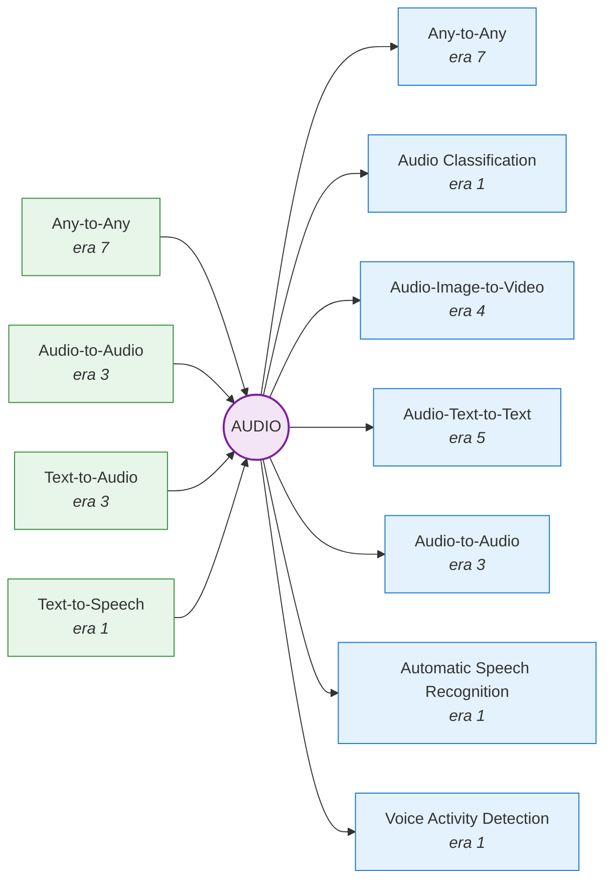

### `DOC` flow lattice

**Producers (1):** `Visual Document Retrieval`

**Consumers (2):** `Document Question Answering`, `Visual Document Retrieval`

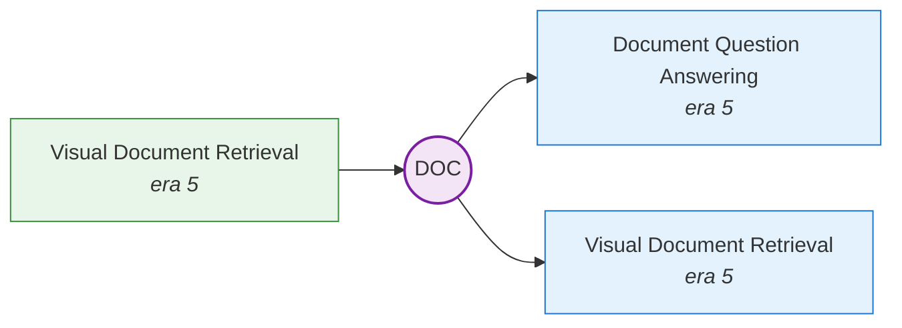

### `EMBEDDING` flow lattice

**Producers (2):** `Feature Extraction`, `Image Feature Extraction`

**Consumers (2):** `Sentence Similarity`, `Sentence Similarity`

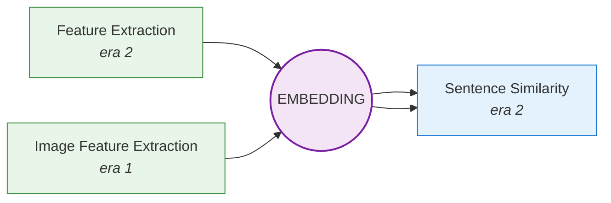

### `GRAPH` flow lattice

**Producers (1):** `Graph Machine Learning`

**Consumers (1):** `Graph Machine Learning`


### `IMAGE` flow lattice

**Producers (5):** `Any-to-Any`, `Image-Text-to-Image`, `Image-to-Image`, `Text-to-Image`, `Unconditional Image Generation`

**Consumers (20):** `Any-to-Any`, `Audio-Image-to-Video`, `Depth Estimation`, `Image Classification`, `Image Feature Extraction`, `Image Segmentation`, `Image-Text-to-Image`, `Image-Text-to-Text`, `Image-Text-to-Video`, `Image-to-3D`, `Image-to-Image`, `Image-to-Text`, `Image-to-Video`, `Keypoint Detection`, `Mask Generation`, `Object Detection`, `Robotics`, `Visual Question Answering`, `Zero-Shot Image Classification`, `Zero-Shot Object Detection`

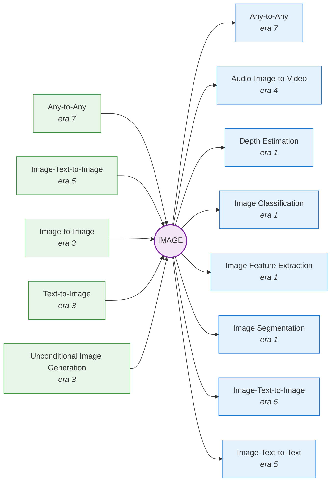
_(graph capped at 8/side; lattice has 5 producers × 20 consumers = 100 potential edges)_

### `TEXT` flow lattice

**Producers (15):** `Any-to-Any`, `Audio-Text-to-Text`, `Automatic Speech Recognition`, `Document Question Answering`, `Fill-Mask`, `Image-Text-to-Text`, `Image-to-Text`, `Question Answering`, `Summarization`, `Table Question Answering`, `Text Generation`, `Text Ranking`, `Translation`, `Video-Text-to-Text`, `Visual Question Answering`

**Consumers (29):** `Any-to-Any`, `Audio-Text-to-Text`, `Document Question Answering`, `Feature Extraction`, `Fill-Mask`, `Image-Text-to-Image`, `Image-Text-to-Text`, `Image-Text-to-Video`, `Question Answering`, `Question Answering`, `Robotics`, `Summarization`, `Table Question Answering`, `Text Classification`, `Text Generation`, `Text Ranking`, `Text Ranking`, `Text-to-3D`, `Text-to-Audio`, `Text-to-Image`, `Text-to-Speech`, `Text-to-Video`, `Token Classification`, `Translation`, `Video-Text-to-Text`, `Visual Document Retrieval`, `Visual Question Answering`, `Zero-Shot Classification`, `Zero-Shot Object Detection`

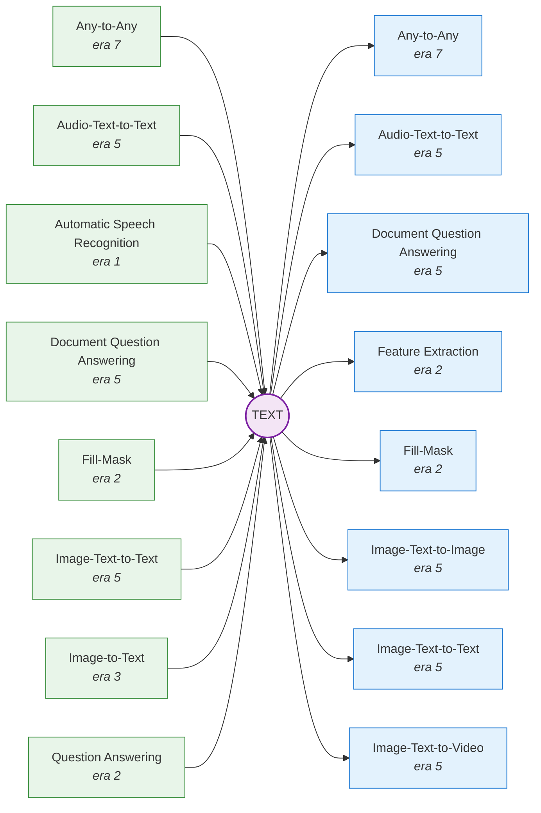
_(graph capped at 8/side; lattice has 15 producers × 29 consumers = 435 potential edges)_

### `TIMESERIES` flow lattice

**Producers (1):** `Time Series Forecasting`

**Consumers (1):** `Time Series Forecasting`

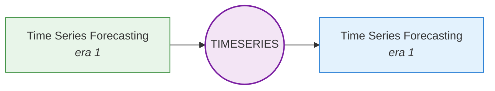

### `VIDEO` flow lattice

**Producers (6):** `Any-to-Any`, `Audio-Image-to-Video`, `Image-Text-to-Video`, `Image-to-Video`, `Text-to-Video`, `Video-to-Video`

**Consumers (4):** `Any-to-Any`, `Video Classification`, `Video-Text-to-Text`, `Video-to-Video`

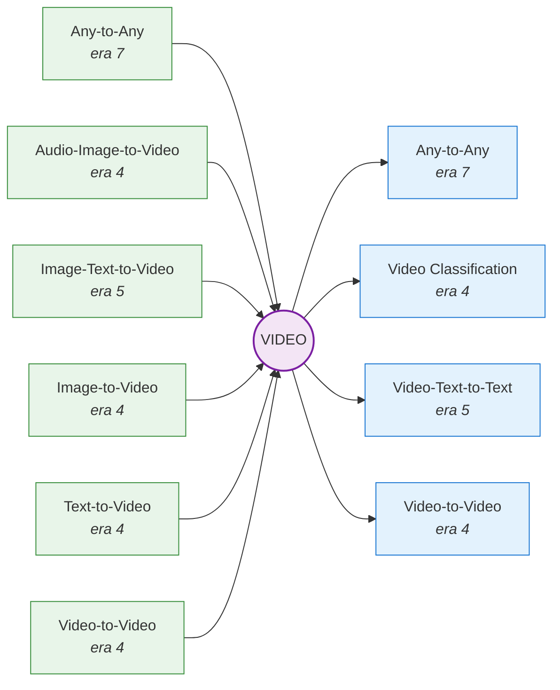

---

## Per-opcode successor predictions

Each opcode below lists its top 5 ranked successors, a Mermaid fan-out diagram, and 2-3 example chain continuations starting from this opcode.

### Multimodal  (10 opcodes)

#### Audio-Image-to-Video
  **outputs:** `VIDEO`

  **Top successors (ranked):**

  | # | Successor | Era | Layer | Match | Score |
  |---|---|---|---|---|---|
  | 1 | `Video-Text-to-Text` | 5 | L3 | `VIDEO` | 1.7 |
  | 2 | `Video Classification` | 4 | L1 | `VIDEO` | 1.0 |
  | 3 | `Any-to-Any` | 7 | L5 | `VIDEO` | 0.9 |
  | 4 | `Video-to-Video` | 4 | L1 | `VIDEO` | 0.8 |

  **Fan-out:**

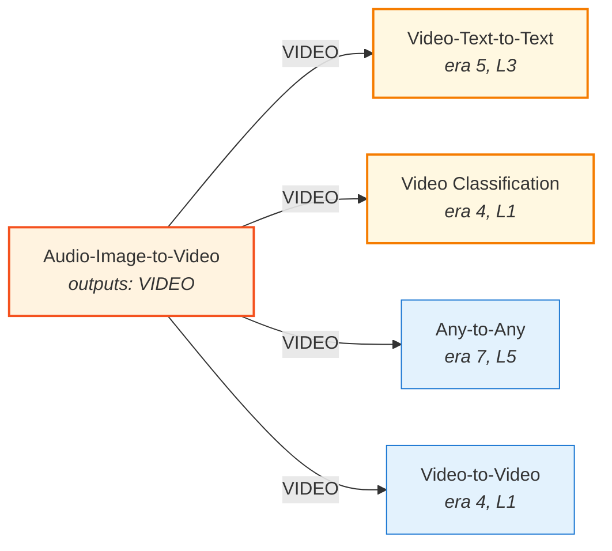

  **Example continuations:**

  - `Audio-Image-to-Video → Video-Text-to-Text → Text-to-Audio`
  - `Audio-Image-to-Video → Video-Text-to-Text → Text-to-Speech`
  - `Audio-Image-to-Video → Video-Text-to-Text → Audio-Text-to-Text → Text-to-Audio`


#### Audio-Text-to-Text
  **outputs:** `TEXT`

  **Top successors (ranked):**

  | # | Successor | Era | Layer | Match | Score |
  |---|---|---|---|---|---|
  | 1 | `Image-Text-to-Video` | 5 | L3 | `TEXT` | 2.1 |
  | 2 | `Text Generation` | 2 | L1 | `TEXT` | 1.9 |
  | 3 | `Translation` | 2 | L1 | `TEXT` | 1.9 |
  | 4 | `Image-Text-to-Image` | 5 | L3 | `TEXT` | 1.7 |
  | 5 | `Visual Document Retrieval` | 5 | L3 | `TEXT` | 1.7 |

  **Fan-out:**

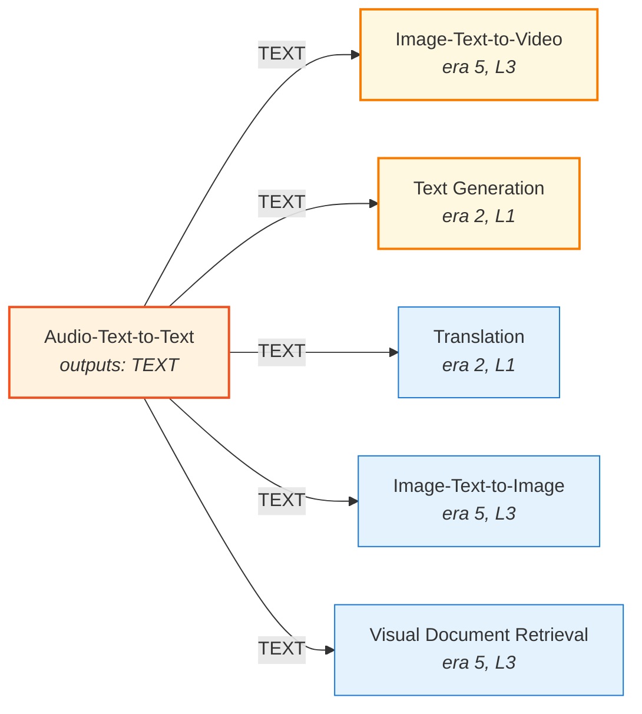

  **Example continuations:**

  - `Audio-Text-to-Text → Image-Text-to-Video`
  - `Audio-Text-to-Text → Document Question Answering → Image-Text-to-Video`
  - `Audio-Text-to-Text → Image-Text-to-Image → Image-Text-to-Video`


#### Document Question Answering
  **outputs:** `TEXT`

  **Top successors (ranked):**

  | # | Successor | Era | Layer | Match | Score |
  |---|---|---|---|---|---|
  | 1 | `Image-Text-to-Image` | 5 | L3 | `TEXT` | 1.7 |
  | 2 | `Image-Text-to-Video` | 5 | L3 | `TEXT` | 1.7 |
  | 3 | `Visual Document Retrieval` | 5 | L3 | `TEXT` | 1.7 |
  | 4 | `Audio-Text-to-Text` | 5 | L3 | `TEXT` | 1.5 |
  | 5 | `Image-Text-to-Text` | 5 | L3 | `TEXT` | 1.5 |

  **Fan-out:**

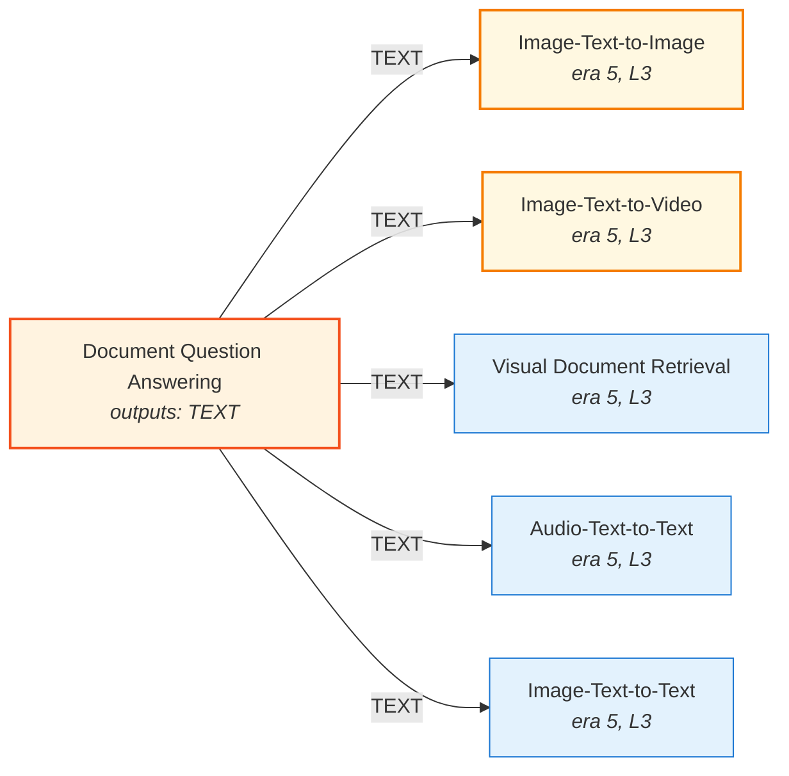

  **Example continuations:**

  - `Document Question Answering → Image-Text-to-Video`
  - `Document Question Answering → Audio-Text-to-Text → Image-Text-to-Video`
  - `Document Question Answering → Image-Text-to-Image → Image-Text-to-Video`


#### Image-Text-to-Image
  **outputs:** `IMAGE`

  **Top successors (ranked):**

  | # | Successor | Era | Layer | Match | Score |
  |---|---|---|---|---|---|
  | 1 | `Image-Text-to-Text` | 5 | L3 | `IMAGE` | 1.7 |
  | 2 | `Image-Text-to-Video` | 5 | L3 | `IMAGE` | 1.7 |
  | 3 | `Audio-Image-to-Video` | 4 | L3 | `IMAGE` | 1.5 |
  | 4 | `Visual Question Answering` | 3 | L3 | `IMAGE` | 1.3 |
  | 5 | `Robotics` | 5 | L6 | `IMAGE` | 1.2 |

  **Fan-out:**

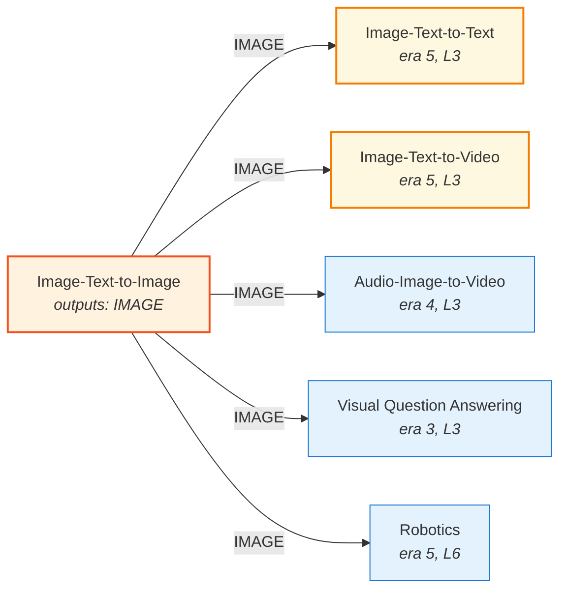

  **Example continuations:**

  - `Image-Text-to-Image → Image-Text-to-Video`
  - `Image-Text-to-Image → Audio-Image-to-Video`
  - `Image-Text-to-Image → Image-Text-to-Text → Image-Text-to-Video`


#### Image-Text-to-Text
  **outputs:** `TEXT`

  **Top successors (ranked):**

  | # | Successor | Era | Layer | Match | Score |
  |---|---|---|---|---|---|
  | 1 | `Image-Text-to-Image` | 5 | L3 | `TEXT` | 1.7 |
  | 2 | `Image-Text-to-Video` | 5 | L3 | `TEXT` | 1.7 |
  | 3 | `Visual Document Retrieval` | 5 | L3 | `TEXT` | 1.7 |
  | 4 | `Audio-Text-to-Text` | 5 | L3 | `TEXT` | 1.5 |
  | 5 | `Document Question Answering` | 5 | L3 | `TEXT` | 1.5 |

  **Fan-out:**

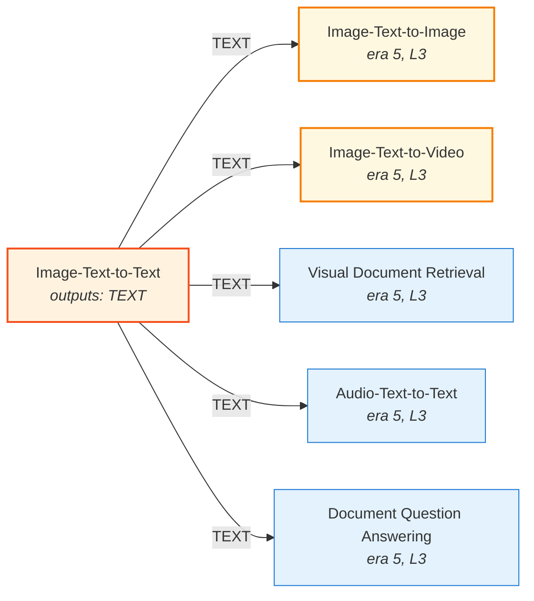

  **Example continuations:**

  - `Image-Text-to-Text → Image-Text-to-Video`
  - `Image-Text-to-Text → Audio-Text-to-Text → Image-Text-to-Video`
  - `Image-Text-to-Text → Document Question Answering → Image-Text-to-Video`


#### Image-Text-to-Video
  **outputs:** `VIDEO`

  **Top successors (ranked):**

  | # | Successor | Era | Layer | Match | Score |
  |---|---|---|---|---|---|
  | 1 | `Video-to-Video` | 4 | L1 | `VIDEO` | 2.3 |
  | 2 | `Video-Text-to-Text` | 5 | L3 | `VIDEO` | 1.7 |
  | 3 | `Video Classification` | 4 | L1 | `VIDEO` | 1.0 |
  | 4 | `Any-to-Any` | 7 | L5 | `VIDEO` | 0.9 |

  **Fan-out:**

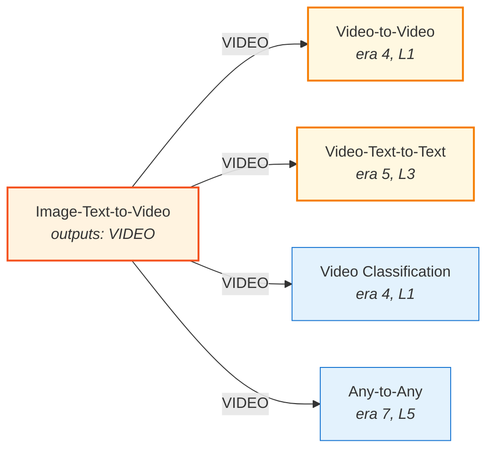

  **Example continuations:**

  - `Image-Text-to-Video → Video-Text-to-Text → Text-to-Audio`
  - `Image-Text-to-Video → Video-Text-to-Text → Text-to-Speech`
  - `Image-Text-to-Video → Video-Text-to-Text → Audio-Text-to-Text → Text-to-Audio`


#### Video-Text-to-Text
  **outputs:** `TEXT`

  **Top successors (ranked):**

  | # | Successor | Era | Layer | Match | Score |
  |---|---|---|---|---|---|
  | 1 | `Image-Text-to-Image` | 5 | L3 | `TEXT` | 1.7 |
  | 2 | `Image-Text-to-Video` | 5 | L3 | `TEXT` | 1.7 |
  | 3 | `Visual Document Retrieval` | 5 | L3 | `TEXT` | 1.7 |
  | 4 | `Audio-Text-to-Text` | 5 | L3 | `TEXT` | 1.5 |
  | 5 | `Document Question Answering` | 5 | L3 | `TEXT` | 1.5 |

  **Fan-out:**


  **Example continuations:**

  - `Video-Text-to-Text → Image-Text-to-Video`
  - `Video-Text-to-Text → Audio-Text-to-Text → Image-Text-to-Video`
  - `Video-Text-to-Text → Document Question Answering → Image-Text-to-Video`


#### Visual Document Retrieval
  **outputs:** `DOC`

  **Top successors (ranked):**

  | # | Successor | Era | Layer | Match | Score |
  |---|---|---|---|---|---|
  | 1 | `Document Question Answering` | 5 | L3 | `DOC` | 1.7 |

  **Fan-out:**


  **Example continuations:**

  - `Visual Document Retrieval → Document Question Answering → Image-Text-to-Video`
  - `Visual Document Retrieval → Document Question Answering → Audio-Text-to-Text → Image-Text-to-Video`
  - `Visual Document Retrieval → Document Question Answering → Image-Text-to-Image → Image-Text-to-Video`


#### Visual Question Answering
  **outputs:** `TEXT`

  **Top successors (ranked):**

  | # | Successor | Era | Layer | Match | Score |
  |---|---|---|---|---|---|
  | 1 | `Image-Text-to-Image` | 5 | L3 | `TEXT` | 1.7 |
  | 2 | `Image-Text-to-Video` | 5 | L3 | `TEXT` | 1.7 |
  | 3 | `Visual Document Retrieval` | 5 | L3 | `TEXT` | 1.7 |
  | 4 | `Audio-Text-to-Text` | 5 | L3 | `TEXT` | 1.5 |
  | 5 | `Document Question Answering` | 5 | L3 | `TEXT` | 1.5 |

  **Fan-out:**

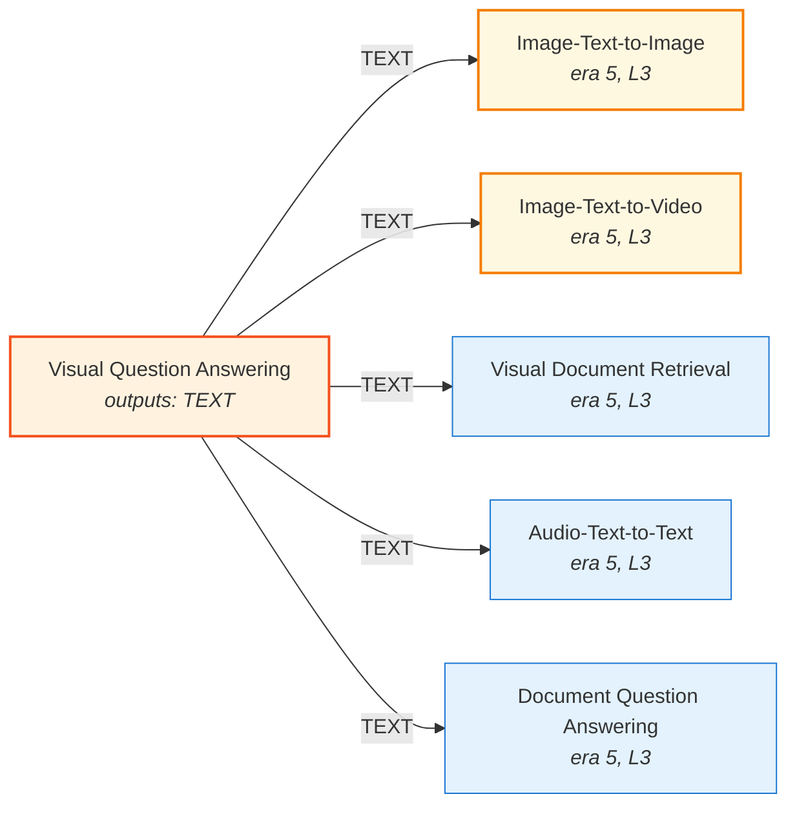

  **Example continuations:**

  - `Visual Question Answering → Image-Text-to-Video`
  - `Visual Question Answering → Audio-Text-to-Text → Image-Text-to-Video`
  - `Visual Question Answering → Document Question Answering → Image-Text-to-Video`


#### Any-to-Any
  **outputs:** `TEXT+IMAGE+AUDIO+VIDEO`

  **Top successors (ranked):**

  | # | Successor | Era | Layer | Match | Score |
  |---|---|---|---|---|---|
  | 1 | `Audio-Text-to-Text` | 5 | L3 | `AUDIO+TEXT` | 1.7 |
  | 2 | `Document Question Answering` | 5 | L3 | `TEXT` | 1.7 |
  | 3 | `Image-Text-to-Image` | 5 | L3 | `IMAGE+TEXT` | 1.7 |
  | 4 | `Image-Text-to-Text` | 5 | L3 | `IMAGE+TEXT` | 1.7 |
  | 5 | `Image-Text-to-Video` | 5 | L3 | `IMAGE+TEXT` | 1.7 |

  **Fan-out:**

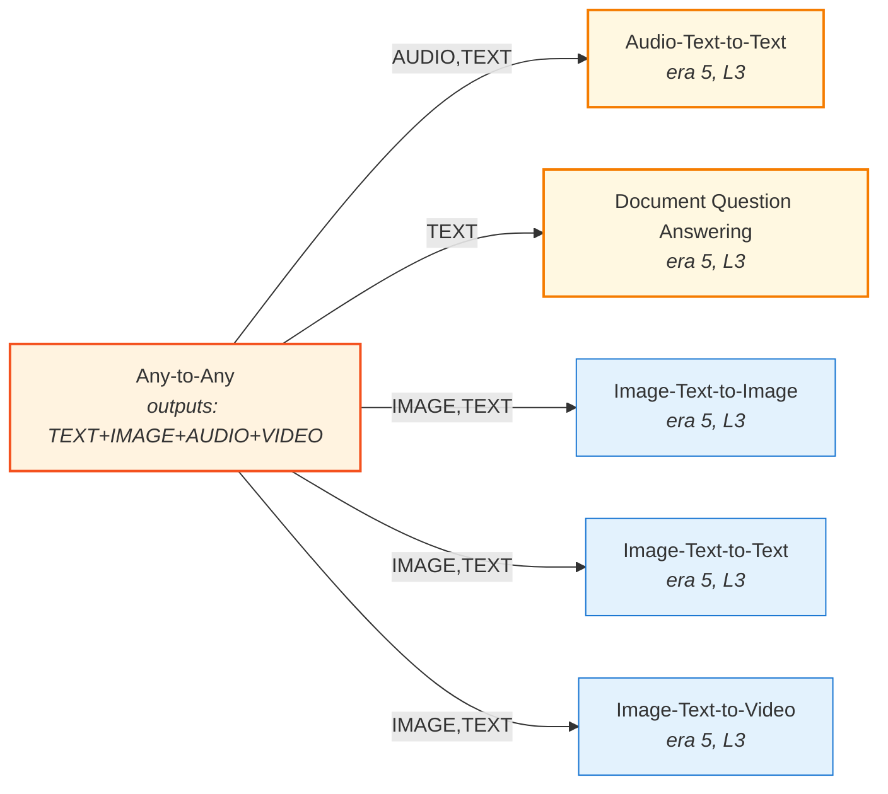

  **Example continuations:**

  - `Any-to-Any → Image-Text-to-Video`
  - `Any-to-Any → Audio-Text-to-Text → Image-Text-to-Video`
  - `Any-to-Any → Document Question Answering → Image-Text-to-Video`


---

### Computer Vision  (19 opcodes)

#### Depth Estimation
  **outputs:** `DEPTH_MAP`

  _No successors found._

#### Image Classification
  **outputs:** `LABEL`

  _Terminal opcode — outputs are not consumed by any other opcode in the taxonomy._

#### Image Segmentation
  **outputs:** `MASK`

  _No successors found._

#### Image-to-Image
  **outputs:** `IMAGE`

  **Top successors (ranked):**

  | # | Successor | Era | Layer | Match | Score |
  |---|---|---|---|---|---|
  | 1 | `Image-Text-to-Text` | 5 | L3 | `IMAGE` | 1.7 |
  | 2 | `Image-Text-to-Video` | 5 | L3 | `IMAGE` | 1.7 |
  | 3 | `Audio-Image-to-Video` | 4 | L3 | `IMAGE` | 1.5 |
  | 4 | `Image-Text-to-Image` | 5 | L3 | `IMAGE` | 1.5 |
  | 5 | `Visual Question Answering` | 3 | L3 | `IMAGE` | 1.3 |

  **Fan-out:**

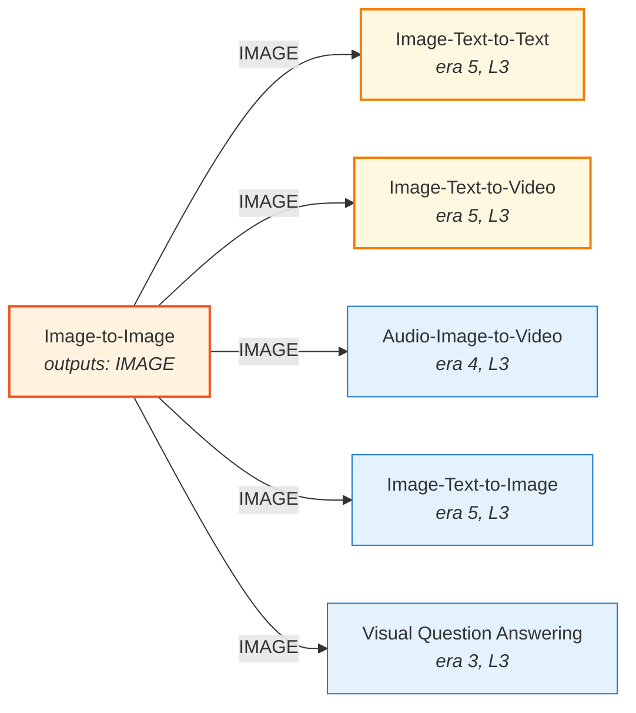

  **Example continuations:**

  - `Image-to-Image → Image-Text-to-Video`
  - `Image-to-Image → Audio-Image-to-Video`
  - `Image-to-Image → Image-Text-to-Image → Image-Text-to-Video`


#### Keypoint Detection
  **outputs:** `KEYPOINTS`

  _No successors found._

#### Mask Generation
  **outputs:** `MASK`

  _No successors found._

#### Object Detection
  **outputs:** `BOXES+LABEL`

  _No successors found._

#### Unconditional Image Generation
  **outputs:** `IMAGE`

  **Top successors (ranked):**

  | # | Successor | Era | Layer | Match | Score |
  |---|---|---|---|---|---|
  | 1 | `Image-Text-to-Text` | 5 | L3 | `IMAGE` | 1.7 |
  | 2 | `Image-Text-to-Video` | 5 | L3 | `IMAGE` | 1.7 |
  | 3 | `Audio-Image-to-Video` | 4 | L3 | `IMAGE` | 1.5 |
  | 4 | `Image-Text-to-Image` | 5 | L3 | `IMAGE` | 1.5 |
  | 5 | `Visual Question Answering` | 3 | L3 | `IMAGE` | 1.3 |

  **Fan-out:**

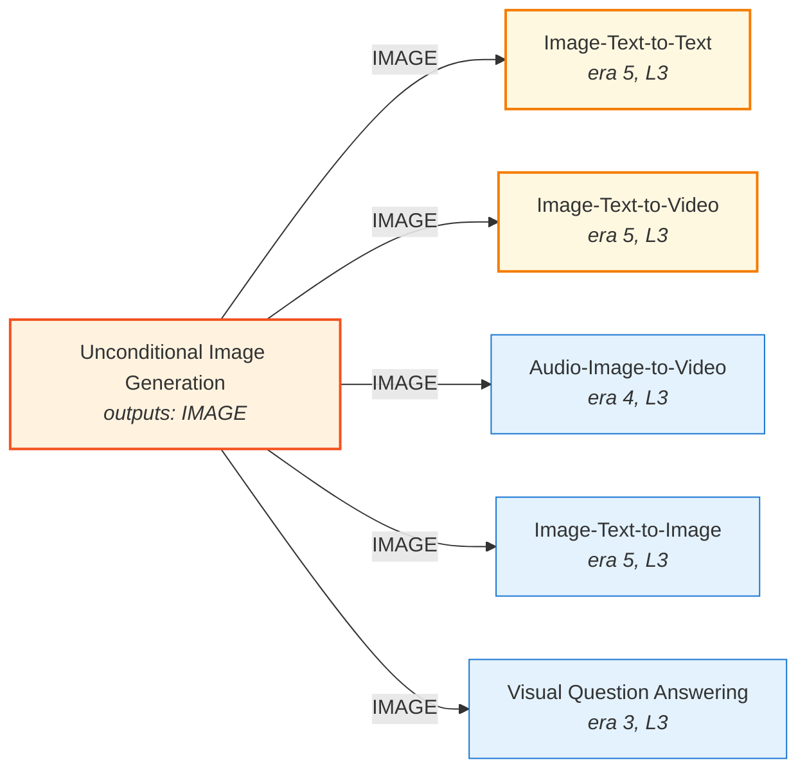

  **Example continuations:**

  - `Unconditional Image Generation → Image-Text-to-Video`
  - `Unconditional Image Generation → Audio-Image-to-Video`
  - `Unconditional Image Generation → Image-Text-to-Image → Image-Text-to-Video`


#### Video Classification
  **outputs:** `LABEL`

  _Terminal opcode — outputs are not consumed by any other opcode in the taxonomy._

#### Video-to-Video
  **outputs:** `VIDEO`

  **Top successors (ranked):**

  | # | Successor | Era | Layer | Match | Score |
  |---|---|---|---|---|---|
  | 1 | `Video-Text-to-Text` | 5 | L3 | `VIDEO` | 1.7 |
  | 2 | `Video Classification` | 4 | L1 | `VIDEO` | 1.0 |
  | 3 | `Any-to-Any` | 7 | L5 | `VIDEO` | 0.9 |

  **Fan-out:**

```mermaid
flowchart LR
    classDef root fill:#fff3e0,stroke:#f4511e,stroke-width:2px
    classDef succ fill:#e3f2fd,stroke:#1976d2
    classDef succHi fill:#fff8e1,stroke:#f57c00,stroke-width:2px
    this_Video_to_Video["Video-to-Video<br/><i>outputs: VIDEO</i>"]
    class this_Video_to_Video root
    s0_Video_Text_to_Text["Video-Text-to-Text<br/><i>era 5, L3</i>"]
    class s0_Video_Text_to_Text succHi
    this_Video_to_Video -->|VIDEO| s0_Video_Text_to_Text
    s1_Video_Classification["Video Classification<br/><i>era 4, L1</i>"]
    class s1_Video_Classification succHi
    this_Video_to_Video -->|VIDEO| s1_Video_Classification
    s2_Any_to_Any["Any-to-Any<br/><i>era 7, L5</i>"]
    class s2_Any_to_Any succ
    this_Video_to_Video -->|VIDEO| s2_Any_to_Any
```

  **Example continuations:**

  - `Video-to-Video → Video-Text-to-Text → Text-to-Audio`
  - `Video-to-Video → Video-Text-to-Text → Text-to-Speech`
  - `Video-to-Video → Video-Text-to-Text → Audio-Text-to-Text → Text-to-Audio`


#### Image-to-3D
  **outputs:** `3D`

  _No successors found._

#### Image-to-Text
  **outputs:** `TEXT`

  **Top successors (ranked):**

  | # | Successor | Era | Layer | Match | Score |
  |---|---|---|---|---|---|
  | 1 | `Image-Text-to-Image` | 5 | L3 | `TEXT` | 1.7 |
  | 2 | `Image-Text-to-Video` | 5 | L3 | `TEXT` | 1.7 |
  | 3 | `Visual Document Retrieval` | 5 | L3 | `TEXT` | 1.7 |
  | 4 | `Audio-Text-to-Text` | 5 | L3 | `TEXT` | 1.5 |
  | 5 | `Document Question Answering` | 5 | L3 | `TEXT` | 1.5 |

  **Fan-out:**

```mermaid
flowchart LR
    classDef root fill:#fff3e0,stroke:#f4511e,stroke-width:2px
    classDef succ fill:#e3f2fd,stroke:#1976d2
    classDef succHi fill:#fff8e1,stroke:#f57c00,stroke-width:2px
    this_Image_to_Text["Image-to-Text<br/><i>outputs: TEXT</i>"]
    class this_Image_to_Text root
    s0_Image_Text_to_Image["Image-Text-to-Image<br/><i>era 5, L3</i>"]
    class s0_Image_Text_to_Image succHi
    this_Image_to_Text -->|TEXT| s0_Image_Text_to_Image
    s1_Image_Text_to_Video["Image-Text-to-Video<br/><i>era 5, L3</i>"]
    class s1_Image_Text_to_Video succHi
    this_Image_to_Text -->|TEXT| s1_Image_Text_to_Video
    s2_Visual_Document_Retrieval["Visual Document Retrieval<br/><i>era 5, L3</i>"]
    class s2_Visual_Document_Retrieval succ
    this_Image_to_Text -->|TEXT| s2_Visual_Document_Retrieval
    s3_Audio_Text_to_Text["Audio-Text-to-Text<br/><i>era 5, L3</i>"]
    class s3_Audio_Text_to_Text succ
    this_Image_to_Text -->|TEXT| s3_Audio_Text_to_Text
    s4_Document_Question_Answering["Document Question Answering<br/><i>era 5, L3</i>"]
    class s4_Document_Question_Answering succ
    this_Image_to_Text -->|TEXT| s4_Document_Question_Answering
```

  **Example continuations:**

  - `Image-to-Text → Image-Text-to-Video`
  - `Image-to-Text → Audio-Text-to-Text → Image-Text-to-Video`
  - `Image-to-Text → Document Question Answering → Image-Text-to-Video`


#### Image-to-Video
  **outputs:** `VIDEO`

  **Top successors (ranked):**

  | # | Successor | Era | Layer | Match | Score |
  |---|---|---|---|---|---|
  | 1 | `Video-Text-to-Text` | 5 | L3 | `VIDEO` | 1.7 |
  | 2 | `Video-to-Video` | 4 | L1 | `VIDEO` | 1.2 |
  | 3 | `Video Classification` | 4 | L1 | `VIDEO` | 1.0 |
  | 4 | `Any-to-Any` | 7 | L5 | `VIDEO` | 0.9 |

  **Fan-out:**

```mermaid
flowchart LR
    classDef root fill:#fff3e0,stroke:#f4511e,stroke-width:2px
    classDef succ fill:#e3f2fd,stroke:#1976d2
    classDef succHi fill:#fff8e1,stroke:#f57c00,stroke-width:2px
    this_Image_to_Video["Image-to-Video<br/><i>outputs: VIDEO</i>"]
    class this_Image_to_Video root
    s0_Video_Text_to_Text["Video-Text-to-Text<br/><i>era 5, L3</i>"]
    class s0_Video_Text_to_Text succHi
    this_Image_to_Video -->|VIDEO| s0_Video_Text_to_Text
    s1_Video_to_Video["Video-to-Video<br/><i>era 4, L1</i>"]
    class s1_Video_to_Video succHi
    this_Image_to_Video -->|VIDEO| s1_Video_to_Video
    s2_Video_Classification["Video Classification<br/><i>era 4, L1</i>"]
    class s2_Video_Classification succ
    this_Image_to_Video -->|VIDEO| s2_Video_Classification
    s3_Any_to_Any["Any-to-Any<br/><i>era 7, L5</i>"]
    class s3_Any_to_Any succ
    this_Image_to_Video -->|VIDEO| s3_Any_to_Any
```

  **Example continuations:**

  - `Image-to-Video → Video-Text-to-Text → Text-to-Audio`
  - `Image-to-Video → Video-Text-to-Text → Text-to-Speech`
  - `Image-to-Video → Video-Text-to-Text → Audio-Text-to-Text → Text-to-Audio`


#### Text-to-3D
  **outputs:** `3D`

  _No successors found._

#### Text-to-Image
  **outputs:** `IMAGE`

  **Top successors (ranked):**

  | # | Successor | Era | Layer | Match | Score |
  |---|---|---|---|---|---|
  | 1 | `Image-Text-to-Text` | 5 | L3 | `IMAGE` | 1.7 |
  | 2 | `Image-Text-to-Video` | 5 | L3 | `IMAGE` | 1.7 |
  | 3 | `Audio-Image-to-Video` | 4 | L3 | `IMAGE` | 1.5 |
  | 4 | `Image-Text-to-Image` | 5 | L3 | `IMAGE` | 1.5 |
  | 5 | `Visual Question Answering` | 3 | L3 | `IMAGE` | 1.3 |

  **Fan-out:**

```mermaid
flowchart LR
    classDef root fill:#fff3e0,stroke:#f4511e,stroke-width:2px
    classDef succ fill:#e3f2fd,stroke:#1976d2
    classDef succHi fill:#fff8e1,stroke:#f57c00,stroke-width:2px
    this_Text_to_Image["Text-to-Image<br/><i>outputs: IMAGE</i>"]
    class this_Text_to_Image root
    s0_Image_Text_to_Text["Image-Text-to-Text<br/><i>era 5, L3</i>"]
    class s0_Image_Text_to_Text succHi
    this_Text_to_Image -->|IMAGE| s0_Image_Text_to_Text
    s1_Image_Text_to_Video["Image-Text-to-Video<br/><i>era 5, L3</i>"]
    class s1_Image_Text_to_Video succHi
    this_Text_to_Image -->|IMAGE| s1_Image_Text_to_Video
    s2_Audio_Image_to_Video["Audio-Image-to-Video<br/><i>era 4, L3</i>"]
    class s2_Audio_Image_to_Video succ
    this_Text_to_Image -->|IMAGE| s2_Audio_Image_to_Video
    s3_Image_Text_to_Image["Image-Text-to-Image<br/><i>era 5, L3</i>"]
    class s3_Image_Text_to_Image succ
    this_Text_to_Image -->|IMAGE| s3_Image_Text_to_Image
    s4_Visual_Question_Answering["Visual Question Answering<br/><i>era 3, L3</i>"]
    class s4_Visual_Question_Answering succ
    this_Text_to_Image -->|IMAGE| s4_Visual_Question_Answering
```

  **Example continuations:**

  - `Text-to-Image → Image-Text-to-Video`
  - `Text-to-Image → Audio-Image-to-Video`
  - `Text-to-Image → Image-Text-to-Image → Image-Text-to-Video`


#### Text-to-Video
  **outputs:** `VIDEO`

  **Top successors (ranked):**

  | # | Successor | Era | Layer | Match | Score |
  |---|---|---|---|---|---|
  | 1 | `Video-to-Video` | 4 | L1 | `VIDEO` | 2.3 |
  | 2 | `Video-Text-to-Text` | 5 | L3 | `VIDEO` | 1.7 |
  | 3 | `Video Classification` | 4 | L1 | `VIDEO` | 1.0 |
  | 4 | `Any-to-Any` | 7 | L5 | `VIDEO` | 0.9 |

  **Fan-out:**

```mermaid
flowchart LR
    classDef root fill:#fff3e0,stroke:#f4511e,stroke-width:2px
    classDef succ fill:#e3f2fd,stroke:#1976d2
    classDef succHi fill:#fff8e1,stroke:#f57c00,stroke-width:2px
    this_Text_to_Video["Text-to-Video<br/><i>outputs: VIDEO</i>"]
    class this_Text_to_Video root
    s0_Video_to_Video["Video-to-Video<br/><i>era 4, L1</i>"]
    class s0_Video_to_Video succHi
    this_Text_to_Video -->|VIDEO| s0_Video_to_Video
    s1_Video_Text_to_Text["Video-Text-to-Text<br/><i>era 5, L3</i>"]
    class s1_Video_Text_to_Text succHi
    this_Text_to_Video -->|VIDEO| s1_Video_Text_to_Text
    s2_Video_Classification["Video Classification<br/><i>era 4, L1</i>"]
    class s2_Video_Classification succ
    this_Text_to_Video -->|VIDEO| s2_Video_Classification
    s3_Any_to_Any["Any-to-Any<br/><i>era 7, L5</i>"]
    class s3_Any_to_Any succ
    this_Text_to_Video -->|VIDEO| s3_Any_to_Any
```

  **Example continuations:**

  - `Text-to-Video → Video-Text-to-Text → Text-to-Audio`
  - `Text-to-Video → Video-Text-to-Text → Text-to-Speech`
  - `Text-to-Video → Video-Text-to-Text → Audio-Text-to-Text → Text-to-Audio`


#### Zero-Shot Image Classification
  **outputs:** `LABEL`

  _Terminal opcode — outputs are not consumed by any other opcode in the taxonomy._

#### Zero-Shot Object Detection
  **outputs:** `BOXES`

  _No successors found._

#### Image Feature Extraction
  **outputs:** `EMBEDDING`

  **Top successors (ranked):**

  | # | Successor | Era | Layer | Match | Score |
  |---|---|---|---|---|---|
  | 1 | `Sentence Similarity` | 2 | L3 | `EMBEDDING` | 1.1 |

  **Fan-out:**

```mermaid
flowchart LR
    classDef root fill:#fff3e0,stroke:#f4511e,stroke-width:2px
    classDef succ fill:#e3f2fd,stroke:#1976d2
    classDef succHi fill:#fff8e1,stroke:#f57c00,stroke-width:2px
    this_Image_Feature_Extraction["Image Feature Extraction<br/><i>outputs: EMBEDDING</i>"]
    class this_Image_Feature_Extraction root
    s0_Sentence_Similarity["Sentence Similarity<br/><i>era 2, L3</i>"]
    class s0_Sentence_Similarity succHi
    this_Image_Feature_Extraction -->|EMBEDDING| s0_Sentence_Similarity
```


---

### Natural Language Processing  (12 opcodes)

#### Fill-Mask
  **outputs:** `TEXT`

  **Top successors (ranked):**

  | # | Successor | Era | Layer | Match | Score |
  |---|---|---|---|---|---|
  | 1 | `Image-Text-to-Image` | 5 | L3 | `TEXT` | 1.7 |
  | 2 | `Image-Text-to-Video` | 5 | L3 | `TEXT` | 1.7 |
  | 3 | `Visual Document Retrieval` | 5 | L3 | `TEXT` | 1.7 |
  | 4 | `Audio-Text-to-Text` | 5 | L3 | `TEXT` | 1.5 |
  | 5 | `Document Question Answering` | 5 | L3 | `TEXT` | 1.5 |

  **Fan-out:**

```mermaid
flowchart LR
    classDef root fill:#fff3e0,stroke:#f4511e,stroke-width:2px
    classDef succ fill:#e3f2fd,stroke:#1976d2
    classDef succHi fill:#fff8e1,stroke:#f57c00,stroke-width:2px
    this_Fill_Mask["Fill-Mask<br/><i>outputs: TEXT</i>"]
    class this_Fill_Mask root
    s0_Image_Text_to_Image["Image-Text-to-Image<br/><i>era 5, L3</i>"]
    class s0_Image_Text_to_Image succHi
    this_Fill_Mask -->|TEXT| s0_Image_Text_to_Image
    s1_Image_Text_to_Video["Image-Text-to-Video<br/><i>era 5, L3</i>"]
    class s1_Image_Text_to_Video succHi
    this_Fill_Mask -->|TEXT| s1_Image_Text_to_Video
    s2_Visual_Document_Retrieval["Visual Document Retrieval<br/><i>era 5, L3</i>"]
    class s2_Visual_Document_Retrieval succ
    this_Fill_Mask -->|TEXT| s2_Visual_Document_Retrieval
    s3_Audio_Text_to_Text["Audio-Text-to-Text<br/><i>era 5, L3</i>"]
    class s3_Audio_Text_to_Text succ
    this_Fill_Mask -->|TEXT| s3_Audio_Text_to_Text
    s4_Document_Question_Answering["Document Question Answering<br/><i>era 5, L3</i>"]
    class s4_Document_Question_Answering succ
    this_Fill_Mask -->|TEXT| s4_Document_Question_Answering
```

  **Example continuations:**

  - `Fill-Mask → Image-Text-to-Video`
  - `Fill-Mask → Audio-Text-to-Text → Image-Text-to-Video`
  - `Fill-Mask → Document Question Answering → Image-Text-to-Video`


#### Summarization
  **outputs:** `TEXT`

  **Top successors (ranked):**

  | # | Successor | Era | Layer | Match | Score |
  |---|---|---|---|---|---|
  | 1 | `Image-Text-to-Image` | 5 | L3 | `TEXT` | 1.7 |
  | 2 | `Image-Text-to-Video` | 5 | L3 | `TEXT` | 1.7 |
  | 3 | `Visual Document Retrieval` | 5 | L3 | `TEXT` | 1.7 |
  | 4 | `Audio-Text-to-Text` | 5 | L3 | `TEXT` | 1.5 |
  | 5 | `Document Question Answering` | 5 | L3 | `TEXT` | 1.5 |

  **Fan-out:**

```mermaid
flowchart LR
    classDef root fill:#fff3e0,stroke:#f4511e,stroke-width:2px
    classDef succ fill:#e3f2fd,stroke:#1976d2
    classDef succHi fill:#fff8e1,stroke:#f57c00,stroke-width:2px
    this_Summarization["Summarization<br/><i>outputs: TEXT</i>"]
    class this_Summarization root
    s0_Image_Text_to_Image["Image-Text-to-Image<br/><i>era 5, L3</i>"]
    class s0_Image_Text_to_Image succHi
    this_Summarization -->|TEXT| s0_Image_Text_to_Image
    s1_Image_Text_to_Video["Image-Text-to-Video<br/><i>era 5, L3</i>"]
    class s1_Image_Text_to_Video succHi
    this_Summarization -->|TEXT| s1_Image_Text_to_Video
    s2_Visual_Document_Retrieval["Visual Document Retrieval<br/><i>era 5, L3</i>"]
    class s2_Visual_Document_Retrieval succ
    this_Summarization -->|TEXT| s2_Visual_Document_Retrieval
    s3_Audio_Text_to_Text["Audio-Text-to-Text<br/><i>era 5, L3</i>"]
    class s3_Audio_Text_to_Text succ
    this_Summarization -->|TEXT| s3_Audio_Text_to_Text
    s4_Document_Question_Answering["Document Question Answering<br/><i>era 5, L3</i>"]
    class s4_Document_Question_Answering succ
    this_Summarization -->|TEXT| s4_Document_Question_Answering
```

  **Example continuations:**

  - `Summarization → Image-Text-to-Video`
  - `Summarization → Audio-Text-to-Text → Image-Text-to-Video`
  - `Summarization → Document Question Answering → Image-Text-to-Video`


#### Text Classification
  **outputs:** `LABEL`

  _Terminal opcode — outputs are not consumed by any other opcode in the taxonomy._

#### Text Generation
  **outputs:** `TEXT`

  **Top successors (ranked):**

  | # | Successor | Era | Layer | Match | Score |
  |---|---|---|---|---|---|
  | 1 | `Image-Text-to-Video` | 5 | L3 | `TEXT` | 2.1 |
  | 2 | `Text-to-Speech` | 1 | L2 | `TEXT` | 1.9 |
  | 3 | `Image-Text-to-Image` | 5 | L3 | `TEXT` | 1.7 |
  | 4 | `Visual Document Retrieval` | 5 | L3 | `TEXT` | 1.7 |
  | 5 | `Audio-Text-to-Text` | 5 | L3 | `TEXT` | 1.5 |

  **Fan-out:**

```mermaid
flowchart LR
    classDef root fill:#fff3e0,stroke:#f4511e,stroke-width:2px
    classDef succ fill:#e3f2fd,stroke:#1976d2
    classDef succHi fill:#fff8e1,stroke:#f57c00,stroke-width:2px
    this_Text_Generation["Text Generation<br/><i>outputs: TEXT</i>"]
    class this_Text_Generation root
    s0_Image_Text_to_Video["Image-Text-to-Video<br/><i>era 5, L3</i>"]
    class s0_Image_Text_to_Video succHi
    this_Text_Generation -->|TEXT| s0_Image_Text_to_Video
    s1_Text_to_Speech["Text-to-Speech<br/><i>era 1, L2</i>"]
    class s1_Text_to_Speech succHi
    this_Text_Generation -->|TEXT| s1_Text_to_Speech
    s2_Image_Text_to_Image["Image-Text-to-Image<br/><i>era 5, L3</i>"]
    class s2_Image_Text_to_Image succ
    this_Text_Generation -->|TEXT| s2_Image_Text_to_Image
    s3_Visual_Document_Retrieval["Visual Document Retrieval<br/><i>era 5, L3</i>"]
    class s3_Visual_Document_Retrieval succ
    this_Text_Generation -->|TEXT| s3_Visual_Document_Retrieval
    s4_Audio_Text_to_Text["Audio-Text-to-Text<br/><i>era 5, L3</i>"]
    class s4_Audio_Text_to_Text succ
    this_Text_Generation -->|TEXT| s4_Audio_Text_to_Text
```

  **Example continuations:**

  - `Text Generation → Image-Text-to-Video`
  - `Text Generation → Audio-Text-to-Text → Image-Text-to-Video`
  - `Text Generation → Document Question Answering → Image-Text-to-Video`


#### Token Classification
  **outputs:** `LABEL_SEQ`

  _Terminal opcode — outputs are not consumed by any other opcode in the taxonomy._

#### Translation
  **outputs:** `TEXT`

  **Top successors (ranked):**

  | # | Successor | Era | Layer | Match | Score |
  |---|---|---|---|---|---|
  | 1 | `Image-Text-to-Video` | 5 | L3 | `TEXT` | 2.1 |
  | 2 | `Text-to-Speech` | 1 | L2 | `TEXT` | 1.9 |
  | 3 | `Image-Text-to-Image` | 5 | L3 | `TEXT` | 1.7 |
  | 4 | `Visual Document Retrieval` | 5 | L3 | `TEXT` | 1.7 |
  | 5 | `Audio-Text-to-Text` | 5 | L3 | `TEXT` | 1.5 |

  **Fan-out:**

```mermaid
flowchart LR
    classDef root fill:#fff3e0,stroke:#f4511e,stroke-width:2px
    classDef succ fill:#e3f2fd,stroke:#1976d2
    classDef succHi fill:#fff8e1,stroke:#f57c00,stroke-width:2px
    this_Translation["Translation<br/><i>outputs: TEXT</i>"]
    class this_Translation root
    s0_Image_Text_to_Video["Image-Text-to-Video<br/><i>era 5, L3</i>"]
    class s0_Image_Text_to_Video succHi
    this_Translation -->|TEXT| s0_Image_Text_to_Video
    s1_Text_to_Speech["Text-to-Speech<br/><i>era 1, L2</i>"]
    class s1_Text_to_Speech succHi
    this_Translation -->|TEXT| s1_Text_to_Speech
    s2_Image_Text_to_Image["Image-Text-to-Image<br/><i>era 5, L3</i>"]
    class s2_Image_Text_to_Image succ
    this_Translation -->|TEXT| s2_Image_Text_to_Image
    s3_Visual_Document_Retrieval["Visual Document Retrieval<br/><i>era 5, L3</i>"]
    class s3_Visual_Document_Retrieval succ
    this_Translation -->|TEXT| s3_Visual_Document_Retrieval
    s4_Audio_Text_to_Text["Audio-Text-to-Text<br/><i>era 5, L3</i>"]
    class s4_Audio_Text_to_Text succ
    this_Translation -->|TEXT| s4_Audio_Text_to_Text
```

  **Example continuations:**

  - `Translation → Image-Text-to-Video`
  - `Translation → Audio-Text-to-Text → Image-Text-to-Video`
  - `Translation → Document Question Answering → Image-Text-to-Video`


#### Question Answering
  **outputs:** `TEXT`

  **Top successors (ranked):**

  | # | Successor | Era | Layer | Match | Score |
  |---|---|---|---|---|---|
  | 1 | `Image-Text-to-Image` | 5 | L3 | `TEXT` | 1.7 |
  | 2 | `Image-Text-to-Video` | 5 | L3 | `TEXT` | 1.7 |
  | 3 | `Visual Document Retrieval` | 5 | L3 | `TEXT` | 1.7 |
  | 4 | `Audio-Text-to-Text` | 5 | L3 | `TEXT` | 1.5 |
  | 5 | `Document Question Answering` | 5 | L3 | `TEXT` | 1.5 |

  **Fan-out:**

```mermaid
flowchart LR
    classDef root fill:#fff3e0,stroke:#f4511e,stroke-width:2px
    classDef succ fill:#e3f2fd,stroke:#1976d2
    classDef succHi fill:#fff8e1,stroke:#f57c00,stroke-width:2px
    this_Question_Answering["Question Answering<br/><i>outputs: TEXT</i>"]
    class this_Question_Answering root
    s0_Image_Text_to_Image["Image-Text-to-Image<br/><i>era 5, L3</i>"]
    class s0_Image_Text_to_Image succHi
    this_Question_Answering -->|TEXT| s0_Image_Text_to_Image
    s1_Image_Text_to_Video["Image-Text-to-Video<br/><i>era 5, L3</i>"]
    class s1_Image_Text_to_Video succHi
    this_Question_Answering -->|TEXT| s1_Image_Text_to_Video
    s2_Visual_Document_Retrieval["Visual Document Retrieval<br/><i>era 5, L3</i>"]
    class s2_Visual_Document_Retrieval succ
    this_Question_Answering -->|TEXT| s2_Visual_Document_Retrieval
    s3_Audio_Text_to_Text["Audio-Text-to-Text<br/><i>era 5, L3</i>"]
    class s3_Audio_Text_to_Text succ
    this_Question_Answering -->|TEXT| s3_Audio_Text_to_Text
    s4_Document_Question_Answering["Document Question Answering<br/><i>era 5, L3</i>"]
    class s4_Document_Question_Answering succ
    this_Question_Answering -->|TEXT| s4_Document_Question_Answering
```

  **Example continuations:**

  - `Question Answering → Image-Text-to-Video`
  - `Question Answering → Audio-Text-to-Text → Image-Text-to-Video`
  - `Question Answering → Document Question Answering → Image-Text-to-Video`


#### Sentence Similarity
  **outputs:** `SCALAR`

  _Terminal opcode — outputs are not consumed by any other opcode in the taxonomy._

#### Table Question Answering
  **outputs:** `TEXT`

  **Top successors (ranked):**

  | # | Successor | Era | Layer | Match | Score |
  |---|---|---|---|---|---|
  | 1 | `Image-Text-to-Image` | 5 | L3 | `TEXT` | 1.7 |
  | 2 | `Image-Text-to-Video` | 5 | L3 | `TEXT` | 1.7 |
  | 3 | `Visual Document Retrieval` | 5 | L3 | `TEXT` | 1.7 |
  | 4 | `Audio-Text-to-Text` | 5 | L3 | `TEXT` | 1.5 |
  | 5 | `Document Question Answering` | 5 | L3 | `TEXT` | 1.5 |

  **Fan-out:**

```mermaid
flowchart LR
    classDef root fill:#fff3e0,stroke:#f4511e,stroke-width:2px
    classDef succ fill:#e3f2fd,stroke:#1976d2
    classDef succHi fill:#fff8e1,stroke:#f57c00,stroke-width:2px
    this_Table_Question_Answering["Table Question Answering<br/><i>outputs: TEXT</i>"]
    class this_Table_Question_Answering root
    s0_Image_Text_to_Image["Image-Text-to-Image<br/><i>era 5, L3</i>"]
    class s0_Image_Text_to_Image succHi
    this_Table_Question_Answering -->|TEXT| s0_Image_Text_to_Image
    s1_Image_Text_to_Video["Image-Text-to-Video<br/><i>era 5, L3</i>"]
    class s1_Image_Text_to_Video succHi
    this_Table_Question_Answering -->|TEXT| s1_Image_Text_to_Video
    s2_Visual_Document_Retrieval["Visual Document Retrieval<br/><i>era 5, L3</i>"]
    class s2_Visual_Document_Retrieval succ
    this_Table_Question_Answering -->|TEXT| s2_Visual_Document_Retrieval
    s3_Audio_Text_to_Text["Audio-Text-to-Text<br/><i>era 5, L3</i>"]
    class s3_Audio_Text_to_Text succ
    this_Table_Question_Answering -->|TEXT| s3_Audio_Text_to_Text
    s4_Document_Question_Answering["Document Question Answering<br/><i>era 5, L3</i>"]
    class s4_Document_Question_Answering succ
    this_Table_Question_Answering -->|TEXT| s4_Document_Question_Answering
```

  **Example continuations:**

  - `Table Question Answering → Image-Text-to-Video`
  - `Table Question Answering → Audio-Text-to-Text → Image-Text-to-Video`
  - `Table Question Answering → Document Question Answering → Image-Text-to-Video`


#### Text Ranking
  **outputs:** `TEXT`

  **Top successors (ranked):**

  | # | Successor | Era | Layer | Match | Score |
  |---|---|---|---|---|---|
  | 1 | `Image-Text-to-Image` | 5 | L3 | `TEXT` | 1.7 |
  | 2 | `Image-Text-to-Video` | 5 | L3 | `TEXT` | 1.7 |
  | 3 | `Visual Document Retrieval` | 5 | L3 | `TEXT` | 1.7 |
  | 4 | `Audio-Text-to-Text` | 5 | L3 | `TEXT` | 1.5 |
  | 5 | `Document Question Answering` | 5 | L3 | `TEXT` | 1.5 |

  **Fan-out:**

```mermaid
flowchart LR
    classDef root fill:#fff3e0,stroke:#f4511e,stroke-width:2px
    classDef succ fill:#e3f2fd,stroke:#1976d2
    classDef succHi fill:#fff8e1,stroke:#f57c00,stroke-width:2px
    this_Text_Ranking["Text Ranking<br/><i>outputs: TEXT</i>"]
    class this_Text_Ranking root
    s0_Image_Text_to_Image["Image-Text-to-Image<br/><i>era 5, L3</i>"]
    class s0_Image_Text_to_Image succHi
    this_Text_Ranking -->|TEXT| s0_Image_Text_to_Image
    s1_Image_Text_to_Video["Image-Text-to-Video<br/><i>era 5, L3</i>"]
    class s1_Image_Text_to_Video succHi
    this_Text_Ranking -->|TEXT| s1_Image_Text_to_Video
    s2_Visual_Document_Retrieval["Visual Document Retrieval<br/><i>era 5, L3</i>"]
    class s2_Visual_Document_Retrieval succ
    this_Text_Ranking -->|TEXT| s2_Visual_Document_Retrieval
    s3_Audio_Text_to_Text["Audio-Text-to-Text<br/><i>era 5, L3</i>"]
    class s3_Audio_Text_to_Text succ
    this_Text_Ranking -->|TEXT| s3_Audio_Text_to_Text
    s4_Document_Question_Answering["Document Question Answering<br/><i>era 5, L3</i>"]
    class s4_Document_Question_Answering succ
    this_Text_Ranking -->|TEXT| s4_Document_Question_Answering
```

  **Example continuations:**

  - `Text Ranking → Image-Text-to-Video`
  - `Text Ranking → Audio-Text-to-Text → Image-Text-to-Video`
  - `Text Ranking → Document Question Answering → Image-Text-to-Video`


#### Zero-Shot Classification
  **outputs:** `LABEL`

  _Terminal opcode — outputs are not consumed by any other opcode in the taxonomy._

#### Feature Extraction
  **outputs:** `EMBEDDING`

  **Top successors (ranked):**

  | # | Successor | Era | Layer | Match | Score |
  |---|---|---|---|---|---|
  | 1 | `Sentence Similarity` | 2 | L3 | `EMBEDDING` | 1.1 |

  **Fan-out:**

```mermaid
flowchart LR
    classDef root fill:#fff3e0,stroke:#f4511e,stroke-width:2px
    classDef succ fill:#e3f2fd,stroke:#1976d2
    classDef succHi fill:#fff8e1,stroke:#f57c00,stroke-width:2px
    this_Feature_Extraction["Feature Extraction<br/><i>outputs: EMBEDDING</i>"]
    class this_Feature_Extraction root
    s0_Sentence_Similarity["Sentence Similarity<br/><i>era 2, L3</i>"]
    class s0_Sentence_Similarity succHi
    this_Feature_Extraction -->|EMBEDDING| s0_Sentence_Similarity
```


---

### Audio  (6 opcodes)

#### Audio Classification
  **outputs:** `LABEL`

  _Terminal opcode — outputs are not consumed by any other opcode in the taxonomy._

#### Audio-to-Audio
  **outputs:** `AUDIO`

  **Top successors (ranked):**

  | # | Successor | Era | Layer | Match | Score |
  |---|---|---|---|---|---|
  | 1 | `Audio-Text-to-Text` | 5 | L3 | `AUDIO` | 1.7 |
  | 2 | `Audio-Image-to-Video` | 4 | L3 | `AUDIO` | 1.5 |
  | 3 | `Any-to-Any` | 7 | L5 | `AUDIO` | 0.9 |
  | 4 | `Audio Classification` | 1 | L1 | `AUDIO` | 0.4 |
  | 5 | `Automatic Speech Recognition` | 1 | L2 | `AUDIO` | 0.4 |

  **Fan-out:**

```mermaid
flowchart LR
    classDef root fill:#fff3e0,stroke:#f4511e,stroke-width:2px
    classDef succ fill:#e3f2fd,stroke:#1976d2
    classDef succHi fill:#fff8e1,stroke:#f57c00,stroke-width:2px
    this_Audio_to_Audio["Audio-to-Audio<br/><i>outputs: AUDIO</i>"]
    class this_Audio_to_Audio root
    s0_Audio_Text_to_Text["Audio-Text-to-Text<br/><i>era 5, L3</i>"]
    class s0_Audio_Text_to_Text succHi
    this_Audio_to_Audio -->|AUDIO| s0_Audio_Text_to_Text
    s1_Audio_Image_to_Video["Audio-Image-to-Video<br/><i>era 4, L3</i>"]
    class s1_Audio_Image_to_Video succHi
    this_Audio_to_Audio -->|AUDIO| s1_Audio_Image_to_Video
    s2_Any_to_Any["Any-to-Any<br/><i>era 7, L5</i>"]
    class s2_Any_to_Any succ
    this_Audio_to_Audio -->|AUDIO| s2_Any_to_Any
    s3_Audio_Classification["Audio Classification<br/><i>era 1, L1</i>"]
    class s3_Audio_Classification succ
    this_Audio_to_Audio -->|AUDIO| s3_Audio_Classification
    s4_Automatic_Speech_Recognition["Automatic Speech Recognition<br/><i>era 1, L2</i>"]
    class s4_Automatic_Speech_Recognition succ
    this_Audio_to_Audio -->|AUDIO| s4_Automatic_Speech_Recognition
```

  **Example continuations:**

  - `Audio-to-Audio → Audio-Image-to-Video`
  - `Audio-to-Audio → Audio-Text-to-Text → Image-Text-to-Video`
  - `Audio-to-Audio → Audio-Text-to-Text → Document Question Answering → Image-Text-to-Video`


#### Voice Activity Detection
  **outputs:** `LABEL_SEQ`

  _Terminal opcode — outputs are not consumed by any other opcode in the taxonomy._

#### Automatic Speech Recognition
  **outputs:** `TEXT`

  **Top successors (ranked):**

  | # | Successor | Era | Layer | Match | Score |
  |---|---|---|---|---|---|
  | 1 | `Image-Text-to-Video` | 5 | L3 | `TEXT` | 2.1 |
  | 2 | `Text Generation` | 2 | L1 | `TEXT` | 1.9 |
  | 3 | `Translation` | 2 | L1 | `TEXT` | 1.9 |
  | 4 | `Image-Text-to-Image` | 5 | L3 | `TEXT` | 1.7 |
  | 5 | `Visual Document Retrieval` | 5 | L3 | `TEXT` | 1.7 |

  **Fan-out:**

```mermaid
flowchart LR
    classDef root fill:#fff3e0,stroke:#f4511e,stroke-width:2px
    classDef succ fill:#e3f2fd,stroke:#1976d2
    classDef succHi fill:#fff8e1,stroke:#f57c00,stroke-width:2px
    this_Automatic_Speech_Recognition["Automatic Speech Recognition<br/><i>outputs: TEXT</i>"]
    class this_Automatic_Speech_Recognition root
    s0_Image_Text_to_Video["Image-Text-to-Video<br/><i>era 5, L3</i>"]
    class s0_Image_Text_to_Video succHi
    this_Automatic_Speech_Recognition -->|TEXT| s0_Image_Text_to_Video
    s1_Text_Generation["Text Generation<br/><i>era 2, L1</i>"]
    class s1_Text_Generation succHi
    this_Automatic_Speech_Recognition -->|TEXT| s1_Text_Generation
    s2_Translation["Translation<br/><i>era 2, L1</i>"]
    class s2_Translation succ
    this_Automatic_Speech_Recognition -->|TEXT| s2_Translation
    s3_Image_Text_to_Image["Image-Text-to-Image<br/><i>era 5, L3</i>"]
    class s3_Image_Text_to_Image succ
    this_Automatic_Speech_Recognition -->|TEXT| s3_Image_Text_to_Image
    s4_Visual_Document_Retrieval["Visual Document Retrieval<br/><i>era 5, L3</i>"]
    class s4_Visual_Document_Retrieval succ
    this_Automatic_Speech_Recognition -->|TEXT| s4_Visual_Document_Retrieval
```

  **Example continuations:**

  - `Automatic Speech Recognition → Image-Text-to-Video`
  - `Automatic Speech Recognition → Audio-Text-to-Text → Image-Text-to-Video`
  - `Automatic Speech Recognition → Document Question Answering → Image-Text-to-Video`


#### Text-to-Audio
  **outputs:** `AUDIO`

  **Top successors (ranked):**

  | # | Successor | Era | Layer | Match | Score |
  |---|---|---|---|---|---|
  | 1 | `Audio-Text-to-Text` | 5 | L3 | `AUDIO` | 1.7 |
  | 2 | `Audio-Image-to-Video` | 4 | L3 | `AUDIO` | 1.5 |
  | 3 | `Any-to-Any` | 7 | L5 | `AUDIO` | 0.9 |
  | 4 | `Audio-to-Audio` | 3 | L1 | `AUDIO` | 0.6 |
  | 5 | `Audio Classification` | 1 | L1 | `AUDIO` | 0.4 |

  **Fan-out:**

```mermaid
flowchart LR
    classDef root fill:#fff3e0,stroke:#f4511e,stroke-width:2px
    classDef succ fill:#e3f2fd,stroke:#1976d2
    classDef succHi fill:#fff8e1,stroke:#f57c00,stroke-width:2px
    this_Text_to_Audio["Text-to-Audio<br/><i>outputs: AUDIO</i>"]
    class this_Text_to_Audio root
    s0_Audio_Text_to_Text["Audio-Text-to-Text<br/><i>era 5, L3</i>"]
    class s0_Audio_Text_to_Text succHi
    this_Text_to_Audio -->|AUDIO| s0_Audio_Text_to_Text
    s1_Audio_Image_to_Video["Audio-Image-to-Video<br/><i>era 4, L3</i>"]
    class s1_Audio_Image_to_Video succHi
    this_Text_to_Audio -->|AUDIO| s1_Audio_Image_to_Video
    s2_Any_to_Any["Any-to-Any<br/><i>era 7, L5</i>"]
    class s2_Any_to_Any succ
    this_Text_to_Audio -->|AUDIO| s2_Any_to_Any
    s3_Audio_to_Audio["Audio-to-Audio<br/><i>era 3, L1</i>"]
    class s3_Audio_to_Audio succ
    this_Text_to_Audio -->|AUDIO| s3_Audio_to_Audio
    s4_Audio_Classification["Audio Classification<br/><i>era 1, L1</i>"]
    class s4_Audio_Classification succ
    this_Text_to_Audio -->|AUDIO| s4_Audio_Classification
```

  **Example continuations:**

  - `Text-to-Audio → Audio-Image-to-Video`
  - `Text-to-Audio → Audio-Text-to-Text → Image-Text-to-Video`
  - `Text-to-Audio → Audio-Text-to-Text → Document Question Answering → Image-Text-to-Video`


#### Text-to-Speech
  **outputs:** `AUDIO`

  **Top successors (ranked):**

  | # | Successor | Era | Layer | Match | Score |
  |---|---|---|---|---|---|
  | 1 | `Audio-Image-to-Video` | 4 | L3 | `AUDIO` | 1.9 |
  | 2 | `Audio-Text-to-Text` | 5 | L3 | `AUDIO` | 1.7 |
  | 3 | `Any-to-Any` | 7 | L5 | `AUDIO` | 0.9 |
  | 4 | `Audio-to-Audio` | 3 | L1 | `AUDIO` | 0.6 |
  | 5 | `Audio Classification` | 1 | L1 | `AUDIO` | 0.4 |

  **Fan-out:**

```mermaid
flowchart LR
    classDef root fill:#fff3e0,stroke:#f4511e,stroke-width:2px
    classDef succ fill:#e3f2fd,stroke:#1976d2
    classDef succHi fill:#fff8e1,stroke:#f57c00,stroke-width:2px
    this_Text_to_Speech["Text-to-Speech<br/><i>outputs: AUDIO</i>"]
    class this_Text_to_Speech root
    s0_Audio_Image_to_Video["Audio-Image-to-Video<br/><i>era 4, L3</i>"]
    class s0_Audio_Image_to_Video succHi
    this_Text_to_Speech -->|AUDIO| s0_Audio_Image_to_Video
    s1_Audio_Text_to_Text["Audio-Text-to-Text<br/><i>era 5, L3</i>"]
    class s1_Audio_Text_to_Text succHi
    this_Text_to_Speech -->|AUDIO| s1_Audio_Text_to_Text
    s2_Any_to_Any["Any-to-Any<br/><i>era 7, L5</i>"]
    class s2_Any_to_Any succ
    this_Text_to_Speech -->|AUDIO| s2_Any_to_Any
    s3_Audio_to_Audio["Audio-to-Audio<br/><i>era 3, L1</i>"]
    class s3_Audio_to_Audio succ
    this_Text_to_Speech -->|AUDIO| s3_Audio_to_Audio
    s4_Audio_Classification["Audio Classification<br/><i>era 1, L1</i>"]
    class s4_Audio_Classification succ
    this_Text_to_Speech -->|AUDIO| s4_Audio_Classification
```

  **Example continuations:**

  - `Text-to-Speech → Audio-Image-to-Video`
  - `Text-to-Speech → Audio-Text-to-Text → Image-Text-to-Video`
  - `Text-to-Speech → Audio-Text-to-Text → Document Question Answering → Image-Text-to-Video`


---

### Tabular  (3 opcodes)

#### Tabular Classification
  **outputs:** `LABEL`

  _Terminal opcode — outputs are not consumed by any other opcode in the taxonomy._

#### Tabular Regression
  **outputs:** `SCALAR`

  _Terminal opcode — outputs are not consumed by any other opcode in the taxonomy._

#### Time Series Forecasting
  **outputs:** `TIMESERIES`

  _No successors found._

---

### Reinforcement Learning  (2 opcodes)

#### Reinforcement Learning
  **outputs:** `ACTION`

  _Terminal opcode — outputs are not consumed by any other opcode in the taxonomy._

#### Robotics
  **outputs:** `ACTION`

  _Terminal opcode — outputs are not consumed by any other opcode in the taxonomy._

---

### Other  (1 opcodes)

#### Graph Machine Learning
  **outputs:** `GRAPH+LABEL`

  _No successors found._

---

---

## Reading the cross-DAG in practice

When a user's session reaches the `✓ done` terminal of an opcode's GUI
flow, three behaviors are reasonable:

1. **Stop and save.** Most common. The user has what they came for.
2. **Continue into a top-ranked successor.** The UI offers the top 3
   successors as a "what's next" panel under the output. One click
   loads that opcode's GUI with the previous output pre-bound.
3. **Branch into a workflow template.** If the current `done` state
   matches the entry of a workflow_templates row (one whose first
   step.opcode equals this opcode's task), surface the template name
   as a "deeper workflow" suggestion.

The Phase-5 decomposer uses this same successor map: when the user
types "make a YouTube avatar", the decomposer searches outgoing edges
from `Video-Text-to-Text` (the entry opcode for "consume YT video"),
follows them through Text Generation → Text-to-Speech → Audio-Image-
to-Video, and produces the avatar workflow template seeded with the
top-ranked model candidate per step.

## How to extend

- Add an opcode → it shows up here automatically next regen.
- Tune the ranking heuristic → edit `ranked_successors` in
  `dag_cross_generator.py`. The 7 factors above are the surface area.
- Add a "blocklist" for specific opcode pairs that match by type but
  are semantically nonsense → add to `BLOCKED_PAIRS` (not yet defined,
  but the hook is here when needed).
