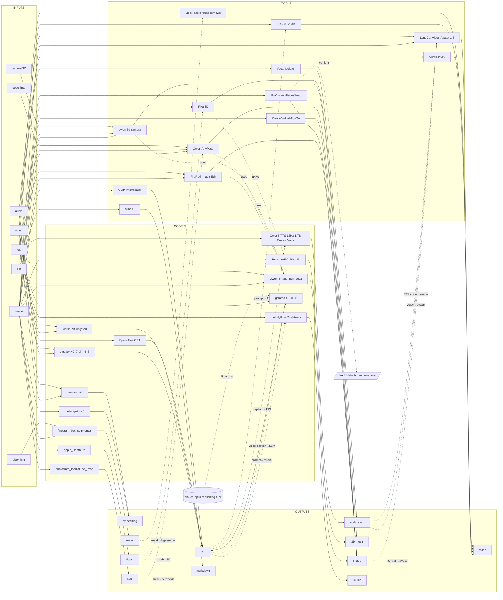

# /home/tom/models — DAG

Generated 2026-05-26. Classification source: prior scan (13 tools, 12 models, 1 lora, 1 class).

## Mermaid



## Example composed pipelines the DAG enables

| Goal | Path |
|---|---|
| Photo → talking avatar | IMG → T_LCV ← AUD (or M_UV synth) → O_VID |
| Photo → 3D asset | IMG → M_DEPTH → O_DEPTH → T_PX3D → O_3D |
| Pose-controlled edit | IMG → M_POSE → O_KPTS → T_QPOSE → O_IMG |
| Auto-prompt → T2V | IMG → T_CLIP → O_TXT → T_LTX → O_VID |
| Song splitter | AUD → T_VOX → O_AUD (stems) → M_MFLOW (remix) → O_MUS |
| Doc ingest → LLM | PDF → T_MINE → O_MD → M_GEMMA → O_TXT |
| Green-screen comp | VID → T_CKEY → O_VID → T_VBG → O_VID |
| Video → dense captions w/ timestamps | VID → M_MAR → O_TXT (scene/event spans) |
| Video → short description | VID → M_STG → O_TXT |
| Text → custom-voice speech | TXT → M_QTTS → O_AUD |
| LLM answer → spoken reply | TXT → M_GEMMA → O_TXT → M_QTTS → O_AUD |
| Video → narrated explainer | VID → M_MAR → O_TXT → M_GEMMA → O_TXT → M_QTTS → O_AUD → T_LCV (+ IMG) → O_VID |
| Find a moment in a video | VID + TXT (query) → M_MAR → O_TXT (start/end span) |

## Render

```
dot -Tsvg /home/tom/models/DAG.dot -o /home/tom/models/DAG.svg
dot -Tpng /home/tom/models/DAG.dot -o /home/tom/models/DAG.png
```
