# Passes DAG — by imported filetype

Auto-generated by `studio/passes/filetype_dag.py`. Don't hand-edit.

## Overview

- 20 registered passes
- 27 recognized file extensions

## Per-filetype plan

| Ext | Import-time (heavy stuff that runs once) | Lazy (on render) |
|-----|-------------------------------------------|------------------|
| `.avi` | `content_hash`, `vid_thumb`, `waveform`, `video_caption`, `stems` | _(none)_ |
| `.avif` | `thumb`, `content_hash`, `mask`, `nobg`, `depth`, `caption`, `tags`, `embedding`, `layered_svg` | `keypoints` |
| `.bmp` | `thumb`, `content_hash`, `mask`, `nobg`, `depth`, `caption`, `tags`, `embedding`, `layered_svg` | `keypoints`, `normal_map`, `albedo` |
| `.exr` | `layered_svg` | `normal_map`, `albedo` |
| `.fbx` | `content_hash`, `mesh_thumb`, `bbox_volume` | _(none)_ |
| `.flac` | `content_hash`, `waveform`, `stems`, `speech_to_text` | _(none)_ |
| `.glb` | `content_hash`, `mesh_thumb`, `bbox_volume` | _(none)_ |
| `.gltf` | `content_hash`, `mesh_thumb`, `bbox_volume` | _(none)_ |
| `.jpeg` | `thumb`, `content_hash`, `mask`, `nobg`, `depth`, `caption`, `tags`, `embedding`, `layered_svg` | `keypoints`, `normal_map`, `albedo` |
| `.jpg` | `thumb`, `content_hash`, `mask`, `nobg`, `depth`, `caption`, `tags`, `embedding`, `layered_svg` | `keypoints`, `normal_map`, `albedo` |
| `.m4a` | `content_hash`, `waveform`, `stems`, `speech_to_text` | _(none)_ |
| `.m4v` | `content_hash`, `vid_thumb`, `waveform`, `video_caption`, `stems` | _(none)_ |
| `.mkv` | `content_hash`, `vid_thumb`, `waveform`, `video_caption`, `stems` | _(none)_ |
| `.mov` | `content_hash`, `vid_thumb`, `waveform`, `video_caption`, `stems` | _(none)_ |
| `.mp3` | `content_hash`, `waveform`, `stems`, `speech_to_text` | _(none)_ |
| `.mp4` | `content_hash`, `vid_thumb`, `waveform`, `video_caption`, `stems` | _(none)_ |
| `.obj` | `content_hash`, `mesh_thumb`, `bbox_volume` | _(none)_ |
| `.ogg` | `content_hash`, `waveform`, `stems`, `speech_to_text` | _(none)_ |
| `.pdf` | `content_hash`, `pdf_extract_text` | _(none)_ |
| `.ply` | `content_hash`, `mesh_thumb`, `bbox_volume` | _(none)_ |
| `.png` | `thumb`, `content_hash`, `mask`, `nobg`, `depth`, `caption`, `tags`, `embedding`, `layered_svg` | `keypoints`, `normal_map`, `albedo` |
| `.stl` | `content_hash`, `mesh_thumb`, `bbox_volume` | _(none)_ |
| `.tga` | `layered_svg` | `normal_map`, `albedo` |
| `.tiff` | `thumb`, `content_hash`, `mask`, `nobg`, `depth`, `caption`, `tags`, `embedding`, `layered_svg` | `keypoints` |
| `.wav` | `content_hash`, `waveform`, `stems`, `speech_to_text` | _(none)_ |
| `.webm` | `content_hash`, `vid_thumb`, `waveform`, `video_caption`, `stems` | _(none)_ |
| `.webp` | `thumb`, `content_hash`, `mask`, `nobg`, `depth`, `caption`, `tags`, `embedding`, `layered_svg` | `keypoints`, `normal_map`, `albedo` |

## Pass details

| Pass | Cost | Stage | Inputs → Output | Description |
|------|------|-------|----------------|-------------|
| **thumb** | LIGHT | import | IMG → IMG | Generates a 256-px thumb via PIL LANCZOS resize. |
| **content_hash** | LIGHT | import | IMG → TXT | Identity fingerprint — drives dedup + index lookups. |
| **mask** | HEAVY | import | IMG → MASK | rembg (U²-Net / BiRefNet) with GrabCut fallback. |
| **nobg** | HEAVY | import | IMG → IMG | Source image × mask = subject-only RGBA image. |
| **depth** | HEAVY | import | IMG → DEPTH | Pseudo-depth via edge+luminance gradient (PIL); stub for DepthPro / Depth-Anything-v2. |
| **caption** | HEAVY | import | IMG → TXT | CLIP-Interrogator wrapper, with cc-tiny fallback. |
| **tags** | MEDIUM | import | IMG → TXT | Uses process.py's KEYWORDS list; falls back to cc-tiny. |
| **keypoints** | HEAVY | lazy | IMG → KPTS | MediaPipe Pose wrapper (stub — install mediapipe). |
| **embedding** | HEAVY | import | IMG → EMB | metaclip-2-mt5 wrapper (stub — install transformers). |
| **normal_map** | MEDIUM | lazy | IMG → IMG | PIL gradient → normal-space conversion. For PBR shading. |
| **albedo** | MEDIUM | lazy | IMG → IMG | Stub for Intrinsic decomposition. |
| **layered_svg** | LIGHT | import | IMG → SVG | The main self-describing output. See passes.svg_layers. |
| **vid_thumb** | LIGHT | import | VID → IMG | ffmpeg -ss <dur/2> -frames:v 1 → png. |
| **waveform** | LIGHT | import | VID+AUD → TXT | Reuses yt_cutter.extract_waveform; no numpy needed. |
| **video_caption** | HEAVY | import | VID → TXT | SpaceTimeGPT wrapper (stub). |
| **stems** | HEAVY | import | AUD → AUD | demucs if installed, else ffmpeg karaoke fallback. Existing utility lives at media/.tools/separate.py. |
| **speech_to_text** | HEAVY | import | AUD → TXT | ultravox wrapper (stub). |
| **mesh_thumb** | MEDIUM | import | 3D → IMG | Blender / Open3D headless render (stub). |
| **bbox_volume** | LIGHT | import | 3D → TXT | trimesh.load + .bounds. |
| **pdf_extract_text** | HEAVY | import | PDF → MD | MinerU wrapper (stub). |

## Mermaid graph

```mermaid
flowchart LR
  F_AVI[".avi"]
  F_AVI[".avi"] ==>|import| P_CONTENT_HASH["Content hash<br/><i>LIGHT</i>"]
  F_AVI[".avi"] ==>|import| P_VID_THUMB["Video thumbnail<br/><i>LIGHT</i>"]
  F_AVI[".avi"] ==>|import| P_WAVEFORM["Waveform<br/><i>LIGHT</i>"]
  F_AVI[".avi"] ==>|import| P_VIDEO_CAPTION["Video caption<br/><i>HEAVY</i>"]
  F_AVI[".avi"] ==>|import| P_STEMS["Stem separation<br/><i>HEAVY</i>"]
  F_AVIF[".avif"]
  F_AVIF[".avif"] ==>|import| P_THUMB["Thumbnail<br/><i>LIGHT</i>"]
  F_AVIF[".avif"] ==>|import| P_CONTENT_HASH["Content hash<br/><i>LIGHT</i>"]
  F_AVIF[".avif"] ==>|import| P_MASK["Background mask<br/><i>HEAVY</i>"]
  F_AVIF[".avif"] ==>|import| P_NOBG["Background-removed<br/><i>HEAVY</i>"]
  F_AVIF[".avif"] ==>|import| P_DEPTH["Depth map<br/><i>HEAVY</i>"]
  F_AVIF[".avif"] ==>|import| P_CAPTION["Caption<br/><i>HEAVY</i>"]
  F_AVIF[".avif"] ==>|import| P_TAGS["Tags<br/><i>MEDIUM</i>"]
  F_AVIF[".avif"] ==>|import| P_EMBEDDING["Embedding<br/><i>HEAVY</i>"]
  F_AVIF[".avif"] ==>|import| P_LAYERED_SVG["Layered SVG<br/><i>LIGHT</i>"]
  F_AVIF[".avif"] -. lazy .-> P_KEYPOINTS["Pose keypoints<br/><i>HEAVY</i>"]
  F_BMP[".bmp"]
  F_BMP[".bmp"] ==>|import| P_THUMB["Thumbnail<br/><i>LIGHT</i>"]
  F_BMP[".bmp"] ==>|import| P_CONTENT_HASH["Content hash<br/><i>LIGHT</i>"]
  F_BMP[".bmp"] ==>|import| P_MASK["Background mask<br/><i>HEAVY</i>"]
  F_BMP[".bmp"] ==>|import| P_NOBG["Background-removed<br/><i>HEAVY</i>"]
  F_BMP[".bmp"] ==>|import| P_DEPTH["Depth map<br/><i>HEAVY</i>"]
  F_BMP[".bmp"] ==>|import| P_CAPTION["Caption<br/><i>HEAVY</i>"]
  F_BMP[".bmp"] ==>|import| P_TAGS["Tags<br/><i>MEDIUM</i>"]
  F_BMP[".bmp"] ==>|import| P_EMBEDDING["Embedding<br/><i>HEAVY</i>"]
  F_BMP[".bmp"] ==>|import| P_LAYERED_SVG["Layered SVG<br/><i>LIGHT</i>"]
  F_BMP[".bmp"] -. lazy .-> P_KEYPOINTS["Pose keypoints<br/><i>HEAVY</i>"]
  F_BMP[".bmp"] -. lazy .-> P_NORMAL_MAP["Normal map<br/><i>MEDIUM</i>"]
  F_BMP[".bmp"] -. lazy .-> P_ALBEDO["Albedo extract<br/><i>MEDIUM</i>"]
  F_EXR[".exr"]
  F_EXR[".exr"] ==>|import| P_LAYERED_SVG["Layered SVG<br/><i>LIGHT</i>"]
  F_EXR[".exr"] -. lazy .-> P_NORMAL_MAP["Normal map<br/><i>MEDIUM</i>"]
  F_EXR[".exr"] -. lazy .-> P_ALBEDO["Albedo extract<br/><i>MEDIUM</i>"]
  F_FBX[".fbx"]
  F_FBX[".fbx"] ==>|import| P_CONTENT_HASH["Content hash<br/><i>LIGHT</i>"]
  F_FBX[".fbx"] ==>|import| P_MESH_THUMB["Mesh preview<br/><i>MEDIUM</i>"]
  F_FBX[".fbx"] ==>|import| P_BBOX_VOLUME["Bounding volume<br/><i>LIGHT</i>"]
  F_FLAC[".flac"]
  F_FLAC[".flac"] ==>|import| P_CONTENT_HASH["Content hash<br/><i>LIGHT</i>"]
  F_FLAC[".flac"] ==>|import| P_WAVEFORM["Waveform<br/><i>LIGHT</i>"]
  F_FLAC[".flac"] ==>|import| P_STEMS["Stem separation<br/><i>HEAVY</i>"]
  F_FLAC[".flac"] ==>|import| P_SPEECH_TO_TEXT["Speech → text<br/><i>HEAVY</i>"]
  F_GLB[".glb"]
  F_GLB[".glb"] ==>|import| P_CONTENT_HASH["Content hash<br/><i>LIGHT</i>"]
  F_GLB[".glb"] ==>|import| P_MESH_THUMB["Mesh preview<br/><i>MEDIUM</i>"]
  F_GLB[".glb"] ==>|import| P_BBOX_VOLUME["Bounding volume<br/><i>LIGHT</i>"]
  F_GLTF[".gltf"]
  F_GLTF[".gltf"] ==>|import| P_CONTENT_HASH["Content hash<br/><i>LIGHT</i>"]
  F_GLTF[".gltf"] ==>|import| P_MESH_THUMB["Mesh preview<br/><i>MEDIUM</i>"]
  F_GLTF[".gltf"] ==>|import| P_BBOX_VOLUME["Bounding volume<br/><i>LIGHT</i>"]
  F_JPEG[".jpeg"]
  F_JPEG[".jpeg"] ==>|import| P_THUMB["Thumbnail<br/><i>LIGHT</i>"]
  F_JPEG[".jpeg"] ==>|import| P_CONTENT_HASH["Content hash<br/><i>LIGHT</i>"]
  F_JPEG[".jpeg"] ==>|import| P_MASK["Background mask<br/><i>HEAVY</i>"]
  F_JPEG[".jpeg"] ==>|import| P_NOBG["Background-removed<br/><i>HEAVY</i>"]
  F_JPEG[".jpeg"] ==>|import| P_DEPTH["Depth map<br/><i>HEAVY</i>"]
  F_JPEG[".jpeg"] ==>|import| P_CAPTION["Caption<br/><i>HEAVY</i>"]
  F_JPEG[".jpeg"] ==>|import| P_TAGS["Tags<br/><i>MEDIUM</i>"]
  F_JPEG[".jpeg"] ==>|import| P_EMBEDDING["Embedding<br/><i>HEAVY</i>"]
  F_JPEG[".jpeg"] ==>|import| P_LAYERED_SVG["Layered SVG<br/><i>LIGHT</i>"]
  F_JPEG[".jpeg"] -. lazy .-> P_KEYPOINTS["Pose keypoints<br/><i>HEAVY</i>"]
  F_JPEG[".jpeg"] -. lazy .-> P_NORMAL_MAP["Normal map<br/><i>MEDIUM</i>"]
  F_JPEG[".jpeg"] -. lazy .-> P_ALBEDO["Albedo extract<br/><i>MEDIUM</i>"]
  F_JPG[".jpg"]
  F_JPG[".jpg"] ==>|import| P_THUMB["Thumbnail<br/><i>LIGHT</i>"]
  F_JPG[".jpg"] ==>|import| P_CONTENT_HASH["Content hash<br/><i>LIGHT</i>"]
  F_JPG[".jpg"] ==>|import| P_MASK["Background mask<br/><i>HEAVY</i>"]
  F_JPG[".jpg"] ==>|import| P_NOBG["Background-removed<br/><i>HEAVY</i>"]
  F_JPG[".jpg"] ==>|import| P_DEPTH["Depth map<br/><i>HEAVY</i>"]
  F_JPG[".jpg"] ==>|import| P_CAPTION["Caption<br/><i>HEAVY</i>"]
  F_JPG[".jpg"] ==>|import| P_TAGS["Tags<br/><i>MEDIUM</i>"]
  F_JPG[".jpg"] ==>|import| P_EMBEDDING["Embedding<br/><i>HEAVY</i>"]
  F_JPG[".jpg"] ==>|import| P_LAYERED_SVG["Layered SVG<br/><i>LIGHT</i>"]
  F_JPG[".jpg"] -. lazy .-> P_KEYPOINTS["Pose keypoints<br/><i>HEAVY</i>"]
  F_JPG[".jpg"] -. lazy .-> P_NORMAL_MAP["Normal map<br/><i>MEDIUM</i>"]
  F_JPG[".jpg"] -. lazy .-> P_ALBEDO["Albedo extract<br/><i>MEDIUM</i>"]
  F_M4A[".m4a"]
  F_M4A[".m4a"] ==>|import| P_CONTENT_HASH["Content hash<br/><i>LIGHT</i>"]
  F_M4A[".m4a"] ==>|import| P_WAVEFORM["Waveform<br/><i>LIGHT</i>"]
  F_M4A[".m4a"] ==>|import| P_STEMS["Stem separation<br/><i>HEAVY</i>"]
  F_M4A[".m4a"] ==>|import| P_SPEECH_TO_TEXT["Speech → text<br/><i>HEAVY</i>"]
  F_M4V[".m4v"]
  F_M4V[".m4v"] ==>|import| P_CONTENT_HASH["Content hash<br/><i>LIGHT</i>"]
  F_M4V[".m4v"] ==>|import| P_VID_THUMB["Video thumbnail<br/><i>LIGHT</i>"]
  F_M4V[".m4v"] ==>|import| P_WAVEFORM["Waveform<br/><i>LIGHT</i>"]
  F_M4V[".m4v"] ==>|import| P_VIDEO_CAPTION["Video caption<br/><i>HEAVY</i>"]
  F_M4V[".m4v"] ==>|import| P_STEMS["Stem separation<br/><i>HEAVY</i>"]
  F_MKV[".mkv"]
  F_MKV[".mkv"] ==>|import| P_CONTENT_HASH["Content hash<br/><i>LIGHT</i>"]
  F_MKV[".mkv"] ==>|import| P_VID_THUMB["Video thumbnail<br/><i>LIGHT</i>"]
  F_MKV[".mkv"] ==>|import| P_WAVEFORM["Waveform<br/><i>LIGHT</i>"]
  F_MKV[".mkv"] ==>|import| P_VIDEO_CAPTION["Video caption<br/><i>HEAVY</i>"]
  F_MKV[".mkv"] ==>|import| P_STEMS["Stem separation<br/><i>HEAVY</i>"]
  F_MOV[".mov"]
  F_MOV[".mov"] ==>|import| P_CONTENT_HASH["Content hash<br/><i>LIGHT</i>"]
  F_MOV[".mov"] ==>|import| P_VID_THUMB["Video thumbnail<br/><i>LIGHT</i>"]
  F_MOV[".mov"] ==>|import| P_WAVEFORM["Waveform<br/><i>LIGHT</i>"]
  F_MOV[".mov"] ==>|import| P_VIDEO_CAPTION["Video caption<br/><i>HEAVY</i>"]
  F_MOV[".mov"] ==>|import| P_STEMS["Stem separation<br/><i>HEAVY</i>"]
  F_MP3[".mp3"]
  F_MP3[".mp3"] ==>|import| P_CONTENT_HASH["Content hash<br/><i>LIGHT</i>"]
  F_MP3[".mp3"] ==>|import| P_WAVEFORM["Waveform<br/><i>LIGHT</i>"]
  F_MP3[".mp3"] ==>|import| P_STEMS["Stem separation<br/><i>HEAVY</i>"]
  F_MP3[".mp3"] ==>|import| P_SPEECH_TO_TEXT["Speech → text<br/><i>HEAVY</i>"]
  F_MP4[".mp4"]
  F_MP4[".mp4"] ==>|import| P_CONTENT_HASH["Content hash<br/><i>LIGHT</i>"]
  F_MP4[".mp4"] ==>|import| P_VID_THUMB["Video thumbnail<br/><i>LIGHT</i>"]
  F_MP4[".mp4"] ==>|import| P_WAVEFORM["Waveform<br/><i>LIGHT</i>"]
  F_MP4[".mp4"] ==>|import| P_VIDEO_CAPTION["Video caption<br/><i>HEAVY</i>"]
  F_MP4[".mp4"] ==>|import| P_STEMS["Stem separation<br/><i>HEAVY</i>"]
  F_OBJ[".obj"]
  F_OBJ[".obj"] ==>|import| P_CONTENT_HASH["Content hash<br/><i>LIGHT</i>"]
  F_OBJ[".obj"] ==>|import| P_MESH_THUMB["Mesh preview<br/><i>MEDIUM</i>"]
  F_OBJ[".obj"] ==>|import| P_BBOX_VOLUME["Bounding volume<br/><i>LIGHT</i>"]
  F_OGG[".ogg"]
  F_OGG[".ogg"] ==>|import| P_CONTENT_HASH["Content hash<br/><i>LIGHT</i>"]
  F_OGG[".ogg"] ==>|import| P_WAVEFORM["Waveform<br/><i>LIGHT</i>"]
  F_OGG[".ogg"] ==>|import| P_STEMS["Stem separation<br/><i>HEAVY</i>"]
  F_OGG[".ogg"] ==>|import| P_SPEECH_TO_TEXT["Speech → text<br/><i>HEAVY</i>"]
  F_PDF[".pdf"]
  F_PDF[".pdf"] ==>|import| P_CONTENT_HASH["Content hash<br/><i>LIGHT</i>"]
  F_PDF[".pdf"] ==>|import| P_PDF_EXTRACT_TEXT["PDF → markdown<br/><i>HEAVY</i>"]
  F_PLY[".ply"]
  F_PLY[".ply"] ==>|import| P_CONTENT_HASH["Content hash<br/><i>LIGHT</i>"]
  F_PLY[".ply"] ==>|import| P_MESH_THUMB["Mesh preview<br/><i>MEDIUM</i>"]
  F_PLY[".ply"] ==>|import| P_BBOX_VOLUME["Bounding volume<br/><i>LIGHT</i>"]
  F_PNG[".png"]
  F_PNG[".png"] ==>|import| P_THUMB["Thumbnail<br/><i>LIGHT</i>"]
  F_PNG[".png"] ==>|import| P_CONTENT_HASH["Content hash<br/><i>LIGHT</i>"]
  F_PNG[".png"] ==>|import| P_MASK["Background mask<br/><i>HEAVY</i>"]
  F_PNG[".png"] ==>|import| P_NOBG["Background-removed<br/><i>HEAVY</i>"]
  F_PNG[".png"] ==>|import| P_DEPTH["Depth map<br/><i>HEAVY</i>"]
  F_PNG[".png"] ==>|import| P_CAPTION["Caption<br/><i>HEAVY</i>"]
  F_PNG[".png"] ==>|import| P_TAGS["Tags<br/><i>MEDIUM</i>"]
  F_PNG[".png"] ==>|import| P_EMBEDDING["Embedding<br/><i>HEAVY</i>"]
  F_PNG[".png"] ==>|import| P_LAYERED_SVG["Layered SVG<br/><i>LIGHT</i>"]
  F_PNG[".png"] -. lazy .-> P_KEYPOINTS["Pose keypoints<br/><i>HEAVY</i>"]
  F_PNG[".png"] -. lazy .-> P_NORMAL_MAP["Normal map<br/><i>MEDIUM</i>"]
  F_PNG[".png"] -. lazy .-> P_ALBEDO["Albedo extract<br/><i>MEDIUM</i>"]
  F_STL[".stl"]
  F_STL[".stl"] ==>|import| P_CONTENT_HASH["Content hash<br/><i>LIGHT</i>"]
  F_STL[".stl"] ==>|import| P_MESH_THUMB["Mesh preview<br/><i>MEDIUM</i>"]
  F_STL[".stl"] ==>|import| P_BBOX_VOLUME["Bounding volume<br/><i>LIGHT</i>"]
  F_TGA[".tga"]
  F_TGA[".tga"] ==>|import| P_LAYERED_SVG["Layered SVG<br/><i>LIGHT</i>"]
  F_TGA[".tga"] -. lazy .-> P_NORMAL_MAP["Normal map<br/><i>MEDIUM</i>"]
  F_TGA[".tga"] -. lazy .-> P_ALBEDO["Albedo extract<br/><i>MEDIUM</i>"]
  F_TIFF[".tiff"]
  F_TIFF[".tiff"] ==>|import| P_THUMB["Thumbnail<br/><i>LIGHT</i>"]
  F_TIFF[".tiff"] ==>|import| P_CONTENT_HASH["Content hash<br/><i>LIGHT</i>"]
  F_TIFF[".tiff"] ==>|import| P_MASK["Background mask<br/><i>HEAVY</i>"]
  F_TIFF[".tiff"] ==>|import| P_NOBG["Background-removed<br/><i>HEAVY</i>"]
  F_TIFF[".tiff"] ==>|import| P_DEPTH["Depth map<br/><i>HEAVY</i>"]
  F_TIFF[".tiff"] ==>|import| P_CAPTION["Caption<br/><i>HEAVY</i>"]
  F_TIFF[".tiff"] ==>|import| P_TAGS["Tags<br/><i>MEDIUM</i>"]
  F_TIFF[".tiff"] ==>|import| P_EMBEDDING["Embedding<br/><i>HEAVY</i>"]
  F_TIFF[".tiff"] ==>|import| P_LAYERED_SVG["Layered SVG<br/><i>LIGHT</i>"]
  F_TIFF[".tiff"] -. lazy .-> P_KEYPOINTS["Pose keypoints<br/><i>HEAVY</i>"]
  F_WAV[".wav"]
  F_WAV[".wav"] ==>|import| P_CONTENT_HASH["Content hash<br/><i>LIGHT</i>"]
  F_WAV[".wav"] ==>|import| P_WAVEFORM["Waveform<br/><i>LIGHT</i>"]
  F_WAV[".wav"] ==>|import| P_STEMS["Stem separation<br/><i>HEAVY</i>"]
  F_WAV[".wav"] ==>|import| P_SPEECH_TO_TEXT["Speech → text<br/><i>HEAVY</i>"]
  F_WEBM[".webm"]
  F_WEBM[".webm"] ==>|import| P_CONTENT_HASH["Content hash<br/><i>LIGHT</i>"]
  F_WEBM[".webm"] ==>|import| P_VID_THUMB["Video thumbnail<br/><i>LIGHT</i>"]
  F_WEBM[".webm"] ==>|import| P_WAVEFORM["Waveform<br/><i>LIGHT</i>"]
  F_WEBM[".webm"] ==>|import| P_VIDEO_CAPTION["Video caption<br/><i>HEAVY</i>"]
  F_WEBM[".webm"] ==>|import| P_STEMS["Stem separation<br/><i>HEAVY</i>"]
  F_WEBP[".webp"]
  F_WEBP[".webp"] ==>|import| P_THUMB["Thumbnail<br/><i>LIGHT</i>"]
  F_WEBP[".webp"] ==>|import| P_CONTENT_HASH["Content hash<br/><i>LIGHT</i>"]
  F_WEBP[".webp"] ==>|import| P_MASK["Background mask<br/><i>HEAVY</i>"]
  F_WEBP[".webp"] ==>|import| P_NOBG["Background-removed<br/><i>HEAVY</i>"]
  F_WEBP[".webp"] ==>|import| P_DEPTH["Depth map<br/><i>HEAVY</i>"]
  F_WEBP[".webp"] ==>|import| P_CAPTION["Caption<br/><i>HEAVY</i>"]
  F_WEBP[".webp"] ==>|import| P_TAGS["Tags<br/><i>MEDIUM</i>"]
  F_WEBP[".webp"] ==>|import| P_EMBEDDING["Embedding<br/><i>HEAVY</i>"]
  F_WEBP[".webp"] ==>|import| P_LAYERED_SVG["Layered SVG<br/><i>LIGHT</i>"]
  F_WEBP[".webp"] -. lazy .-> P_KEYPOINTS["Pose keypoints<br/><i>HEAVY</i>"]
  F_WEBP[".webp"] -. lazy .-> P_NORMAL_MAP["Normal map<br/><i>MEDIUM</i>"]
  F_WEBP[".webp"] -. lazy .-> P_ALBEDO["Albedo extract<br/><i>MEDIUM</i>"]
```

